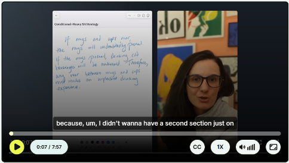
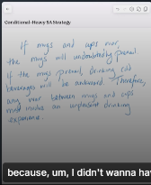
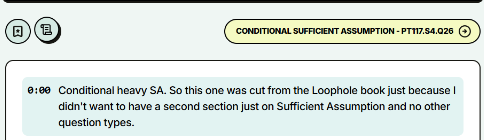
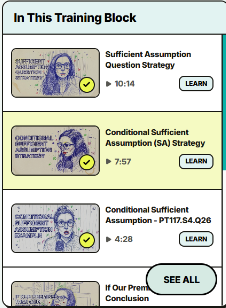

# Conditional Sufficient Assumption (SA) Strategy

**Instructor:** Ellen Cassidy  
**Platform:** Loophole Online Training Camp  
**Runtime:** 7:57  
**Linked Practice Drill:** `CONDITIONAL SUFFICIENT ASSUMPTION - PT117.S4.Q26`  



---

## Visual Setup & Screen Layout

The lesson is recorded in a dynamic split-screen format:
- **Left Side:** A digital handwritten notepad where Ellen progressively diagrams premises, chains, and equations.
- **Right Side:** Ellen Cassidy speaking directly to camera, explaining intuitive rationale and test-maker psychology.
- **Bottom Shelf:** Interactive transcript tracker synchronized to video timestamps and bookmarking controls.
- **Right Sidebar:** Training block playlist displaying neighboring video modules.

---

## Verbatim Transcript & Visual Milestone Breakdown

### Section 1: Origins and Scope of Conditional Heavy SA
**Timestamp: [00:00 - 00:45]**  
**Visual Reference:** 

> **[00:00] Ellen Cassidy:** "Conditional heavy SA. So this one was cut from the Loophole book just because I didn't want to have a second section just on Sufficient Assumption and no other question types."  
> 
> **[00:14] Ellen Cassidy:** "Because, um, I didn't wanna have a second section just on Sufficient Assumption while keeping the book balanced. But online, we have the space to really get into what happens when the LSAT throws heavy formal logic at a Sufficient Assumption stem."  
> 
> **[00:28] Ellen Cassidy:** "On regular Sufficient Assumption questions, you are looking for that classic bridge between the premises and the conclusion. But when an argument is built on conditional chains, the game changes slightly. You have to treat the argument like a series of train cars, and find exactly where the track is broken."

---

### Section 2: The Whiteboard Scenario (Mugs vs. Cups War)
**Timestamp: [00:45 - 02:15]**  
**Visual Reference:** 

Ellen introduces a handwritten example on the digital notepad:

```text
Conditional-Heavy SA Strategy

If mugs and cups war, the mugs will undoubtedly prevail.
If the mugs prevail, drinking cold beverages will be awkward.
Therefore, any war between mugs and cups must involve an unpleasant drinking experience.
```

> **[00:45] Ellen Cassidy:** "Let us look at an example so you can see how this works in real life. I wrote this up on the board for us:  
> *If mugs and cups war, the mugs will undoubtedly prevail. If the mugs prevail, drinking cold beverages will be awkward. Therefore, any war between mugs and cups must involve an unpleasant drinking experience.*"  
> 
> **[01:12] Ellen Cassidy:** "Take a look at what we are being asked to do here. This is an argument that sounds persuasive at first glance, but if you look at the moving parts, something is missing between what we know and what the author concludes."

---

### Section 3: Mapping the Premise Chain
**Timestamp: [02:15 - 03:45]**

> **[02:15] Ellen Cassidy:** "Let us map out our evidence step by step.  
> Our first premise is: *If mugs and cups war, the mugs will undoubtedly prevail.*  
> So whenever we have a war between mugs and cups, mugs winning is guaranteed. That is:  
> `War -> Mugs Prevail`."  
> 
> **[02:40] Ellen Cassidy:** "Now look at our second premise:  
> *If the mugs prevail, drinking cold beverages will be awkward.*  
> That links right onto the back of our first premise!  
> `Mugs Prevail -> Awkward Cold Beverages`."  
> 
> **[03:05] Ellen Cassidy:** "When you put those two together, you get a clean two-step chain:  
> `War -> Mugs Prevail -> Awkward Cold Beverages`.  
> That means if a war breaks out, cold beverage drinking is guaranteed to be awkward. That is our total evidence base. That is all the author actually gave us."

---

### Section 4: Isolating the Conclusion and the Rogue Term
**Timestamp: [03:45 - 05:00]**

> **[03:45] Ellen Cassidy:** "Now, let us examine where the author tries to take us in the conclusion:  
> *Therefore, any war between mugs and cups must involve an unpleasant drinking experience.*  
> Notice what happened here."  
> 
> **[04:10] Ellen Cassidy:** "The trigger of the conclusion is *war between mugs and cups*. That matches the beginning of our chain. That part is fine!  
> But what is the consequence? The author claims this war *must involve an unpleasant drinking experience*."  
> 
> **[04:32] Ellen Cassidy:** "Where did *unpleasant drinking experience* come from? Did our premises talk about an unpleasant drinking experience? No! Our premises stopped at *awkward cold beverages*.  
> *Unpleasant drinking experience* is a brand-new, rogue concept that has never been established."

---

### Section 5: Constructing the Sufficient Assumption Bridge
**Timestamp: [05:00 - 06:15]**

> **[05:00] Ellen Cassidy:** "In a Sufficient Assumption question, our job is not to be timid. Our job is to build an iron bridge that forces the conclusion to be one hundred percent true.  
> We need to connect the dead end of our premises to the new term in the conclusion."  
> 
> **[05:25] Ellen Cassidy:** "What was the dead end of our premises?  
> `Drinking cold beverages will be awkward`.  
> What was the rogue conclusion term?  
> `An unpleasant drinking experience`.  
> So what is our bridge equation?  
> *If drinking cold beverages is awkward, then it involves an unpleasant drinking experience.*"  
> 
> **[05:50] Ellen Cassidy:** "Symbolically:  
> `Awkward Cold Beverages -> Unpleasant Drinking Experience`.  
> If you add that rule to the premises, the chain connects from start to finish:  
> `War -> Prevail -> Awkward -> Unpleasant`.  
> The conclusion is forced into existence. That is your Sufficient Assumption!"

---

### Section 6: Anticipating the Contrapositive on Test Day
**Timestamp: [06:15 - 07:15]**

> **[06:15] Ellen Cassidy:** "Here is the catch, and this is why students get tripped up on Section 4:  
> The test writers know that you are looking for `Awkward -> Unpleasant`. They know that is the intuitive forward direction."  
> 
> **[06:35] Ellen Cassidy:** "So what do they do in the answer choices? They hide it in the contrapositive!  
> What is the contrapositive of `Awkward -> Unpleasant`?  
> Flip and negate both terms:  
> `~Unpleasant Drinking Experience -> ~Awkward Cold Beverages`."  
> 
> **[06:55] Ellen Cassidy:** "In plain English, that sounds like:  
> *Any drinking experience that is not unpleasant cannot involve awkward cold beverages.*  
> It sounds clunky and backward when you read it in the choices, but logically it is identical to our bridge equation. If you do not actively prephrase the contrapositive, you might stare right at the correct answer and miss it."

---

### Section 7: Moving to the Official LSAT Drill (PT117.S4.Q26)
**Timestamp: [07:15 - 07:57]**  
**Visual Reference:** 

> **[07:15] Ellen Cassidy:** "Now that you have seen the core mechanics on the board, we are going to apply this exact same thinking to an official LSAT question.  
> Right below this video, you have the link to our drill problem:  
> **Conditional Sufficient Assumption: PT117.S4.Q26**."  
> 
> **[07:35] Ellen Cassidy:** "This is a famous political theorist question about the European Union and foreign policy. It has multiple conditional rules linked together by 'unless' and 'only if'.  
> Go ahead, click the drill button below, try the question using our bridge method, and I will see you in the next video where we break down the question together!"



---

## Pedagogical Summary Checklist

1. **Chain Formation:** String together all premise conditionals ($A \rightarrow B \rightarrow C$).
2. **Endpoint Identification:** Find where the premise chain stops ($C$).
3. **Rogue Concept Isolation:** Identify the new term introduced in the conclusion ($D$).
4. **Forward Bridge Equation:** Formulate $C \rightarrow D$.
5. **Contrapositive Readiness:** Formulate $\sim D \rightarrow \sim C$.
6. **Elimination Filter:** Reject illegal reversals ($D \rightarrow C$), illegal negations ($\sim C \rightarrow \sim D$), and weak quantifiers ("some" or "most").
