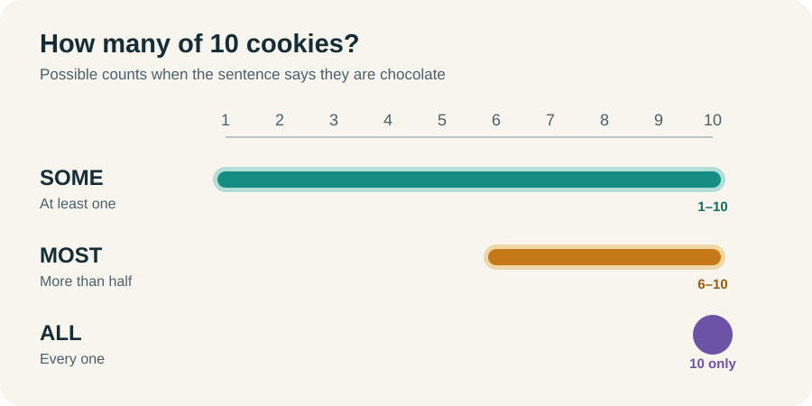
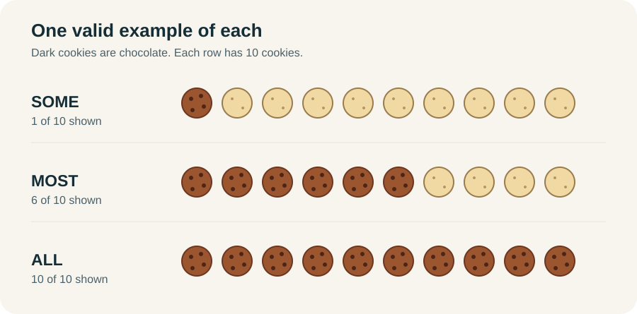

# Some, Most, and All: What Each Word Lets You Conclude

Imagine a plate with **10 cookies**. A sentence might say *some*, *most*, or *all* of them are chocolate. Each word tells us how many must be chocolate and how many could be.



The colored ranges show **possibilities**, not additional facts. If a sentence says “some cookies are chocolate,” all 10 *could* be chocolate. You cannot conclude that all 10 *are* chocolate.



Each row shows **one example**, not the only arrangement that fits the word. The range chart above shows every permitted count.

## Some: at least one

> **Some cookies are chocolate.**

At least one cookie is chocolate. It might be **1 of 10, 6 of 10, or 10 of 10**. The sentence rules out zero and leaves every other count open.

In ordinary conversation, “some” often suggests “some, but not all.” On the LSAT, that suggestion is not part of the claim. **Some can include most or all.**

The sentence also works in reverse: if some cookies are chocolate, then some chocolate things are cookies. The same cookie proves both claims.

> **Check yourself:** If all 10 cookies are chocolate, is “some cookies are chocolate” true? If you hear only “some,” can you conclude that all 10 are chocolate?
>
> **Answer:** Yes to the first question. No to the second. “Some” includes the all-chocolate case without proving it.

## Most: more than half

> **Most cookies are chocolate.**

More than half the cookies are chocolate. On a plate of 10, that means **6 through 10**. On a plate of 5, it means **3 through 5**. The threshold depends on the size of the group; “most” is not always 51%.

All 10 could be chocolate. So “most” does **not** tell you that any non-chocolate cookies exist.

It also does not tell you that most *chocolate things* are cookies. The sentence counts cookies, while that reversed claim would count every chocolate thing in the world. What you can say in reverse is **some chocolate things are cookies**.

> **Check yourself:** If most cookies are chocolate, must at least one cookie be plain?
>
> **Answer:** No. All the cookies could be chocolate.

## All: every one

> **All cookies are chocolate.**

Every cookie on the plate is chocolate: **10 of 10**. There is no room for a non-chocolate cookie. The sentence still does not say that every chocolate thing is a cookie.

Because all 10 are chocolate, more than half are chocolate, and at least one is chocolate. That is why the guaranteed claims run this way, assuming the group has at least one member:


**Read the arrows as guarantees.** “All” guarantees “most,” and “most” guarantees “some.” “Some” merely *allows* “all”; it does not guarantee it.

## The question to ask when the groups switch

Ask **“What are we counting?”** in each sentence.

| Claim | We are counting | Safe conclusion about the other group |
|---|---|---|
| Most cookies are chocolate. | Cookies | Some chocolate things are cookies. |
| Most chocolate things are cookies. | Chocolate things | Some cookies are chocolate. |

Neither row follows from the other. They can both happen to be true, but one does not prove the other.

## When two “most” claims do connect

If most students in **the same class** take history, and most students in that class take biology, at least one student takes both. Two separate groups each containing more than half the class cannot fit inside one class.

```text
Most A are B.
Most A are C.
So some B are C.
```

The repeated A matters. Both claims count the same class. If they count different groups, there is no guaranteed overlap.

## When a rule lets you carry a group forward

Suppose some apples are green, and **all green apples are edible**. At least one apple is green, and every green apple is edible. So some apples are edible. If most apples are green, then most apples are edible under that same rule.

Change the second sentence to “most green things are edible,” and the conclusion fails. The green apples could all be among the green things that are not edible. A *most* claim cannot do the work of an *all* rule here.

## The banjo and guitar example

Most banjo players also play guitar. Most guitar players do **not** play banjo. Think only about the people who play both instruments:

| Same overlap | Compared with banjo players | Compared with guitar players |
|---|---|---|
| People who play both | More than half | Less than half |

The shared overlap fills a larger fraction of the banjo group than of the guitar group. Therefore, the guitar group is larger. We did not reverse a “most” claim; we compared the same people against two different totals.

## A reminder from the conditional drills

“No A are B” translates to **A → not B**. The word “no” has already been used to make the rule. Do not keep “no A” on one side and negate it again.

“A guarantees B” and “A requires B” both describe **A → B**. The first says A is enough for B. The second says B is necessary for A. When a sentence contains more than one indicator, read what the sentence claims before writing an arrow.

## Before next session

- [ ] Finish the remaining conditional drills, including the medium drill.
- [ ] Text me a Friday time for the remaining session. You mentioned noon or 1 p.m.
