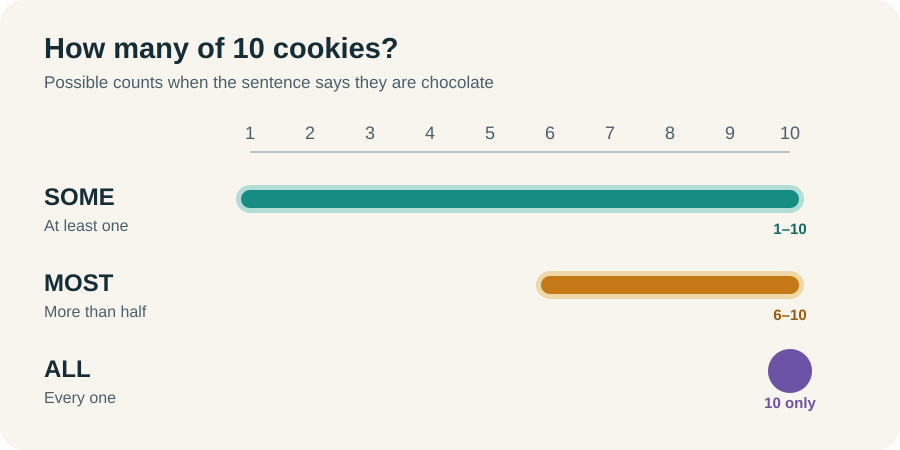
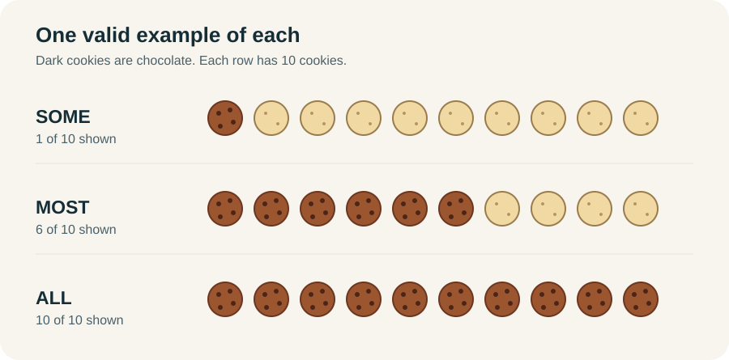
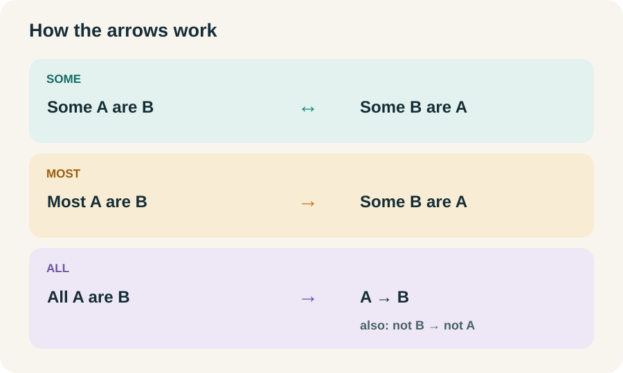
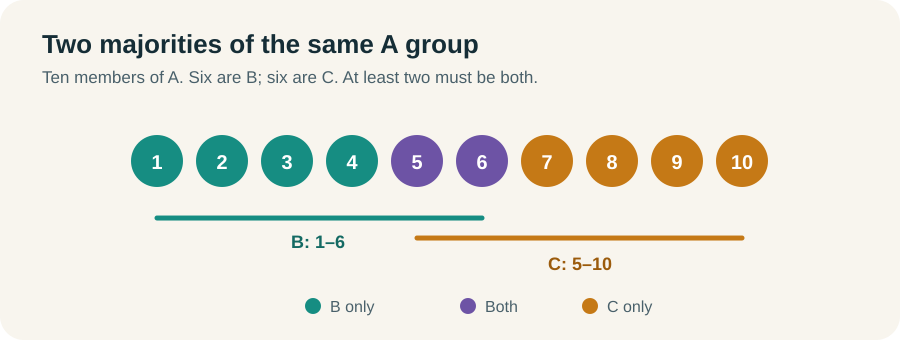

# Some, Most, and All: What Actually Follows

Suppose there are **10 cookies** on a plate. How many are chocolate? The answer depends on the exact word in the sentence:

- **Some** means at least one. It could be all 10.
- **Most** means more than half. With 10 cookies, that means at least 6. It could be all 10.
- **All** means every cookie. With 10 cookies, that means exactly 10.

## The range each word leaves open



In ordinary conversation, “some” often sounds like “some, but not all.” On the LSAT, it just means **at least one**. The chart shows what each word *allows*. A sentence proves only the minimum that word *guarantees*.



## What follows from what?


For these 10 cookies, **all → most → some**. Each step to the right makes a weaker claim. You cannot move left without more information:

- “Some cookies are chocolate” could describe all 10, but it does not prove all 10 are chocolate.
- “Most cookies are chocolate” could describe all 10, but it does not prove all 10 are chocolate.
- “Some cookies are chocolate” does not prove that most are chocolate. One chocolate cookie would make “some” true and “most” false.

**Could be true** is different from **must be true**. Keep that distinction in view whenever you move between these words.

## The arrows work differently

Now use **A** and **B** for any two groups. These are the inferences you can make when you look at the relationship in the other direction.



### Some: the overlap works in both directions

If **some A are B**, at least one thing is both A and B. That same thing proves **some B are A**. You can turn the sentence around and keep “some.”

```text
Some A are B  ⇔  Some B are A
```

The double arrow connects the two **some** statements. It does **not** mean A → B or B → A for every member of either group.

### Most does not reverse as most

If **most A are B**, more than half of A are B. At least one thing is therefore both A and B, so **some B are A**.

```text
Most A are B  →  Some B are A
```

You cannot turn that into **most B are A**. The sentence tells you about the A group, not how many of all the B things are A. You also cannot claim that some A are *not* B. All A could be B.

### All: use the conditional arrow

If **all A are B**, every A is B:

```text
A → B
not B → not A    (contrapositive)
```

If every A is B, something that is **not B** cannot be A. That is why the contrapositive works. The reverse, **B → A**, does not: B may include things outside A.

If at least one A exists, “all A are B” also tells you **some A are B** and **some B are A**. The rule by itself does not tell you whether any A exists.

## When two statements connect

You can carry A through B when the second statement covers the B members you already know about.

| Given | What follows | Why |
|---|---|---|
| All A are B. All B are C. | **All A are C.** | Every A is B, and every B is C. |
| Some A are B. All B are C. | **Some A are C.** | The A that are B are covered by the all-rule. |
| Most A are B. All B are C. | **Most A are C.** | Every A that is B is also C. |
| Most A are B. Most A are C. | **Some B are C.** | Two majorities of the same A group must overlap. |

For the last row, picture 10 things in group A. More than 5 are B, and more than 5 are C. Those groups cannot stay separate inside a group of only 10. At least one A must be both B and C.



## When two statements do not connect

**Some A are B + most B are C** does not guarantee that any A are C. The A inside B could all be among the B that are not C.

**Most A are B + most B are C** does not guarantee that any A are C. The two “most” claims count different groups, and the A inside B could sit outside C.

**All A are B + some B are C** does not guarantee that any A are C. The B that are C could be B that are not A.

The test is simple: **Could all the A that are B fall outside C?** If they could, you do not have a guaranteed conclusion about A and C.

## Try these before reading the answers

**1.** Some A are B. Could all A be B? Does the premise prove that all A are B?

**Answer:** Yes, all A *could* be B. No, the premise does not prove it.

**2.** Most A are B. What can you safely say about B that are A?

**Answer:** Some B are A. You cannot say most B are A without another premise.

**3.** Most A are B, and most A are C. Why must some B be C?

**Answer:** Both majorities are taken from the same A group. Each occupies more than half of it, so they must overlap.
