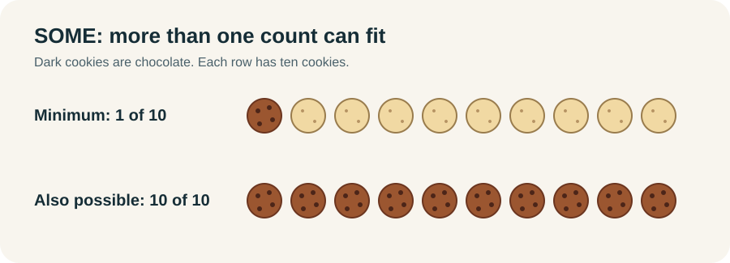
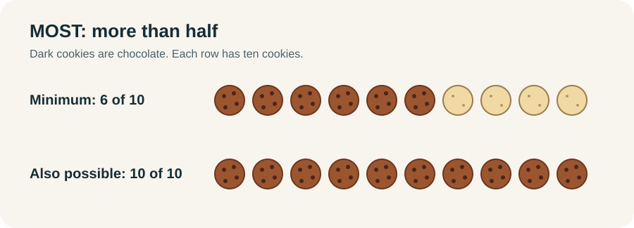
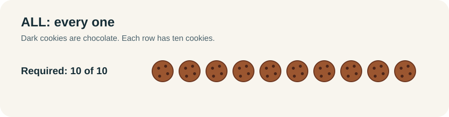
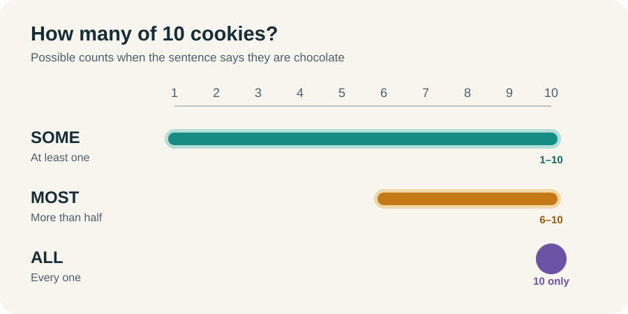
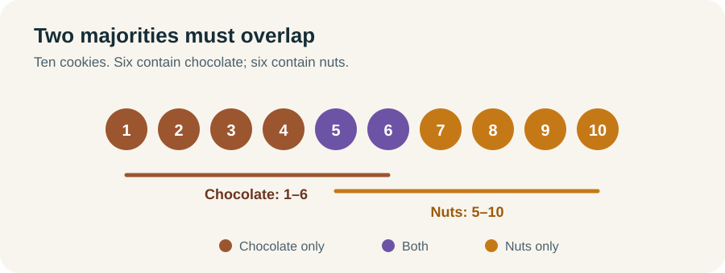
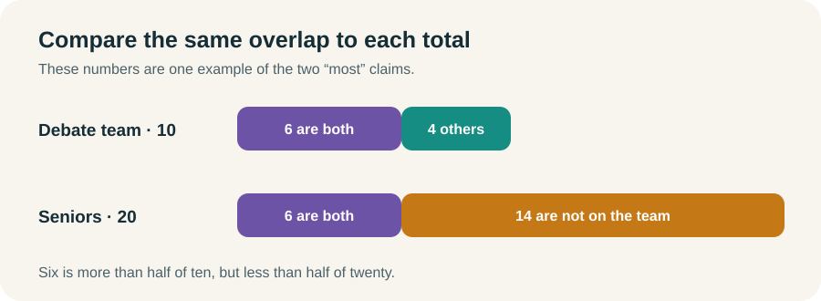

# Some, Most, and All: What Each Statement Proves

Start with **10 cookies** on a tray. If I say “some contain chocolate,” could all ten contain it? To answer that, we need to separate what the sentence **proves** from what it merely **allows**.

## Some means at least one

> **Some of the cookies contain chocolate.**

At least **one** cookie contains chocolate. That is the entire guarantee. It could be one cookie, six cookies, or all ten. The only count ruled out is zero.



In everyday speech, “some” can sound like “some, but not all.” That is not how we read it here. **Some can include most. Some can include all.** Neither one follows *just* because we heard “some.”

“Some” also works in both directions. If some cookies contain chocolate, then some things that contain chocolate are cookies. We are talking about the **same cookie** each time.

```text
Some A are B  ⇔  Some B are A
```

The double arrow connects two **some statements**. It does not mean that every A is B or every B is A.

## Most means more than half

> **Most of the cookies contain chocolate.**

With ten cookies, **six or more** contain chocolate. With five cookies, **three or more** do. “Most” means more than half, so the minimum count changes with the size of the group.



All ten could contain chocolate. “Most” does not tell us that any plain cookies exist.

Now watch what happens if we turn the sentence around. We know **some things that contain chocolate are cookies**. We do **not** know that *most* things that contain chocolate are cookies. The first sentence counted cookies. The reversed sentence would count every chocolate-containing thing.

```text
Most A are B  →  Some B are A
Most A are B  ↛  Most B are A
```

The majority stays attached to **A**. Looking back from B, we have only **some**.

## All means every one

> **All of the cookies contain chocolate.**

Now all **ten out of ten** contain chocolate. One plain cookie would make the statement false.



“All” gives us a regular conditional rule. If something is a cookie on this tray, it contains chocolate. If it does **not** contain chocolate, it cannot be one of the cookies on this tray.

```text
Cookie on this tray → Contains chocolate
Does not contain chocolate → Not a cookie on this tray
```

That second line is the **contrapositive**. The reverse is different: something can contain chocolate without being a cookie on this tray. “All cookies contain chocolate” does not mean “all chocolate things are cookies.”

You may also see **every**, **each**, or **any** used to express this kind of all-rule. The rule tells you what follows *if* you have a member of the group. By itself, it does not prove that the group has any members.

## Now compare the three claims



For a group that exists, the guarantees go one way:


If all ten cookies contain chocolate, then most do, and some do. If **some** contain chocolate, all ten *might* contain it, but they might not. **Could be true** is not the same as **must be true**.

## How statements connect

An **overlap** means at least one thing belongs to both groups. When we combine statements, we need to know whether they identify the *same* things or whether an all-rule carries the things we have found into another group.

### Carry the first claim through an all-rule

Suppose **some cookies contain chocolate**, and **all chocolate cookies contain cocoa**. The chocolate cookie we know about must contain cocoa. So **some cookies contain cocoa**.

The same move works with most or all in the first sentence:

| First claim | Add this rule | What follows |
|---|---|---|
| Some cookies contain chocolate. | All chocolate cookies contain cocoa. | **Some cookies contain cocoa.** |
| Most cookies contain chocolate. | All chocolate cookies contain cocoa. | **Most cookies contain cocoa.** |
| All cookies contain chocolate. | All chocolate cookies contain cocoa. | **All cookies contain cocoa.** |

The first word stays the same because the **all** rule covers every chocolate cookie you reached. If the second sentence said only “most chocolate cookies contain cocoa,” the chocolate cookies from the first sentence could be among the exceptions. We could not carry the claim through.

Direction matters too. “All cocoa-containing cookies contain chocolate” points **toward** chocolate. It would not let us start with a chocolate cookie and conclude that it contains cocoa.

### Two majorities of the same group must overlap

Suppose **most of the ten cookies contain chocolate**, and **most of those same ten cookies contain nuts**. At least six contain chocolate, and at least six contain nuts. Those groups cannot be separate inside a tray of only ten. At least **two** cookies must contain both.



```text
Most A are B.
Most A are C.
Therefore, some B are C.
```

The repeated **A** is what makes this work. Both majorities count the **same group**. If one sentence counts cookies and the next counts all chocolate desserts, you cannot assume the two majorities meet.

### Two “most” claims can also compare group sizes

There is another way two “most” statements can tell us something. Suppose **most debate team members are seniors**, but **most seniors are not on the debate team**.

Think about the students who are both seniors and team members. They are **more than half** of the debate team, but **less than half** of all seniors. The same overlap takes a bigger share of the team than of the senior group. So there must be **more seniors than debate team members**.



The picture uses one possible set of numbers. The conclusion does not depend on those exact numbers. What matters is that the same overlap is a majority of one group and a minority of the other.

### Similar-looking statements may not connect

“Some cookies contain chocolate” plus “some chocolate desserts contain nuts” does **not** prove that any cookies contain nuts. The chocolate desserts with nuts could all be things other than cookies.

Even “some cookies contain chocolate” plus “most chocolate desserts contain nuts” is not enough. The chocolate cookies could be among the desserts without nuts. You need an **all** rule to carry the cookies through, or two majorities of the **same** group to force an overlap.

Changing the first sentence to “most cookies contain chocolate” still does not fix that chain. “Most chocolate desserts contain nuts” counts the desserts, and the chocolate cookies could all sit in the nut-free minority. **Most → most** does not automatically become a new “most” claim.

## Try the inference before reading the answer

**1.** Some cookies contain chocolate. Could all ten contain chocolate? Does the sentence prove that all ten do?

**Answer:** All ten *could* contain chocolate, but “some” proves only at least one.

**2.** Most cookies contain chocolate. What can you say about chocolate-containing things that are cookies?

**Answer:** Some chocolate-containing things are cookies. You cannot say that most chocolate-containing things are cookies.

**3.** Most of ten cookies contain chocolate, and most of the same ten contain nuts. What must be true?

**Answer:** At least two cookies contain both. Each majority needs at least six places in a group with only ten places, so at least two places must be shared.
