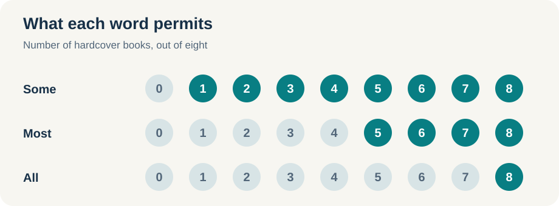
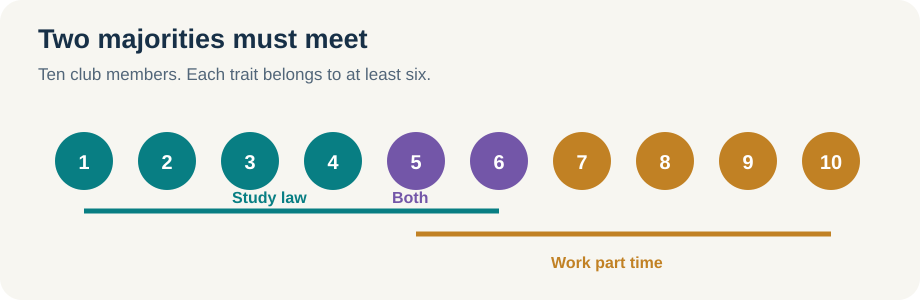
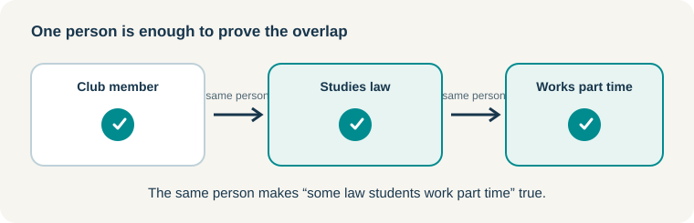
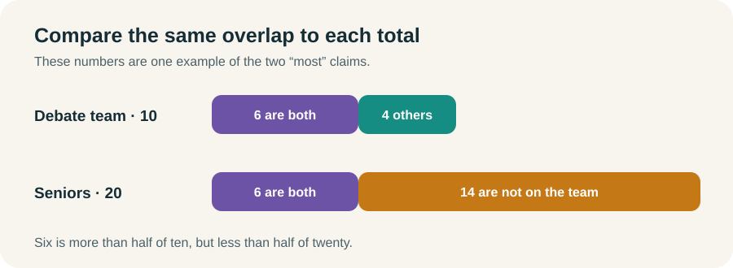

# Some, Most, and All

Quantity statements tell us whether a claim applies to some members of a group, most of them, or all of them. Suppose a class has been assigned a case to read. “Some students read it,” “most students read it,” and “all students read it” are three different claims about that same class. We do not need an exact headcount to understand the difference.

For each sentence, ask: **What must be true? What could still be true?** The answer changes with the word we use.

## Some guarantees at least one

Imagine a shelf with eight books. I tell you that **some of the books are hardcover**. How many hardcover books must there be?

At least **one**. There could be one, four, or all eight. “Some” rules out zero. It does not rule out “most” or “all.”


This is easy to miss because in ordinary conversation “some” often suggests “some, but not all.” On the LSAT, that extra phrase is not part of the statement. If all eight books are hardcover, it is still true that some are hardcover.

**Try it:** “Some applicants received an interview.” Could every applicant have received one? Does the sentence tell us that anyone was denied an interview?

<details><summary>Check your answer</summary>

Every applicant could have received an interview. The sentence does not tell us that anyone was denied one. “Some” guarantees at least one applicant received an interview, but it leaves open how many others did.

</details>

Whenever you read **some**, replace it with **at least one** in your head. That tells you exactly what the sentence guarantees:

> **Some of the books are hardcover.**
>
> **At least one of the books is hardcover.**

Now focus on that one book. It belongs to both groups: it is a book, and it is hardcover. If we describe the same object from the hardcover side, we can say:

> **Some hardcover items are books.**
>
> **At least one hardcover item is a book.**

We have not found a new object. We have described the same overlap in the other direction. That is why a **some** statement works both ways:

```text
Books  ←some→  Hardcover
```

The double arrow tells us that at least one thing belongs to both groups. It does not tell us that every book is hardcover or that every hardcover item is a book.

## Most guarantees more than half

Now I tell you that **most of the eight books are hardcover**. We need at least **five** hardcover books. Four would be exactly half, and half is not most. Five, six, seven, or eight could satisfy the sentence.


Notice that all eight could still be hardcover. “Most” does not tell us that an exception exists.

**Try it:** If most of the eight books are hardcover, must some of them be hardcover? Must any be paperback?

<details><summary>Check your answer</summary>

At least five are hardcover, so **some are hardcover**. No paperback book is required. All eight could be hardcover.

</details>

Here is where the direction of the statement matters. From “most books are hardcover,” we know that **some hardcover things are books**. We cannot say that **most hardcover things are books**. Five of our eight shelf books could be hardcover, while a library holds hundreds of other hardcover items. The first statement counts the eight books; the reversed statement counts a different group.

```text
Books  ─most→  Hardcover
Hardcover  ←some→  Books
```

The first arrow gives the majority claim. The second line is the overlap that the majority guarantees. When we read a most statement backward, the word becomes **some**.

**Quick check:** A program has 100 applicants. Most speak Spanish. What is the smallest possible number who speak Spanish? What is the largest?

<details><summary>Show the answer</summary>

**51 to 100.** Fifty is only half. “Most” also permits all 100, so it does not establish an exception.

</details>

## All leaves no exception

If **all eight books are hardcover**, every book on the shelf is hardcover. One paperback on that shelf would make the statement false.


An all statement gives us a rule: **if it is one of these eight books, then it is hardcover**.

```text
One of these books  →  Hardcover
Not hardcover       →  Not one of these books
```

The second line is the contrapositive. Both lines go with the same rule. We cannot turn the first line around and conclude that every hardcover thing is a book on this shelf.

**Try it:** You pick up a paperback. What does the rule tell you? What if you pick up a hardcover book from another shelf?

<details><summary>Check your answer</summary>

The paperback cannot be one of these eight books. A hardcover book from another shelf does not become one of these eight just because it is hardcover. Being hardcover is required, but it is not enough to identify one of these books.

</details>

There is a small qualification. “All A are B” gives a rule about A. By itself, it does not tell us that any A exist. When we already know the group exists, all also guarantees most and some.

## Put the three statements side by side

The same shelf can help us see the whole range.



Read the implications in one direction:

```text
ALL  →  MOST  →  SOME       (when the group exists)
```

If all eight books are hardcover, then most are, and some are. If only “some” is given, all eight **could** be hardcover, but we cannot conclude that they **are**. Keep the distinction between a possible situation and a required one.

## Carry a claim through an all rule

Now we can combine statements. Suppose **some library books are mysteries** and **all mysteries are fiction**. We have at least one book that is a mystery. The all rule applies to every mystery, including that one. So **some library books are fiction**.

```text
Library books  ←some→  Mysteries  →  Fiction
Library books  ←some→  Fiction
```

The all arrow points **away from** the mystery group we reached. That is why the chain works. If the second sentence said only “most mysteries are fiction,” the mystery books we found could be among the exceptions.

**Quick check:** Some archive documents are letters. All letters are handwritten. What follows?

<details><summary>Show the answer</summary>

**Some archive documents are handwritten.** Take a document guaranteed to be a letter. The all rule applies to that document.

</details>

The same reasoning preserves the first quantity word:

| First statement | Rule | What follows |
|---|---|---|
| Some library books are mysteries. | All mysteries are fiction. | Some library books are fiction. |
| Most library books are mysteries. | All mysteries are fiction. | Most library books are fiction. |
| All library books are mysteries. | All mysteries are fiction. | All library books are fiction. |

**Try it:** “Most library books are mysteries. All fiction is mystery.” Can we conclude that most library books are fiction?

<details><summary>Check your answer</summary>

No. The all arrow goes from fiction to mystery. We cannot start at mystery and travel backward to fiction.

</details>

## Two majorities of the same group must meet

Suppose a club has ten members. **Most members study law**, and **most members work part time**. Each “most” needs at least six of the ten members. Those two sets cannot fit inside the club without sharing at least two people.



So **some law students work part time**. We can also say **some part-time workers study law**. These are the same people, described from opposite sides of a some statement.

```text
Club members  ─most→  Law students
Club members  ─most→  Part-time workers
Law students  ←some→  Part-time workers
```

Both statements count **club members**. That is why the two majorities must overlap. The conclusion is **some**, not most. We know the two groups meet; we do not know what fraction of either group lies in the overlap.

**Quick check:** A club has 25 members. Most are lawyers, and most play an instrument. What is the smallest possible number who are both lawyers and musicians?

<details><summary>Show the answer</summary>

**One.** Each majority needs at least 13 members. If none overlapped, those groups would require 26 different people, but the club has only 25. All 25 could also have both traits.

</details>

**Try it:** If most club members study law and most club members work part time, could the two groups of members be completely separate?

<details><summary>Check your answer</summary>

No. Two separate majorities would require more members than the club has. At least one member must have both traits.

</details>

### When all describes that same group

There is another way to guarantee an overlap. Suppose **most club members study law**, and **all club members work part time**. We already know there are law students in the club. The all rule tells us that *each one of those members* also works part time. So **some law students work part time**.

```text
Club members  ─most→  Law students
Club members  →        Part-time workers
Law students  ←some→  Part-time workers
```

We can make the same move with **some**. If **some club members study law** and **all club members work part time**, take the member guaranteed by “some.” That person has both traits. Again, **some law students work part time**. The sentences can be stated in the other order: **all club members work part time; some club members study law**. The same person still proves the overlap.



**Try it:** All A are B. All A are C. Must some B be C?

<details><summary>Check your answer</summary>

Not yet. The two all rules tell us what is true **if** something is A, but neither tells us that any A exists. Add “at least one A exists,” and the overlap follows.

</details>

## Two majorities can also compare group sizes

Here is a different comparison. **Most debate team members are seniors**, but **most seniors are not on the debate team**. The seniors on the team are more than half of the team and less than half of the seniors. The same overlap takes up a larger share of the team than of the senior class. Therefore, **there are more seniors than debate team members**.



The numbers in the picture are one possible case. The conclusion follows from the two majority claims, not from those particular numbers.

## Similar chains can leave a gap

Two some statements need not describe the same person or thing:

```text
Some volunteers speak Spanish.
Some Spanish speakers are trained.
```

The trained Spanish speakers could all be people who do not volunteer. We cannot conclude that any volunteers are trained.

Replacing the second “some” with “most” does not fix the gap. The Spanish-speaking volunteers could sit in the untrained minority. Even two most statements that count different groups do not automatically produce a new majority claim.

Before drawing a conclusion, ask: **Am I carrying a known group through an all rule? Or do two majorities count the same group?** If neither is true, check whether the groups could miss each other.

**Quick check:** A club has 13 members. Most are women, and some are dancers. How many female dancers are guaranteed? How many are possible?

<details><summary>Show the answer</summary>

**Zero are guaranteed; as many as 13 are possible.** Seven women and one dancer meet the statements even if that dancer is one of the six men. Both traits could also belong to every member. A most claim and a some claim about the same group do not force the two traits to meet.

</details>

## The moves to keep

| What you have | What you may conclude |
|---|---|
| Some A are B | Some B are A |
| Most A are B | Some A are B, and some B are A |
| All A are B | A → B, and not B → not A |
| Some/most/all A are B; all B are C | The same first quantity of A are C |
| Most A are B; most A are C | Some B are C |
| Most A are B; all A are C | Some B are C |
| Some A are B; all A are C | Some B are C |

Two **all** claims about A guarantee that every A has both traits. They guarantee **some B are C** only when we also know that at least one A exists.

Use the sentence behind each arrow to check what it guarantees.

## Nearby words need a closer look

Some test sentences use less exact language. **Many**, **often**, **few**, and **not many** tell us something about frequency or size, but they do not set a universal numerical cutoff. A hundred menu items could make five feel like few; in a menu of six, five would not feel like few. Do not quietly replace these words with a fixed number.

**Most** is different: it crosses a precise line, **more than half**. Words such as **the majority** plainly express that idea. Words such as **usually**, **typically**, **likely**, and **probably** can suggest it in context, but pay attention to what the sentence actually counts. “Probably” about one event, for example, is a likelihood claim, not a headcount of a group.

**Not all** *does* give us a precise minimum: at least one exception. “Not all club members are lawyers” means **at least one club member is not a lawyer**. It does not tell us whether the other members are lawyers.

**Quick check:** A menu lists 100 beers. “Many are Belgian,” “few are Belgian,” and “not many are Belgian” are three claims. Can you assign each one an exact minimum and maximum? What does “not all are Belgian” guarantee?

<details><summary>Show the answer</summary>

The first three do **not** have fixed numerical boundaries. “Many” suggests more than an isolated example, while “few” and “not many” suggest a small number relative to the context. None alone licenses a specific cutoff such as five or ten. “Not all” is exact about one thing: **at least one beer is not Belgian**.

</details>

### Pop quiz: decide whether the overlap follows

For each pair, decide whether it guarantees **some A are C**. Draw a witness or explain where the groups could miss each other before opening the answers.

1. Some A are B. All B are C.
2. Some A are B. Most A are C.
3. All A are B. Some B are C.
4. Some A are B. Most B are C.
5. Some A are B. Some B are C.
6. Most A are B. Most A are C.
7. All A are B. All A are C.

<details><summary>Show the worked answers</summary>

1. **Yes.** The A that is B must also be C because every B is C.
2. **No.** The A that is B could be outside the majority of A that is C.
3. **No.** The B that is C could be outside A. The all rule runs from A to B, not back from B to A.
4. **No.** The known A that is B could be among the B that are not C.
5. **No.** The B in the first statement could differ from the B in the second.
6. **Yes.** Two majorities of the same A group must share at least one member, who is both B and C.
7. **Not from these statements alone.** Every A would be both B and C, but the statements do not establish that an A exists. If at least one A exists, the answer becomes yes.

“No” here means **no guaranteed A–C overlap**. The premises may still imply a different, smaller fact. For example, statement 3's “some B are C” is already given.

</details>

## Short drill: diagram, combine, decide

Here are five statements about one volunteer program. **Volunteer**, **Spanish speaker**, **trained person**, **weekend worker**, and **student** name groups of people. Treat each sentence as true.

1. Some volunteers speak Spanish.
2. All Spanish speakers are trained.
3. Most volunteers work weekends.
4. Most volunteers are students.
5. Most weekend workers are trained.

First, diagram each statement. Then answer these without looking below:

1. Which two statements prove that **some volunteers are trained**?
2. Which two statements prove that **some students work weekends**?
3. Do statements 3 and 5 prove that **most volunteers are trained**? Explain the gap or draw a counterexample.
4. Can you write either valid **some** conclusion in the reverse order?

<details><summary>Show the diagrams and worked answers</summary>

```text
1. Volunteers       ←some→  Spanish speakers
2. Spanish speakers →       Trained people
3. Volunteers       ─most→  Weekend workers
4. Volunteers       ─most→  Students
5. Weekend workers  ─most→  Trained people
```

**1. Statements 1 and 2.** At least one volunteer speaks Spanish. Every Spanish speaker is trained. That volunteer is trained, so **some volunteers are trained**.

**2. Statements 3 and 4.** Both majorities count the volunteers. The weekend workers and students must share at least one volunteer. So **some students work weekends**.

**3. No.** Statement 3 says most volunteers work weekends. Statement 5 counts all weekend workers, a different group. The volunteers who work weekends could be among the untrained weekend workers. Nothing requires most volunteers to be trained.

**4. Yes.** A some statement describes an overlap in either direction: **some trained people are volunteers**, and **some weekend workers are students**.

</details>
