# Must Be True

Source marked complete; review verification notes.

Source: https://app.lsatlab.com/video-library/?videoid=33013

## Accept the facts and learn the three conditional moves

> UNSPOKEN: Source 00:00:02 to 00:18:12; transcript lines 1-307

> SHOW: 00:06:05: Linking rules; original board omits negation before C: correct contrapositive B OR not C -> not A
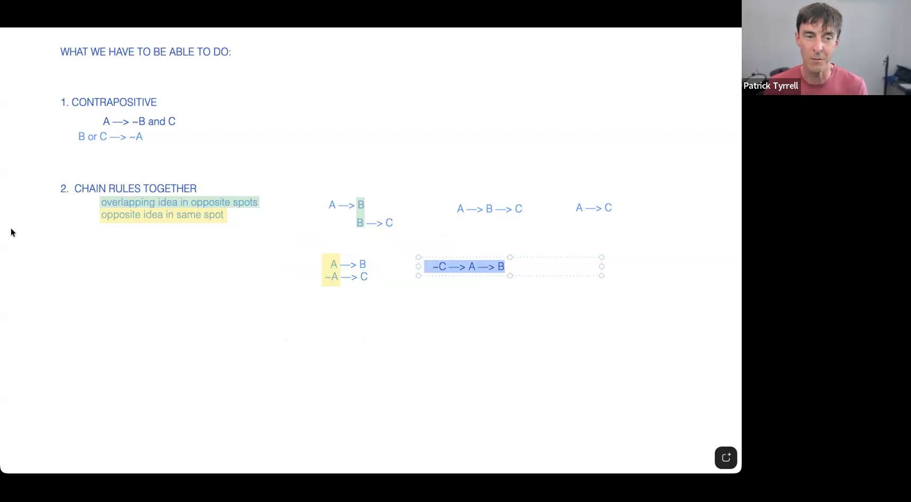

> SHOW: 00:02:35: Initial concept board
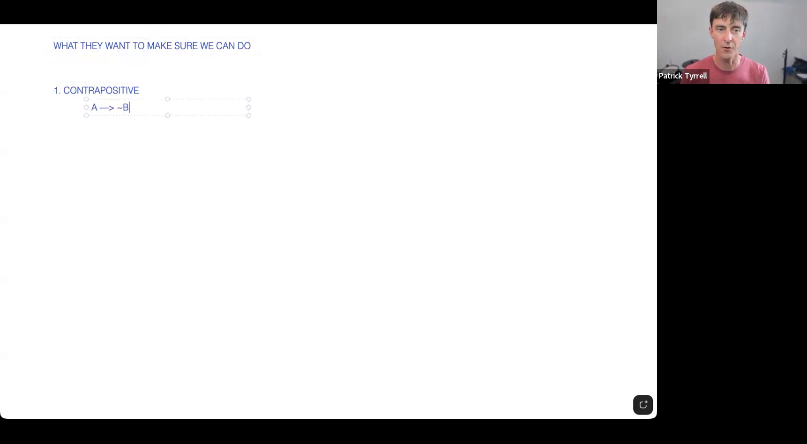

> SHOW: 00:12:43: Three moves and inference clues; original board contrapositive typo corrected in script
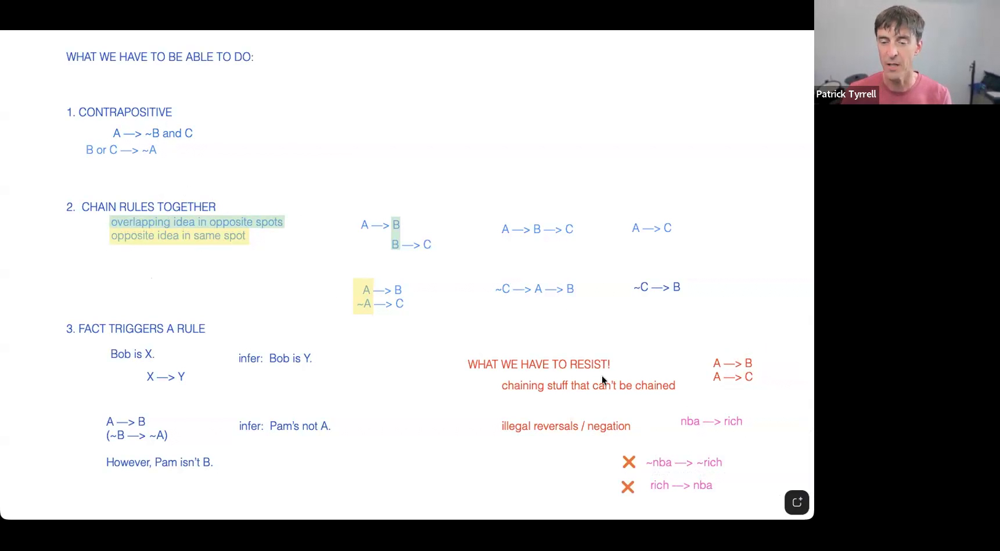

> SHOW: 00:17:45: Warm-up lipid-profile scan
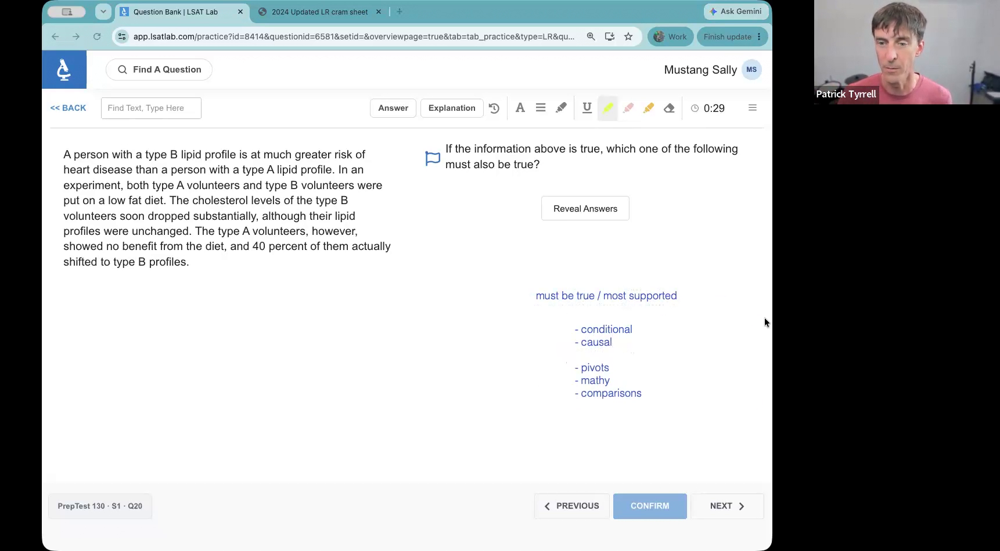

> UNSPOKEN: Show the opening concept board. | Pause after each rhetorical question. | Show the two chaining patterns and their completed contrapositives. | Show the list of inference clues.

We're talking about Must Be True. We might come across Must Be False at the same time, because both are in the inference family.

When we think about the inference family, we're thinking: I'm accepting the information I'm reading. I'm not fighting a conclusion or looking for an assumption. That's a different mindset from much of the test. Here, you accept the supplied facts, but it may be unclear what to do with them. They're sitting there as information, without necessarily giving you an opinion to evaluate.

A fact tells us that something is true. For example, Bob is trained.

A rule tells us what follows if a condition is met: if someone is trained, that person is eligible.

The rule does not tell us that Bob, or anyone else, is trained.

Must Be True and Must Be False have these nauseating difficulty curves. There are so many level-three, level-four, and level-five questions, and very few level-one questions. Why? The instructor's explanation is that these types are dominated by conditional logic. These questions can feel difficult because so many of them involve conditional logic. If conditional logic is a stumbling block, it's worth working on directly. Flashcards and conditional rephrasing are useful: look at a statement, then turn it into conditional form. Memorize the rules until using them becomes automatic. In the end, these questions are very doable. You just have to acquire a skill that people don't normally have. Conditional logic isn't necessarily an intuitive skill you brought into the LSAT. You acquire it through practice.

Here's what they're testing us on. First and foremost: contrapositives. Look at the statement on the board. What is its contrapositive?

Everything switches sides, and everything switches signs. That includes changing AND to OR, or OR to AND, when you negate a combined condition. You're reversing the direction and negating the complete conditions. That's the move. In the board example, A leads to not B and C. Negate that entire result: B or not C. Then reverse the arrow. The correct contrapositive is B or not C leads to not A. The original board drops the not before C; keep that negative in your version.

Number two: chain conditionals together. What's the rule for when you can and can't chain them?

You need the same idea in opposite positions: the necessary condition of one rule is the sufficient condition of the next. If A leads to B, and B leads to C, the overlapping B goes in the middle. You can write the whole chain, A to B to C, or take the express lane from A to C. You can contrapose the entire chain by reversing the order and negating each idea.

There's another presentation that hides the same connection. Look at A to B and not A to C. Here we have opposite ideas, A and not A, in the same position: both are triggers. How can these connect?

Try contraposing either rule. If we contrapose the bottom rule, not A to C becomes not C to A. Now the connection is visible: not C to A to B. As soon as you contrapose it, you see the familiar common term in the middle.

The original presentation takes longer to process. Your brain doesn't see what you're supposed to do. With the overlapping idea in opposite positions, we immediately think: put that idea in the middle, and we've got ourselves a chain. With opposite ideas in the same position, that connection doesn't jump out at us. That's why the contrapositive matters. Sometimes you have to do something to reveal the connection.

If we have the same idea in the same position, that doesn't establish this kind of chain. A to B and A to C can be consolidated: A gives us both B and C. But we don't get B to C, or C to B. Likewise, A to B and C to B share a result; contraposing both shows that not B leads to both not A and not C. That still doesn't create a relationship between A and C.

When we have a chain, we're often looking from the beginning to the end. But don't become attached to the longest possible inference. The instructor observes that older tests often reward the full head-to-tail inference, while more recent questions may hide the result by testing a shorter stretch. If there's a four-part chain, an answer can test A to C or B to D rather than A to D. This is a test-taking observation, not a limit on which inferences are valid. You need to be comfortable with those shorter connections too. A diagram helps: you can look over and see that a proposed connection is available without reconstructing all the wording.

The third skill is seeing when a fact triggers a rule. If I tell you Bob is X, and give you a rule saying X leads to Y, what can you infer? Bob is Y. That feels very easy in symbols.

Now suppose the rule is A to B, but Pam is not B. What can we infer? Pam is not A. All we've done is use the contrapositive. The negative fact didn't look like the trigger of the original rule, but it triggers the contrapositive.

Notice how the contrapositive comes back in both situations. It can hide a chain, and it can hide the fact that we're activating a rule. Rephrasing the rule reveals the simple move underneath.

Should we always write the contrapositive of every rule? You could make a case either way. It takes time, and sometimes the original rules are already straightforward. If I can see A to B and B to C, I don't need a second set of diagrams to connect them.

Here's a practical approach: if you're staring at conditional logic and don't know what to do, contrapose one of the rules. That will often make it click. If you already know what to do, writing every contrapositive may be unnecessary.

For learning, though, the standard is different. If it takes you a second to produce a contrapositive, even when you get it right, keep practising. Suppose I say, only poets can date French women. Only points at poets, so dating French women requires being a poet. The contrapositive is: if you're not a poet, you can't date French women under that rule. You want that translation to be immediate.

If you're newer to conditional logic, writing the contrapositive each time can be useful until it becomes automatic. You do enough repetitions that the move stops taking your attention. Then you can spend your attention on what the passage means.

Is that all of Must Be True? No. But conditional reasoning is the main emphasis of this lesson. We also have to learn what not to do.

First, resist chaining statements that don't connect. A to B and A to C don't give you B to C. An answer choice may tempt you with exactly that invented relationship.

Then resist illegal reversal and illegal negation. If you're in the NBA, you're rich. Does that mean if you're rich, you're in the NBA? No. That reverses the rule. Does it mean if you're not in the NBA, you're not rich? No. That negates without reversing. Other people can be rich.

The legal contrapositive would be: if you're not rich, you're not in the NBA. Reverse and negate. We have to make the difference between those moves automatic.

It's easier with simple letters. It gets harder with long sentences about science or morality. Let's practise finding the conditional wording in actual paragraphs.

Only is a clue. All is a clue. If is a clue. But the keyword alone doesn't settle it.

Suppose a sentence says, when public water supplies are drawn from aquifers, chlorine is often added. When sounds conditional, but look at the main clause: often added. That isn't a guaranteed result. We can't treat it as an all-or-nothing conditional.

As a result of is causal wording. If the statement says contamination can occur as a result of something, can occur doesn't provide a guaranteed result either.

What about some? Some clowns wear rubber noses establishes at least one case, but it doesn't say all clowns wear them. Some and most do not by themselves give us a universal conditional connecting the entire group. All and none can.

Conditionals don't always have keywords. Suppose the statement says exact caffeine content isn't listed on soft-drink labels. That's presented as a statement about the whole class of those labels. We can read it as: if it's a soft-drink label, it doesn't list exact caffeine content. A universal noun can carry the relationship even when there's no if.

Another sentence says listing exact caffeine content would make it easier to limit caffeine intake. This is causal in what it describes: the listing makes something easier. It's also presented as a definite relationship: if you list the exact content, it would be easier to limit intake. A statement can have both causal and conditional features.

For inference questions generally, here's the bigger list of clues: conditional relationships, causal relationships, pivot words creating tension, numerical information, and implied similarities or differences.

For Must Be True, immediately consider conditional logic. For Most Strongly Supported, causal relationships often deserve attention. But don't ignore the other clues. A passage may be asking you to combine numbers or reconcile a contrast. Start with the relationships that are actually there, then ask what they support.

## Q1: University bookstores: a fact activates the contrapositive

> UNSPOKEN: Source 00:18:12 to 00:28:56; transcript lines 308-466

> SHOW: 00:24:50: Q1 full stimulus and choices: PT8 S1 Q19
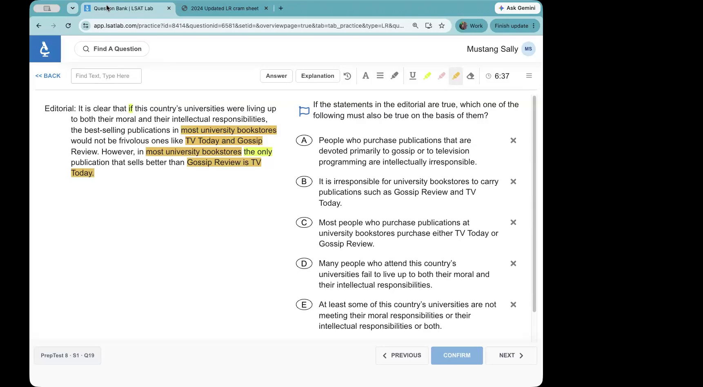

> SHOW: 00:23:20: Q1 rule diagram
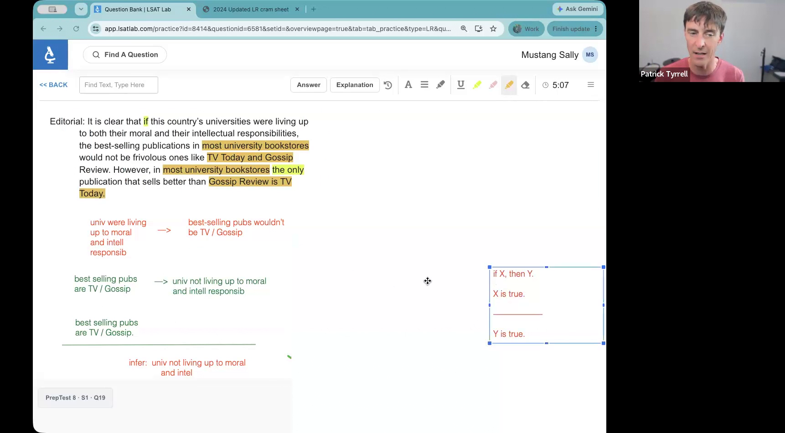

> SHOW: 00:26:55: Q1 worked answer
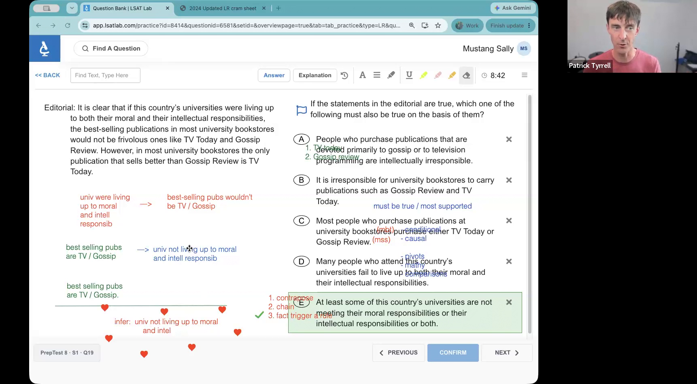

> UNSPOKEN: Show the full question and allow time to read. | Show original rule and contrapositive. | Pause for the predicted inference before showing answers. | Show answer E and the comparisons with C and D.

Read the university-bookstore question on screen. Before looking at the answers, ask whether we're contraposing, chaining, or using a fact to activate a rule.

The first sentence is definitely conditional. The second information also uses only. You could make that conditional, but first ask what the passage is asking you to do with it. The last information brings back TV Today and Gossip Review, so those repeated ideas should catch your attention. That repeated term is a great instinct to follow. We're talking about most university bookstores and these two magazines again. It feels like the two sentences are designed to interact.

The final information tells us that, in most university bookstores, these two magazines occupy the top positions. That establishes that they're the bestselling publications in those stores. We could represent some of the wording with another conditional, but we don't need to diagram every detail. What matters is that the fact supplies the condition used by the first rule.

Take the contrapositive of the first rule. In that form, if those publications are the bestsellers, the universities aren't living up to their moral and intellectual responsibilities.

Now ask what the final fact does. It tells us the trigger is true for the bookstores described. So what follows? The outcome of the rule: the universities aren't living up to the relevant responsibilities.

Strip away the long wording for a moment. If I give you X to Y, then tell you X is true, what can you infer? Y. That's done. They gave us a rule, if this then that, and then they said the trigger is true. This is the story of how many people feel about Must Be True: why was I making that so complicated? It is hard to see mechanical forms in actual conversations. The passage feels more complicated because the original rule isn't written in the form that matches the fact. Once we contrapose it, the relationship becomes straightforward.

This is the work we're practising: recognise that there aren't that many underlying forms. Sometimes you chain rules. Sometimes you contrapose a rule so that you can see a fact activating it. If the original wording doesn't click, rephrase it.

Must Be True often lends itself to prediction. Once we've derived this outcome, we should go to the answer choices actively looking for it. Scan for an answer saying that the universities aren't living up to the moral and intellectual responsibilities described.

When you know what you're looking for, you don't always have to read all five answers with equal attention. Think of finding a friend in a crowd: you can quickly reject faces that don't resemble the person you're seeking, and slow down when you see a possible match. This isn't how every question works, but sometimes the inference is clear enough to search for it directly.

E is the answer. Its wording is softer than our prediction. At least some universities fail in at least one of the relevant responsibilities. That's a consequence of the broader failure we derived. The answer doesn't have to repeat our prediction word for word or preserve its full strength. A weaker statement can follow from a stronger one.

Be careful with the negation: we do not get that every university fails both responsibilities. We get that the original combined condition is not satisfied. At least some universities fail a moral responsibility, an intellectual responsibility, or both.

Now check the tempting alternatives. C talks about most people who purchase publications at university bookstores. Where did our most statement apply? To university bookstores, not to purchasers.

Those are different groups. Most stores having a particular bestseller doesn't establish what most individual buyers do. You have to be able to derive the answer from the paragraph. For this answer to say most people who purchase publications, we would need some information supporting a majority of those people. The majority claim we actually received was about stores. You can't change the group simply because those people are involved in the stores. The passage hasn't supplied a relationship that lets us change the denominator from stores to people. That is why this most claim cannot be derived here.

D resembles E in some of its wording, but look at the subject. Our rule is about universities. D shifts to the people who attend them. A statement about the institution isn't automatically a statement about its students. Keep the subject of the inference attached to the subject of the rule.

The useful checks here are simple. Does the fact activate the original rule or its contrapositive? Does the answer preserve the relevant group? Does it say something no stronger than what we can actually derive? E passes those checks.

## Four kinds of pivot tension

> UNSPOKEN: Source 00:28:56 to 00:33:25; transcript lines 467-532

> SHOW: 00:32:35: Four inference pivots: contrapositive, rebuttal, numerical/mathy, and contrast
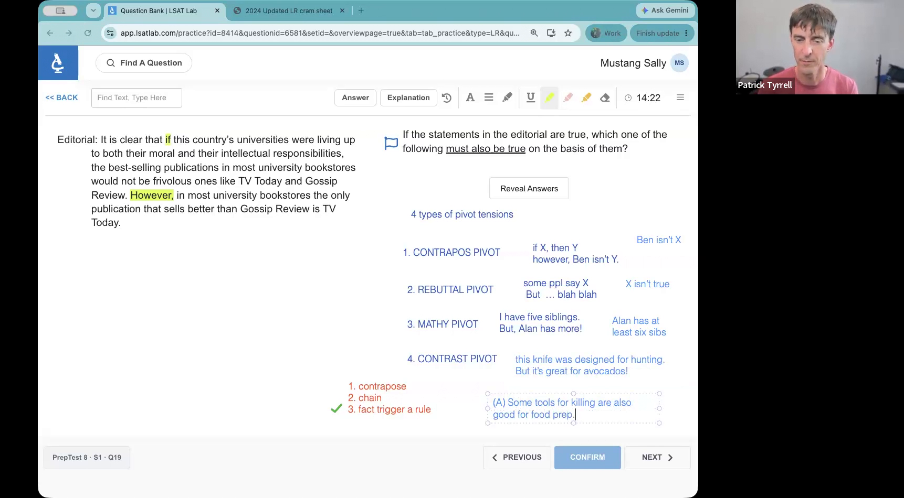

> UNSPOKEN: Show the pivot board. | Pause after each example before supplying the inference.

Let's return to our list of inference clues. We found a conditional in the bookstore passage. What else do you notice? However.

When the last fact begins with a pivot, pay attention to the tension it creates. The instructor calls this a huge pattern in Must Be True and Most Strongly Supported: when the last fact starts with a pivot, the answer very often addresses the tension created by that pivot. That tension tells us which ideas to examine together. If you have a conditional followed by a pivot, one especially useful possibility is that they want you to contrapose because the final fact activates the rule. In this question, the conditional followed by however helps reveal that move.

We can call that a contrapositive pivot. If X, then Y. However, Ben isn't Y. What follows? Ben isn't X. Once you contrapose the rule, the final fact simply activates it.

There are other kinds of pivot tension. One is the rebuttal pivot, which you'll see especially in Most Strongly Supported. Some people say X, but then we receive information that undermines X. The inference often expresses the rejection of that original idea.

Another is a numerical pivot. Suppose I say I have five siblings, but Alan has more. What follows? Alan has at least six siblings. The two numerical facts combine to impose a lower bound. The wording may be more sophisticated on the test, but the basic move is to put the numbers together and ask what must follow.

The fourth is a contrast pivot. This knife was designed for hunting, but it's useful for preparing avocados. An inference can straddle the two ideas: at least some tools designed for killing are also useful for food preparation.

The pivot doesn't give us permission to invent information. It tells us where to look for the relationship. Ask what the statements on either side establish when taken together.

## Q2: Applicants: keep both qualification routes intact

> UNSPOKEN: Source 00:33:25 to 00:43:09; transcript lines 533-674

> SHOW: 00:33:45: Q2 stimulus and exact NOT-meet-manager-requirements stem: PT14 S2 Q2; use with 34:23 all-choices frame
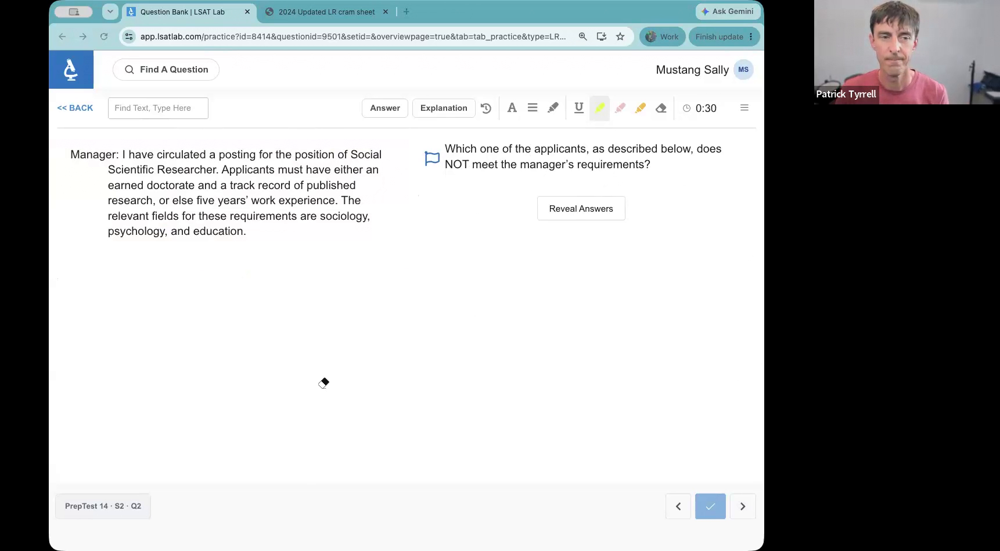

> SHOW: 00:34:23: Q2 complete question; relevant fields apply to these requirements
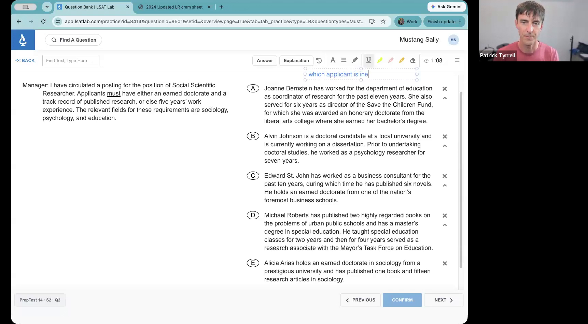

> SHOW: 00:38:00: Q2 applying applicant facts to rules
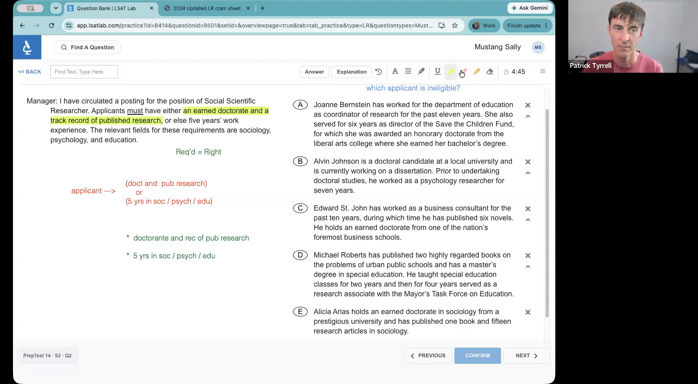

> SHOW: 00:41:10: Q2 worked answer
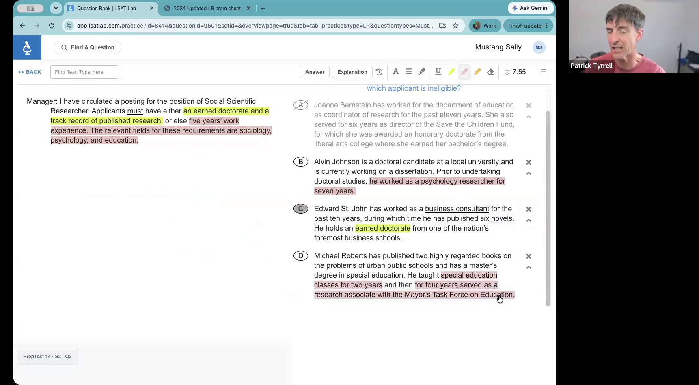

> UNSPOKEN: Show the entire applicant question, including stem and all applicants. | Pause for an answer. | Show the paired route and the five-year route in different colours. | Keep applicant names visible during each evaluation.

Read this applicant question. The stem is a little different. We're looking for an applicant who clashes with the stated requirements, so the task behaves more like Must Be False: which applicant is ineligible?

Must supplies the conditional relationship. These are necessary qualifications for the position. We can diagram the rule, but we can also treat it as a checklist.

There are two routes. An applicant must have an earned doctorate and a track record of published research, or five years of work experience in the relevant fields.

Keep the pair together. The first route isn't a doctorate by itself, and it isn't published research by itself. It's the doctorate and the research. The second route is five years of relevant experience. Either route can satisfy this stated requirement. Having both would also satisfy it; or doesn't mean exactly one.

If you diagram it, put the pair in parentheses: applicant qualification requires the doctorate-and-research combination, or the five years. Required things go on the right. The arrow can be read as requires.

You don't have to write all the wording if you can keep track of the ideas another way. Colour-coding works too: one colour for the paired route, another for the experience route. Then evaluate each applicant against those two possibilities.

Let's check Alvin Johnson. Does he have the doctorate and a track record of published research? Be careful: a doctoral candidate isn't someone who has earned the doctorate. And working as a researcher isn't the same as having a track record of published research. A person can conduct research without getting it published.

So we shouldn't claim Alvin satisfies the paired route. But what about the experience route? He has seven years as a psychology researcher. That supplies more than the required five years in a relevant field. That's the route that keeps him from being our ineligible applicant.

The listed relevant fields are sociology, psychology, and education. The stimulus says these fields apply to these requirements, so keep that restriction in view when applying both qualification routes. For Alvin, seven years of psychology research satisfies the experience route. The original spoken explanation says the doctorate and research can be in any field, but that conflicts with the wording shown in the question. Follow the question text.

Now consider Edward St. John. He has an earned doctorate. Does he have a track record of published research? Six novels don't count as research. Being a published author isn't the same as publishing research.

What about the other route? His business-consulting experience isn't experience in one of the listed fields. So he doesn't have the full first combination, and he doesn't have the relevant second route. This is our answer, C.

What about Michael Roberts? His education experience comes in separate periods: two years and four years. Together that's six years in education, which satisfies the experience requirement.

Should the five years have to be consecutive? The stimulus doesn't say consecutive. If that restriction mattered, it would need to be supplied. We can't add it merely because the work occurred in separate periods.

This is a good example of reading the letter of the rule. Doctoral candidate isn't earned doctorate. Published novels aren't published research. Six years in the relevant field doesn't become inadequate because the years weren't consecutive unless the requirement says that.

Should we diagram this question? Ask what the diagram would do for you. In the previous problem, contraposing helped reveal the inference. Here, we mainly need to keep consulting a checklist. If you're comfortable with the wording on screen, it may be faster to return to it directly or colour-code the two routes.

Throughout conditional work, whether it's Parallel, Must Be True, or Sufficient Assumption, ask on a case-by-case basis: should I have diagrammed this? Would it have helped? The last question was worth diagramming if the contrapositive hadn't already clicked. This one is closer to applying a principle: you keep checking the stated requirement. If you don't need to contrapose the principle, you can leave the wording where it is and use a checklist. A diagram is useful when it makes the reasoning clearer. It doesn't earn points by existing. The goal is to preserve the pair, preserve the alternative, and test each applicant against the actual requirements.

## Q3: Bridge pilings: a stopping standard permits further movement

> UNSPOKEN: Source 00:43:09 to 00:54:54; transcript lines 675-847

> SHOW: 00:49:20: Q3 full stimulus and choices: PT113 S2 Q2
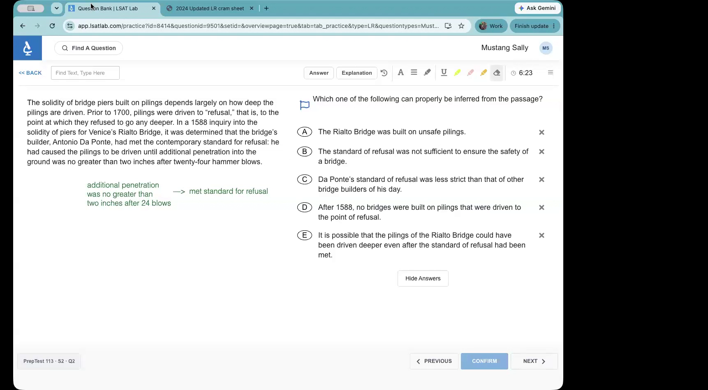

> SHOW: 00:48:27: Refusal standard and 24 blows producing two inches of penetration
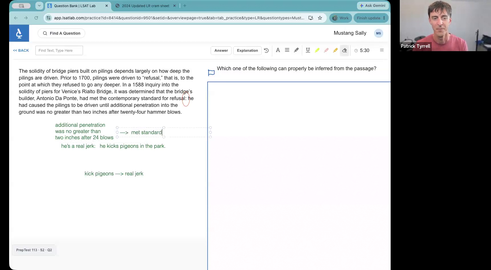

> SHOW: 00:53:35: Q3 worked answer
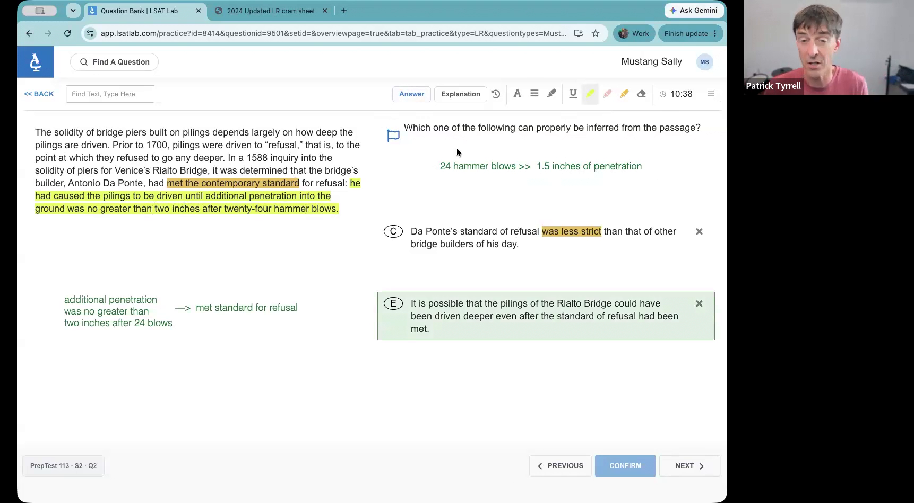

> UNSPOKEN: Show the complete bridge question. | Pause to consider whether a useful conditional exists. | Show the refusal-standard wording and numerical example. | Show E and C side by side.

Read the bridge-piling question. See whether you can make a prediction.

Do we see conditionals? Depends can signal a requirement, but depends largely isn't the same as depends entirely. If I say an application depends largely on an LSAT score, I haven't necessarily made that score an absolute necessary condition.

Until can also appear in conditional translation. In many contexts it works with unless and without. But here, we need to be careful. We're reading about a particular builder and a particular event. For example, if I say I'm working until five, you might represent the period before five as a time when I'm working. But in this bridge passage we're looking at a specific builder causing a particular result. We can go overboard looking for words that signify conditional logic in many contexts but don't have to do that here. A word that often signals conditional logic doesn't require us to force every sentence into an if-then rule.

What looks most like a rule is the standard for refusal. The passage defines when that standard is met: after twenty-four hammer blows, the additional penetration is no greater than two inches.

We can read the defined condition as sufficient for meeting that standard. If the additional penetration after those blows is no greater than two inches, the standard for refusal has been met.

Think of a label followed by the evidence for that label. If I say someone is a jerk, then illustrate it by saying they kick pigeons in the park, the illustration is being offered as evidence that they meet the description. The stated behaviour points toward the label, not automatically the other way around. Definitions can work this way. If I give a label and then illustrate what meets it, the illustration supplies a way to qualify for that label. But even if we identify this relationship, there isn't another obvious rule to chain with it or a new fact waiting to activate it. So we may not have a precise prediction yet.

That's fine. Go to the answers looking for something provable from the information. We don't need to manufacture a chain just because we're in a Must Be True lesson.

Would we generally prefer stronger or weaker wording in these answers? Weaker wording is often easier to prove, but strong doesn't mean wrong. If all A are B and all B are C, then all A are C follows. That's an extreme statement, and it's justified. We pick a statement because it's derivable, not because its wording is mild.

C introduces a comparison: this builder's standard was less strict than other builders' standards. Do we know the standards other builders used? No. We have information about his standard, but no basis for comparing it with theirs.

Also, this isn't what we mean by a volume-dial relationship. A volume dial links changes in two variables: the stricter one thing becomes, the more or less something else happens. Saying one person's standard was less strict than another's is just a comparison. Either way, this comparison needs information we weren't given.

E focuses on what the definition allows. Even when the standard of refusal had been met, the pilings could still be driven further.

Why? No greater than two inches doesn't mean zero inches. Suppose another twenty-four hammer blows produce one and a half inches of additional penetration. One and a half is no greater than two. So the standard is met, even though additional movement has occurred.

The standard describes diminishing returns. It doesn't say the piling is physically incapable of any further movement. There can be some extra penetration without exceeding the threshold.

That's the inference. We aren't saying unlimited movement remains possible, and we aren't comparing this standard with someone else's. We're unpacking the boundary of the definition. A condition can meet a stopping standard without reaching an absolute physical limit.

E is the answer. When a numerical standard says no more than a certain amount, test values within that interval. Zero may be permitted, but it may not be required. A small positive value can reveal exactly what the statement leaves open.

## Q4: Virus X: an infection can precede detectable antibodies

> UNSPOKEN: Source 00:54:54 to 01:16:26; transcript lines 848-1192

> SHOW: 01:02:40: Q4 full stimulus and choices: PT10 S1 Q24, Most Strongly Supported
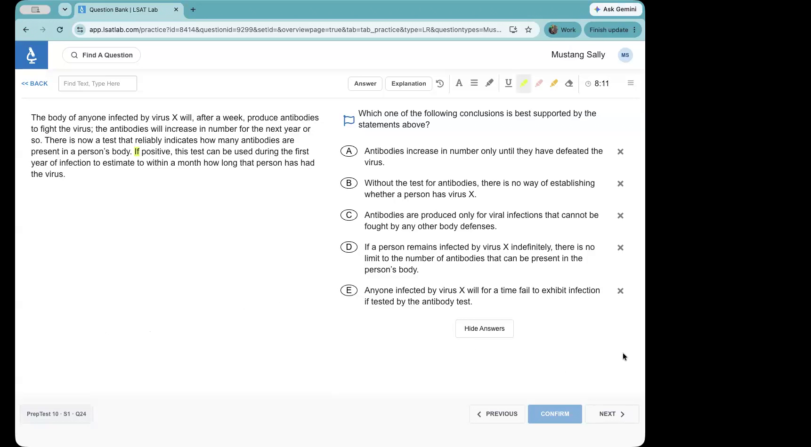

> SHOW: 01:00:50: Antibody production timeline
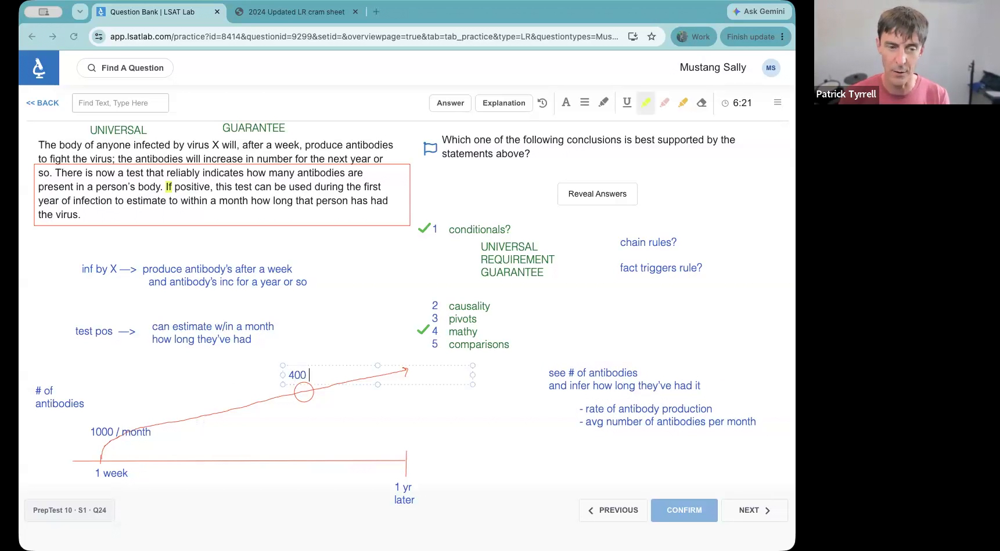

> SHOW: 01:15:25: Q4 worked answer
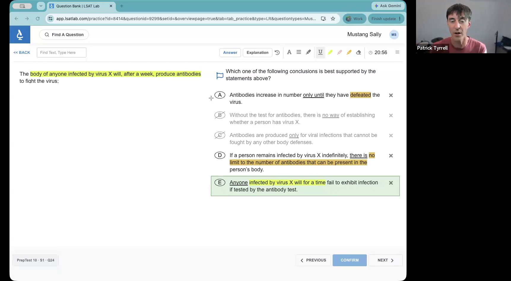

> UNSPOKEN: Show the complete virus question and its actual Most Strongly Supported stem. | Pause for reading and an initial prediction. | Show the week-to-year antibody timeline. | Keep the initial prediction labelled provisional. | Show each answer during its evaluation; pause before resolving E.

Read the virus-X question and try to make a prediction. Start with the conditional-looking language.

Anyone infected by virus X will, after a week, produce antibodies. Anyone gives us a universal subject, and will presents a definite consequence. In an if-then form: if you're infected by X, you will produce antibodies after a week.

The next information describes those antibodies increasing for about a year. We can keep that attached to the same timeline rather than turning every detail into a separate rule. If we learn that someone has X, we'll know something about this sequence of antibody production.

There's also information about a positive antibody test. During the first year of infection, the test can be used to estimate, within a month, how long the person has been infected.

Apart from conditional language, what else is drawing our attention? The timing. A week, a year, an estimate within a month. There's numerical information here, so perhaps the inference concerns the relationship between the antibody level and elapsed time.

Draw a rough graph. Infection happens first. A week later, production starts. The antibody count continues increasing for about a year. If measuring the count lets us estimate elapsed infection time, what would make that possible?

One initial thought is that the production pattern must be somewhat predictable. If, hypothetically, you produced roughly a thousand antibodies a month, measuring four thousand might let us estimate about four months. To look at the test and say someone has six thousand antibodies, so they have been infected four to five months, we would need some connection between the number and elapsed time. We might need to know the rate of antibody production or the average number associated with each month. The precise numbers are just an illustration. The possible prediction is a somewhat predictable relationship between antibody count and time.

But check the question stem. This is actually Most Strongly Supported, not Must Be True. Keep that distinction visible. We still accept the supplied information and ask what it supports, but we're looking at a supported inference rather than presenting every inference as a strict deduction.

Now look at the answers. None of them expresses our initial production-rate prediction. That happens. A prediction guides your attention; it doesn't require the correct answer to match it. If it isn't there, start evaluating the actual choices.

A says antibodies increase only until the virus has been defeated. How would we derive that? The passage talks about infection, antibody production, and elapsed time, but does it tell us when the virus is defeated?

It's tempting to reason that the test needs the antibody level to track infection duration, so perhaps production must stop once the virus is defeated. But that brings in a new event. Defeating the virus isn't described in the passage. We don't know what happens to production after recovery.

We can explore the thought with a hypothetical: suppose the virus is defeated at some point but antibodies keep increasing. Does that by itself show the test couldn't estimate the time since infection? Not necessarily. We've added assumptions about what had the virus means and how recovery would affect the measurement.

So keep the idea provisional, but recognise the problem. We're trying to support a claim about recovery from a passage that doesn't discuss recovery.

B says this test is the only way to determine whether someone has X. Where did only come from? The passage mentions a reliable test. It doesn't exclude other tests.

Mentioning one thing doesn't imply that alternatives don't exist. If I say people in the army are brave, I haven't said people in the navy aren't brave. Likewise, saying this test can reveal something doesn't mean no other method can reveal it.

This is a common wrong-answer move in inference questions and assumption questions. One method is mentioned, and the answer silently converts it into the only method. We can't support that restriction here.

D says there is no upper limit to antibody production if someone remains infected indefinitely. The thought behind it is that infection produces antibodies, so continuing infection might mean production keeps rising forever.

But the passage doesn't say forever. It says the antibodies increase for the next year or so. That wording gives us a limited description of what happens. It doesn't establish unlimited growth. We can't take a trend described over roughly a year and extrapolate it indefinitely.

Even if ongoing production seems conceivable, D is a much stronger statement: there is no upper limit. We weren't given support for that.

C says antibodies are produced only for viral infections that cannot be fought by other bodily defenses. That adds a restriction about the body's other defenses. The passage tells us what happens with virus X; it does not establish that antibody production is limited to infections other defenses cannot fight. We don't know anything supporting that only condition. Look for supplied evidence, not a claim that happens to sound scientific.

Now consider E. It focuses on the first week. If someone takes an antibody test less than a week after becoming infected, the test might fail to reveal the infection.

The first sentence supplies the thought: the body will, after a week, produce antibodies. That suggests a delay between infection and production. During that early interval, someone could have the virus without yet having the antibodies this test detects.

Be precise about the temporal wording. Does after a week mean production starts then, or does it simply guarantee that antibodies are present by then? There's a difference between produce and have.

If I say students will have a skill after graduation, that leaves open the possibility that they acquired it earlier. If I say something will start producing after a particular interval, the wording more naturally identifies the beginning of production.

Here, the lecture reads after a week produce as the delayed start. That reading supports E: an early test can miss an infection because the marker being tested hasn't appeared yet.

We should acknowledge why there was discussion. The phrase has some interpretive looseness, and someone might try to read it as a guarantee only about day seven without excluding earlier production. But the intended reading is the one-week delay. Given this Most Strongly Supported stem, E is the safest supported choice.

Return to A. Could we settle its claim by thinking about a person who defeats the virus within the year? Again, the difficulty is that we haven't been told how defeating the virus affects antibodies. We don't really know what defeating a virus means in this passage. Your body might continue producing antibodies after the virus is defeated. Or some other pattern might occur. We should not fill that gap with outside biology. The simpler reason to reject A is that recovery is new information.

E rests on a temporal feature the passage actually supplies. A rests on an event it doesn't describe. D extends a one-year pattern indefinitely. B makes a mentioned method exclusive. Those are much more ambitious claims.

Notice the similarity to the bridge question. There, meeting a stopping standard left room for a little more movement. Here, having the infection can leave a short interval before the detectable antibodies appear. Both answers explore what a stated boundary leaves possible.

Our final answer is E. The initial prediction wasn't the answer, and that's okay. We used it to investigate the passage, then adjusted when the choices pointed to a different supported feature. The important habits are to preserve the timeline, avoid extra scientific assumptions, and choose the claim best grounded in the actual wording.

## Q5: Language: connect a chain of requirements

> UNSPOKEN: Source 01:16:26 to 01:36:23; transcript lines 1193-1501

> SHOW: 01:25:10: Q5 full stimulus and choices: PT121 S1 Q26
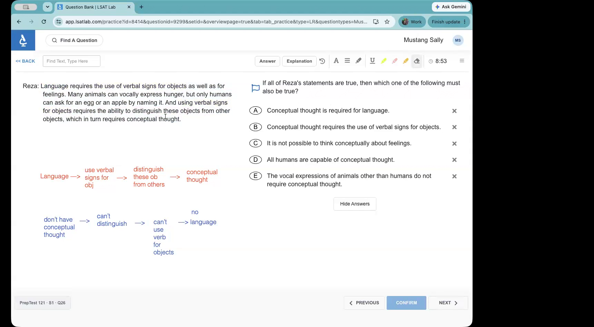

> SHOW: 01:23:55: Q5 chain and contraposition
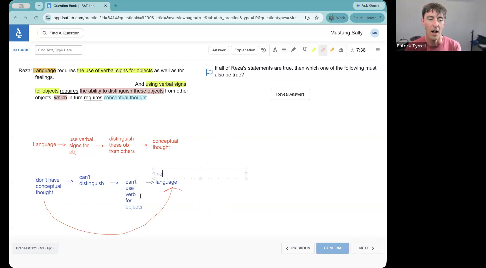

> SHOW: 01:30:05: Q5 worked answer
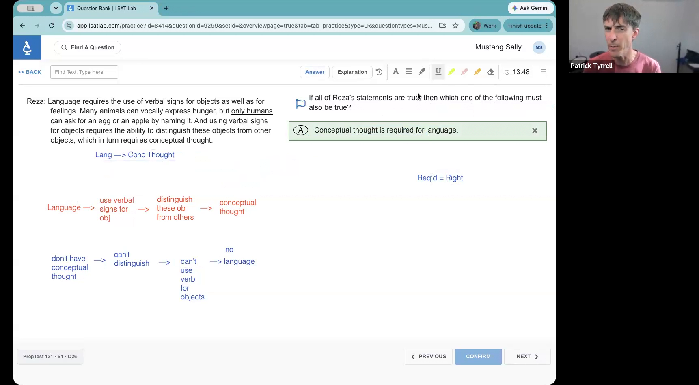

> SHOW: 01:32:30: Q5 reversal and negation traps
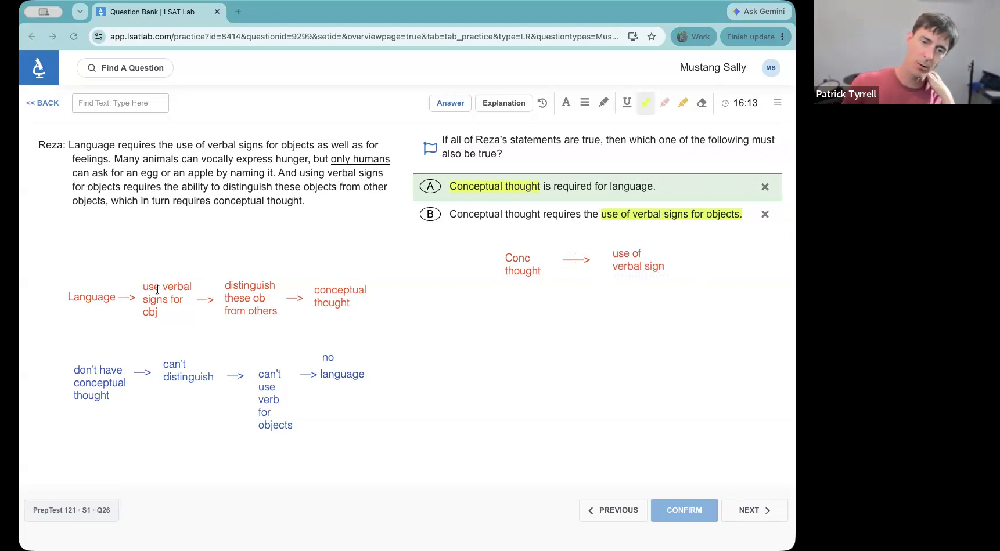

> UNSPOKEN: Show the full language question. | Pause to identify repeated terms. | Show the four-part requirement chain. | Show corrected contrapositive, with every negative visible. | Pause for a prediction, then show A. | Show B, C, D, and E with their specific failed inferences.

Let's finish with a more typical conditional problem. Read the language question on screen and see if you can predict an answer before looking at the choices.

There are several conditionals here. When you see multiple rules, ask whether they share terms that can connect. Language appears in one relationship. Verbal signs appears more than once. The ability to distinguish objects also appears in a continuing relationship.

Where is that ability mentioned the second time? Look carefully at the comma followed by which. A comma followed by which can continue a noun phrase: here, it points back to the ability just mentioned. Look at the actual antecedent rather than assuming it returns to the beginning of the sentence. That is a way of continuing the chain without writing a new standalone sentence.

The separate sentence about only humans asking for an egg or an apple by naming it can be diagrammed, but it doesn't supply the useful overlap in the main chain. Other animals can distinguish an egg from an apple even if they can't ask for one using a verbal sign. Don't collapse distinguishing an object into verbally naming it.

Here's the main chain. Language requires using verbal signs for objects. Using verbal signs requires the ability to distinguish those objects from other objects. That ability requires conceptual thought.

Language to verbal signs to distinguishing objects to conceptual thought.

Read each arrow as requires. They don't have to repeat that exact verb. Different forms of wording can express the same requirement.

For example, getting into Yale requires a great LSAT score. You can get a great LSAT score only if you study for months. You can't study for months without a manageable home life. Those hypothetical statements use requires, only if, and without, but each tells us that one idea requires another.

Read the example as a chain of requirements: Yale requires the score; the score requires months of study; months of study require manageable home life. That's the fluency we're developing.

Required things go on the right. If you get better at reading the meaning of that relationship, you won't have to translate every arrow into a long mechanical sentence. You can see the structure in ordinary language.

Should we diagram the language passage? There's a case either way. The chain is already presented in order, so some readers can keep it in the stimulus. But a short diagram can help with two things: resisting reversals and negations in the answers, and finding the contrapositive.

Look at the chain. If an answer says conceptual thought leads to using verbal signs, that's going backward. The diagram makes that visible.

Now contrapose the whole chain. If you don't have conceptual thought, you don't have the ability to distinguish objects as described. Without that ability, you can't use the relevant verbal signs. Without those verbal signs, you don't have language under these premises.

Not conceptual thought to not distinguish to not verbal signs to not language. Make sure the negative is present in every part. Leaving out a no changes the statement.

What is our prediction? Language requires conceptual thought. Equivalently, if conceptual thought is absent, language is absent.

An answer could also test a shorter connection, such as language requiring the ability to distinguish objects. Don't assume the test always has to take the complete first-to-last chain. But here we have a clear full-chain prediction.

Read the choices. When evaluating a conditional answer, you can diagram it, or begin by asking whether its trigger and result are connected in the passage.

D starts with being human. Do we have a rule that begins with all humans and supplies this outcome? No. The only-humans sentence doesn't make every human a member of the group described.

Only humans have been to the moon doesn't mean all humans have been to the moon. Only puts humans on the necessary side. Don't turn the necessary group into the sufficient group.

Similarly, consider a statement saying only humans are capable of conceptual thought. That would put conceptual thought on the left and human on the right. Do we have a path establishing that? We don't.

There is a separate rule that has humans as an outcome: if someone can request an egg or an apple by naming it, that person is human. So it would be inaccurate to say humans never appears as an outcome anywhere. The issue is that this separate naming rule doesn't give us conceptual thought to human.

We must preserve the exact ideas. Requesting a named object isn't the same as having conceptual thought. Nor can we reverse a chain to make one imply the other.

A question may tempt you to think that verbal signs and distinguishing objects are interchangeable. They aren't. Using a verbal sign requires distinguishing the object, but someone can distinguish objects without using verbal signs.

Think about a dog. It may distinguish an egg from an apple without verbally naming either. So not using verbal signs doesn't establish inability to distinguish. That would be negating the trigger and carrying the negation forward, which isn't a valid conditional move.

Now examine A: conceptual thought is required for language. What goes on the right? Conceptual thought. What's the other idea? Language.

So A says language to conceptual thought. That's exactly the inference we predicted. It is our answer.

Why might this have looked wrong? The passive wording can make the relationship seem reversed. Conceptual thought is required for language means the same thing as language requires conceptual thought.

Compare: practising law requires passing the bar. Passing the bar is required to practise law. Both put passing the bar on the necessary side. Think of active and passive voice. LeBron dunks the ball. The ball is dunked by LeBron. The subject comes first in one version and later in the other, but the action hasn't reversed. Likewise, practising law requires passing the bar and passing the bar is required to practise law express the same requirement. The word that comes first in the sentence does not automatically go before the arrow.

Put the activity before the arrow and what it requires after it: practising law -> passing the bar.

Focus on what the statement identifies as required. Active and passive voice can rearrange the sentence without changing the logical relationship.

B says something different. It makes verbal signs required for conceptual thought. In symbols, conceptual thought to verbal signs. That's a reversal of the connection we have. Our chain goes from verbal signs toward conceptual thought, not from conceptual thought back to verbal signs.

This is why requirement-language matters. Don't merely locate the noun that appears first. Ask which idea is being described as a requirement for the other.

C says it is impossible to think conceptually about feelings. That's a very strong claim. Did the passage give us a consequence ruling out conceptual thought about feelings? No.

The passage initially mentions signs for objects and feelings, then develops a relationship about objects. It doesn't follow that the relationship's opposite applies to feelings. Silence about one subject isn't evidence of its opposite quality.

If I tell you I like pancakes, you can't infer that I dislike waffles. If the passage tells us about signs for objects, we can't infer impossibility about feelings merely because it doesn't continue discussing them.

E has a related problem. It tempts us to start with the idea that humans have language and language requires conceptual thought, then conclude nonhumans don't have conceptual thought because they don't have language.

That is illegal negation. Language to conceptual thought doesn't support not language to not conceptual thought. Something can lack the sufficient condition while still possessing the necessary condition. The premises don't require every kind of conceptual thought to produce language.

The correct answer isn't complicated once the translation is right. We have an ordered chain, and A states its first-to-last requirement. Passive voice disguises the familiar relationship, but it doesn't change it.

Some people thought A looked too easy. But it really isn't a hard structure once the translation is right: a chain in order, then the first-to-last requirement stated in passive voice. We should allow Must Be True to be easier when the logic is clear. The main difficulties are seeing the conditional relationships clearly and staying vigilant about the invalid alternatives. For each answer, ask what condition it starts with and what it claims must follow.

Check whether our rules support that move.

Language requires conceptual thought; conceptual thought alone does not establish language.

## Conditional fluency and careful inference

> UNSPOKEN: Source 01:36:23 to 01:36:54; transcript lines 1502-1509

> UNSPOKEN: Return to the opening three-skill board.

The main focus today was the conditional component of Must Be True: taking contrapositives, connecting rules, and using facts to activate them. The other half is resisting illegal reversals, illegal negations, and connections the premises don't establish.

Not every inference question will be conditional. Some involve causality. Some involve numerical relationships. Quantifier reasoning can interact with conditional rules, and some numerical problems are simply about numbers.

Build the conditional moves until they're fluent, but keep reading the actual information. Then ask what it supports, what it rules out, and what it leaves open.
