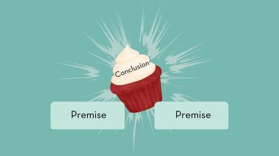

# Premises & Conclusions

[Bootcamps](../../README.md) | [Chapter](../README.md) | [Formatted capture](source.html) | [Original captured JSON](source.json)

Source: https://new.theloophole.com/book-extras/bootcamps/arguments-and-inferences/premises-and-conclusions

Captured: 2026-10-18T12:45:14.310Z. Instructor/source: Loophole Online / Ellen Cassidy.

Coverage: 12/12 questions. Complete observed question sequence and resolved states.

Original source wording follows. Capture commentary and verified-answer labels are archival annotations. Already-answered questions may have no new attempts. Only observed feedback is preserved; unvisited alternative-answer feedback is not claimed.

Archived evidence: `raw/sources/loophole-bootcamps-2026-10-18/arguments-and-inferences/premises-and-conclusions/source.json`.

## Question 1

### Initial observed question and choices

<h2>Question 1</h2>

What is an argument?

<button>
A

Opinions, facts, and sometimes commentary

</button>

<button>
B

Premises and conclusions

</button>

<button>
C

Key support and secondary support

</button>

### Observed attempt 1: A Opinions, facts, and sometimes commentary

<h2>Question 1</h2>

What is an argument?

Ah, not quite

<button>
A

Opinions, facts, and sometimes commentary

</button>

<button>
B

Premises and conclusions

</button>

<button>
C

Key support and secondary support

</button>

### Observed attempt 2: B Premises and conclusions

<h2>Question 1</h2>

What is an argument?

Correct!

<button>
A

Opinions, facts, and sometimes commentary

</button>

<button>
B

Premises and conclusions

</button>

An argument is made up of two things: <em>premises</em> and <em>conclusions.</em>

<em>Premises support conclusions</em>. They are the evidence. <em>Conclusions rely on premises</em>. They are the claim.

<button></button>

<button>
C

Key support and secondary support

</button>

### Final observed answer and feedback

<h2>Question 1</h2>

What is an argument?

Correct!

<button>
A

Opinions, facts, and sometimes commentary

</button>

<button>
B

Premises and conclusions

</button>

An argument is made up of two things: <em>premises</em> and <em>conclusions.</em>

<em>Premises support conclusions</em>. They are the evidence. <em>Conclusions rely on premises</em>. They are the claim.

<button></button>

<button>
C

Key support and secondary support

</button>

**Verified answer:** B Premises and conclusions

Capture commentary: Observed successful final state and selected answer styling.

## Question 2

### Initial observed question and choices

<h2>Question 2</h2>

Think of arguments like blocks holding up a piece of cake. The cake is your conclusion, and it needs those blocks to hold it off the ground.

Premises are solid facts. We accept our premises and we don&#x27;t question their truth.

### Final observed answer and feedback

<h2>Question 2</h2>

Think of arguments like blocks holding up a piece of cake. The cake is your conclusion, and it needs those blocks to hold it off the ground.

Premises are solid facts. We accept our premises and we don&#x27;t question their truth.

**Verified answer:** No answer required

Capture commentary: Information page; no answer required.

## Question 3

### Initial observed question and choices

<h2>Question 3</h2>

Premises are...

<button>
A

The building blocks that allow us to make interesting claims about the world

</button>

<button>
B

The evidence

</button>

<button>
C

The infrastructure of arguments

</button>

<button>
D

All of the above

</button>

### Observed attempt 1: A The building blocks that allow us to make interesting claims about the world

<h2>Question 3</h2>

Premises are...

Ah, not quite

<button>
A

The building blocks that allow us to make interesting claims about the world

</button>

<button>
B

The evidence

</button>

<button>
C

The infrastructure of arguments

</button>

<button>
D

All of the above

</button>

### Observed attempt 2: B The evidence

<h2>Question 3</h2>

Premises are...

Ah, not quite

<button>
A

The building blocks that allow us to make interesting claims about the world

</button>

<button>
B

The evidence

</button>

<button>
C

The infrastructure of arguments

</button>

<button>
D

All of the above

</button>

### Observed attempt 3: C The infrastructure of arguments

<h2>Question 3</h2>

Premises are...

Ah, not quite

<button>
A

The building blocks that allow us to make interesting claims about the world

</button>

<button>
B

The evidence

</button>

<button>
C

The infrastructure of arguments

</button>

<button>
D

All of the above

</button>

### Observed attempt 4: D All of the above

<h2>Question 3</h2>

Premises are...

Correct!

<button>
A

The building blocks that allow us to make interesting claims about the world

</button>

<button>
B

The evidence

</button>

<button>
C

The infrastructure of arguments

</button>

<button>
D

All of the above

</button>

### Final observed answer and feedback

<h2>Question 3</h2>

Premises are...

Correct!

<button>
A

The building blocks that allow us to make interesting claims about the world

</button>

<button>
B

The evidence

</button>

<button>
C

The infrastructure of arguments

</button>

<button>
D

All of the above

</button>

**Verified answer:** D All of the above

Capture commentary: Observed successful final state and selected answer styling.

## Question 4

### Initial observed question and choices

<h2>Question 4</h2>

Premises are not...

<button>
A

Dependent on the conclusion or one another

</button>

<button>
B

In need of support

</button>

<button>
C

Up for debate

</button>

<button>
D

All of the above

</button>

### Observed attempt 1: A Dependent on the conclusion or one another

<h2>Question 4</h2>

Premises are not...

Ah, not quite

<button>
A

Dependent on the conclusion or one another

</button>

<button>
B

In need of support

</button>

<button>
C

Up for debate

</button>

<button>
D

All of the above

</button>

### Observed attempt 2: B In need of support

<h2>Question 4</h2>

Premises are not...

Ah, not quite

<button>
A

Dependent on the conclusion or one another

</button>

<button>
B

In need of support

</button>

<button>
C

Up for debate

</button>

<button>
D

All of the above

</button>

### Observed attempt 3: C Up for debate

<h2>Question 4</h2>

Premises are not...

Ah, not quite

<button>
A

Dependent on the conclusion or one another

</button>

<button>
B

In need of support

</button>

<button>
C

Up for debate

</button>

<button>
D

All of the above

</button>

### Observed attempt 4: D All of the above

<h2>Question 4</h2>

Premises are not...

Correct!

<button>
A

Dependent on the conclusion or one another

</button>

<button>
B

In need of support

</button>

<button>
C

Up for debate

</button>

<button>
D

All of the above

</button>

### Final observed answer and feedback

<h2>Question 4</h2>

Premises are not...

Correct!

<button>
A

Dependent on the conclusion or one another

</button>

<button>
B

In need of support

</button>

<button>
C

Up for debate

</button>

<button>
D

All of the above

</button>

**Verified answer:** D All of the above

Capture commentary: Observed successful final state and selected answer styling.

## Question 5

### Initial observed question and choices

<h2>Question 5</h2>

Should you ever question the truth of the premises?

<button>
A

No, you should never question the truth of the premises.

</button>

<button>
B

It&#x27;s OK to question the support given for claims on RC but never on LR.

</button>

<button>
C

Yes, always.

</button>

### Observed attempt 1: A No, you should never question the truth of the premises.

<h2>Question 5</h2>

Should you ever question the truth of the premises?

Correct! You got it right on the first try!

<button>
A

No, you should never question the truth of the premises.

</button>

<button>
B

It&#x27;s OK to question the support given for claims on RC but never on LR.

</button>

<button>
C

Yes, always.

</button>

### Final observed answer and feedback

<h2>Question 5</h2>

Should you ever question the truth of the premises?

Correct! You got it right on the first try!

<button>
A

No, you should never question the truth of the premises.

</button>

<button>
B

It&#x27;s OK to question the support given for claims on RC but never on LR.

</button>

<button>
C

Yes, always.

</button>

**Verified answer:** A No, you should never question the truth of the premises.

Capture commentary: Observed successful final state and selected answer styling.

## Question 6

### Initial observed question and choices

<h2>Question 6</h2>

On the LSAT, we don&#x27;t question the truth of the premises. Instead, we want to focus on...

<button>
A

How the premises fit together to support the conclusion

</button>

<button>
B

The relationship between the intermediate and main conclusion

</button>

<button>
C

Whether a phrase contains key support

</button>

### Observed attempt 1: A How the premises fit together to support the conclusion

<h2>Question 6</h2>

On the LSAT, we don&#x27;t question the truth of the premises. Instead, we want to focus on...

Correct! You got it right on the first try!

<button>
A

How the premises fit together to support the conclusion

</button>

Never question the truth of the premises when you analyze the stimulus. Instead, focus on how the premises fit together.

<button></button>

<button>
B

The relationship between the intermediate and main conclusion

</button>

<button>
C

Whether a phrase contains key support

</button>

### Final observed answer and feedback

<h2>Question 6</h2>

On the LSAT, we don&#x27;t question the truth of the premises. Instead, we want to focus on...

Correct! You got it right on the first try!

<button>
A

How the premises fit together to support the conclusion

</button>

Never question the truth of the premises when you analyze the stimulus. Instead, focus on how the premises fit together.

<button></button>

<button>
B

The relationship between the intermediate and main conclusion

</button>

<button>
C

Whether a phrase contains key support

</button>

**Verified answer:** A How the premises fit together to support the conclusion

Capture commentary: Observed successful final state and selected answer styling.

## Question 7

### Initial observed question and choices

<h2>Question 7</h2>

Which one of the following is NOT a premise indicator?

<button>
A

Therefore

</button>

<button>
B

Given that

</button>

<button>
C

For

</button>

### Observed attempt 1: A Therefore

<h2>Question 7</h2>

Which one of the following is NOT a premise indicator?

Correct! You got it right on the first try!

<button>
A

Therefore

</button>

The premise indicators are:

<em>Because</em>

<em>For</em>

<em>Since</em>

<em>As</em>

<em>Given that</em>

<strong>Memorize this list.</strong>

<button></button>

<button>
B

Given that

</button>

<button>
C

For

</button>

### Final observed answer and feedback

<h2>Question 7</h2>

Which one of the following is NOT a premise indicator?

Correct! You got it right on the first try!

<button>
A

Therefore

</button>

The premise indicators are:

<em>Because</em>

<em>For</em>

<em>Since</em>

<em>As</em>

<em>Given that</em>

<strong>Memorize this list.</strong>

<button></button>

<button>
B

Given that

</button>

<button>
C

For

</button>

**Verified answer:** A Therefore

Capture commentary: Observed successful final state and selected answer styling.

## Question 8

### Initial observed question and choices

<h2>Question 8</h2>

Here is an example of a premise indicator showing us which parts of the argument are which:

<em>Red velvet cake is the best kind of cake <strong>given that</strong> it is moist and cream cheese-y.</em>

&quot;Given that&quot; precedes &quot;it is moist and cream cheese-y.&quot; This tells us that &quot;it is moist and cream cheese-y&quot; is a premise and the other half of the sentence is the conclusion.

<strong>Premise:</strong> Red velvet cake is moist and cream cheese-y.

<strong>Conclusion</strong>: Red velvet cake is the best kind of cake.

### Final observed answer and feedback

<h2>Question 8</h2>

Here is an example of a premise indicator showing us which parts of the argument are which:

<em>Red velvet cake is the best kind of cake <strong>given that</strong> it is moist and cream cheese-y.</em>

&quot;Given that&quot; precedes &quot;it is moist and cream cheese-y.&quot; This tells us that &quot;it is moist and cream cheese-y&quot; is a premise and the other half of the sentence is the conclusion.

<strong>Premise:</strong> Red velvet cake is moist and cream cheese-y.

<strong>Conclusion</strong>: Red velvet cake is the best kind of cake.

**Verified answer:** No answer required

Capture commentary: Information page; no answer required.

## Question 9

### Initial observed question and choices

<h2>Question 9</h2>

Conclusions are...

<button>
A

Implicit assumptions

</button>

<button>
B

Supporting the premises

</button>

<button>
C

Sufficient conditions

</button>

<button>
D

The part of the argument you question

</button>

### Observed attempt 1: A Implicit assumptions

<h2>Question 9</h2>

Conclusions are...

Ah, not quite

<button>
A

Implicit assumptions

</button>

<button>
B

Supporting the premises

</button>

<button>
C

Sufficient conditions

</button>

<button>
D

The part of the argument you question

</button>

### Observed attempt 2: B Supporting the premises

<h2>Question 9</h2>

Conclusions are...

Ah, not quite

<button>
A

Implicit assumptions

</button>

<button>
B

Supporting the premises

</button>

<button>
C

Sufficient conditions

</button>

<button>
D

The part of the argument you question

</button>

### Observed attempt 3: C Sufficient conditions

<h2>Question 9</h2>

Conclusions are...

Ah, not quite

<button>
A

Implicit assumptions

</button>

<button>
B

Supporting the premises

</button>

<button>
C

Sufficient conditions

</button>

<button>
D

The part of the argument you question

</button>

### Observed attempt 4: D The part of the argument you question

<h2>Question 9</h2>

Conclusions are...

Correct!

<button>
A

Implicit assumptions

</button>

<button>
B

Supporting the premises

</button>

<button>
C

Sufficient conditions

</button>

<button>
D

The part of the argument you question

</button>

### Final observed answer and feedback

<h2>Question 9</h2>

Conclusions are...

Correct!

<button>
A

Implicit assumptions

</button>

<button>
B

Supporting the premises

</button>

<button>
C

Sufficient conditions

</button>

<button>
D

The part of the argument you question

</button>

**Verified answer:** D The part of the argument you question

Capture commentary: Observed successful final state and selected answer styling.

## Question 10

### Initial observed question and choices

<h2>Question 10</h2>

Conclusions are not...

<button>
A

Supported by the premises

</button>

<button>
B

Invalid

</button>

<button>
C

Necessarily proven by the premises

</button>

### Observed attempt 1: A Supported by the premises

<h2>Question 10</h2>

Conclusions are not...

Ah, not quite

<button>
A

Supported by the premises

</button>

<button>
B

Invalid

</button>

<button>
C

Necessarily proven by the premises

</button>

### Observed attempt 2: B Invalid

<h2>Question 10</h2>

Conclusions are not...

Ah, not quite

<button>
A

Supported by the premises

</button>

<button>
B

Invalid

</button>

<button>
C

Necessarily proven by the premises

</button>

### Observed attempt 3: C Necessarily proven by the premises

<h2>Question 10</h2>

Conclusions are not...

Correct!

<button>
A

Supported by the premises

</button>

<button>
B

Invalid

</button>

<button>
C

Necessarily proven by the premises

</button>

### Final observed answer and feedback

<h2>Question 10</h2>

Conclusions are not...

Correct!

<button>
A

Supported by the premises

</button>

<button>
B

Invalid

</button>

<button>
C

Necessarily proven by the premises

</button>

**Verified answer:** C Necessarily proven by the premises

Capture commentary: Observed successful final state and selected answer styling.

## Question 11

### Initial observed question and choices

<h2>Question 11</h2>

Which one of the following is NOT a conclusion indicator?

<button>
A

So

</button>

<button>
B

And

</button>

<button>
C

Hence

</button>

### Observed attempt 1: A So

<h2>Question 11</h2>

Which one of the following is NOT a conclusion indicator?

Ah, not quite

<button>
A

So

</button>

<button>
B

And

</button>

<button>
C

Hence

</button>

### Observed attempt 2: B And

<h2>Question 11</h2>

Which one of the following is NOT a conclusion indicator?

Correct!

<button>
A

So

</button>

<button>
B

And

</button>

The conclusion indicators are:

<em>Therefore</em>

<em>Thus</em>

<em>Accordingly</em>

<em>Hence</em>

<em>Consequently</em>

<em>It follows that</em>

<em>So</em>

<strong>Memorize this list.</strong>

<button></button>

<button>
C

Hence

</button>

### Final observed answer and feedback

<h2>Question 11</h2>

Which one of the following is NOT a conclusion indicator?

Correct!

<button>
A

So

</button>

<button>
B

And

</button>

The conclusion indicators are:

<em>Therefore</em>

<em>Thus</em>

<em>Accordingly</em>

<em>Hence</em>

<em>Consequently</em>

<em>It follows that</em>

<em>So</em>

<strong>Memorize this list.</strong>

<button></button>

<button>
C

Hence

</button>

**Verified answer:** B And

Capture commentary: Observed successful final state and selected answer styling.

## Question 12

### Initial observed question and choices

<h2>Question 12</h2>

What is the conclusion in this argument?

<em>The ingredients for red velvet cake include chocolate, flour, eggs, sugar, and food dye. Some chefs use vanilla extract, while others prefer almond. So baking clearly has no rules.</em>

<button>
A

The ingredients for red velvet cake include chocolate, flour, eggs, sugar, and food dye.

</button>

<button>
B

So baking clearly has no rules.

</button>

<button>
C

Some chefs use vanilla extract, while others prefer almond.

</button>

### Observed attempt 1: A The ingredients for red velvet cake include chocolate, flour, eggs, sugar, and food dye.

<h2>Question 12</h2>

What is the conclusion in this argument?

<em>The ingredients for red velvet cake include chocolate, flour, eggs, sugar, and food dye. Some chefs use vanilla extract, while others prefer almond. So baking clearly has no rules.</em>

Ah, not quite

<button>
A

The ingredients for red velvet cake include chocolate, flour, eggs, sugar, and food dye.

</button>

<button>
B

So baking clearly has no rules.

</button>

<button>
C

Some chefs use vanilla extract, while others prefer almond.

</button>

### Observed attempt 2: B So baking clearly has no rules.

<h2>Question 12</h2>

What is the conclusion in this argument?

<em>The ingredients for red velvet cake include chocolate, flour, eggs, sugar, and food dye. Some chefs use vanilla extract, while others prefer almond. So baking clearly has no rules.</em>

Correct!

<button>
A

The ingredients for red velvet cake include chocolate, flour, eggs, sugar, and food dye.

</button>

<button>
B

So baking clearly has no rules.

</button>

<button>
C

Some chefs use vanilla extract, while others prefer almond.

</button>

### Final observed answer and feedback

<h2>Question 12</h2>

What is the conclusion in this argument?

<em>The ingredients for red velvet cake include chocolate, flour, eggs, sugar, and food dye. Some chefs use vanilla extract, while others prefer almond. So baking clearly has no rules.</em>

Correct!

<button>
A

The ingredients for red velvet cake include chocolate, flour, eggs, sugar, and food dye.

</button>

<button>
B

So baking clearly has no rules.

</button>

<button>
C

Some chefs use vanilla extract, while others prefer almond.

</button>

**Verified answer:** B So baking clearly has no rules.

Capture commentary: Observed successful final state and selected answer styling.
