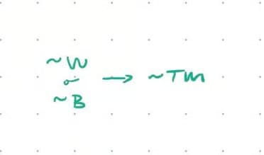
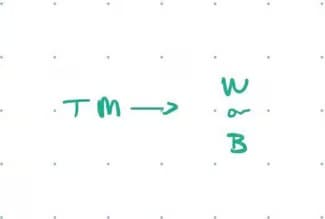
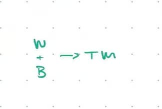

# And/Or, If and Only If, Inclusion, and Exclusion

[Bootcamps](../../README.md) | [Chapter](../README.md) | [Formatted capture](source.html) | [Original captured JSON](source.json)

Source: https://new.theloophole.com/book-extras/bootcamps/conditional-reasoning/and-or-if-and-only-if-inclusion-and-exclusion

Captured: 2026-10-18T12:54:30.404Z. Instructor/source: Loophole Online / Ellen Cassidy.

Coverage: 14/14 questions. Complete observed question sequence and resolved states.

Original source wording follows. Capture commentary and verified-answer labels are archival annotations. Already-answered questions may have no new attempts. Only observed feedback is preserved; unvisited alternative-answer feedback is not claimed.

Archived evidence: `raw/sources/loophole-bootcamps-2026-10-18/conditional-reasoning/and-or-if-and-only-if-inclusion-and-exclusion/source.json`.

## Question 1

### Initial observed question and choices

<h2>Question 1</h2>

<em>If it&#x27;s cold outside, we&#x27;ll drink tea or hot chocolate.</em>

Do we know anything about what happens when it&#x27;s not cold?

<button>
A

No

</button>

<button>
B

Yes

</button>

### Observed attempt 1: A No

<h2>Question 1</h2>

<em>If it&#x27;s cold outside, we&#x27;ll drink tea or hot chocolate.</em>

Do we know anything about what happens when it&#x27;s not cold?

Correct! You got it right on the first try!

<button>
A

No

</button>

Our sufficient condition (cold outside) isn&#x27;t activated if it&#x27;s not cold outside. This leaves our conditional dormant and nothing happens.

<button></button>

<button>
B

Yes

</button>

### Final observed answer and feedback

<h2>Question 1</h2>

<em>If it&#x27;s cold outside, we&#x27;ll drink tea or hot chocolate.</em>

Do we know anything about what happens when it&#x27;s not cold?

Correct! You got it right on the first try!

<button>
A

No

</button>

Our sufficient condition (cold outside) isn&#x27;t activated if it&#x27;s not cold outside. This leaves our conditional dormant and nothing happens.

<button></button>

<button>
B

Yes

</button>

**Verified answer:** A No

Capture commentary: Observed successful final state and selected answer styling.

## Question 2

### Initial observed question and choices

<h2>Question 2</h2>

<em>If it&#x27;s cold outside, we&#x27;ll drink tea or hot chocolate.</em>

Do we know anything about what happens when we&#x27;re drinking either tea or hot chocolate?

<button>
A

No

</button>

<button>
B

Yes

</button>

### Observed attempt 1: A No

<h2>Question 2</h2>

<em>If it&#x27;s cold outside, we&#x27;ll drink tea or hot chocolate.</em>

Do we know anything about what happens when we&#x27;re drinking either tea or hot chocolate?

Correct! You got it right on the first try!

<button>
A

No

</button>

Drinking tea or hot chocolate affirms our necessary condition, but this doesn&#x27;t make anything happen. We cannot read conditional statements backwards.

<button></button>

<button>
B

Yes

</button>

### Final observed answer and feedback

<h2>Question 2</h2>

<em>If it&#x27;s cold outside, we&#x27;ll drink tea or hot chocolate.</em>

Do we know anything about what happens when we&#x27;re drinking either tea or hot chocolate?

Correct! You got it right on the first try!

<button>
A

No

</button>

Drinking tea or hot chocolate affirms our necessary condition, but this doesn&#x27;t make anything happen. We cannot read conditional statements backwards.

<button></button>

<button>
B

Yes

</button>

**Verified answer:** A No

Capture commentary: Observed successful final state and selected answer styling.

## Question 3

### Initial observed question and choices

<h2>Question 3</h2>

<em>If it&#x27;s cold outside, we&#x27;ll drink tea or hot chocolate.</em>

Do we know anything about what happens when we&#x27;re drinking tea but not drinking hot chocolate?

<button>
A

Yes

</button>

<button>
B

No

</button>

### Observed attempt 1: A Yes

<h2>Question 3</h2>

<em>If it&#x27;s cold outside, we&#x27;ll drink tea or hot chocolate.</em>

Do we know anything about what happens when we&#x27;re drinking tea but not drinking hot chocolate?

Ah, not quite

<button>
A

Yes

</button>

<button>
B

No

</button>

### Observed attempt 2: B No

<h2>Question 3</h2>

<em>If it&#x27;s cold outside, we&#x27;ll drink tea or hot chocolate.</em>

Do we know anything about what happens when we&#x27;re drinking tea but not drinking hot chocolate?

Correct!

<button>
A

Yes

</button>

<button>
B

No

</button>

Negating one half of the or does not activate our contrapositive.

<button></button>

### Final observed answer and feedback

<h2>Question 3</h2>

<em>If it&#x27;s cold outside, we&#x27;ll drink tea or hot chocolate.</em>

Do we know anything about what happens when we&#x27;re drinking tea but not drinking hot chocolate?

Correct!

<button>
A

Yes

</button>

<button>
B

No

</button>

Negating one half of the or does not activate our contrapositive.

<button></button>

**Verified answer:** B No

Capture commentary: Observed successful final state and selected answer styling.

## Question 4

### Initial observed question and choices

<h2>Question 4</h2>

<em>If it&#x27;s cold outside, we&#x27;ll drink tea or hot chocolate.</em>

Do we know anything about what happens when we&#x27;re not drinking tea and not drinking hot chocolate?

<button>
A

No

</button>

<button>
B

Yes

</button>

### Observed attempt 1: A No

<h2>Question 4</h2>

<em>If it&#x27;s cold outside, we&#x27;ll drink tea or hot chocolate.</em>

Do we know anything about what happens when we&#x27;re not drinking tea and not drinking hot chocolate?

Ah, not quite

<button>
A

No

</button>

<button>
B

Yes

</button>

### Observed attempt 2: B Yes

<h2>Question 4</h2>

<em>If it&#x27;s cold outside, we&#x27;ll drink tea or hot chocolate.</em>

Do we know anything about what happens when we&#x27;re not drinking tea and not drinking hot chocolate?

Correct!

<button>
A

No

</button>

<button>
B

Yes

</button>

Negating both sides of the or (no tea and no hot chocolate) activates our contrapositive. When we take the contrapositive of an and/or statement, we always switch the and/or.

<button></button>

### Final observed answer and feedback

<h2>Question 4</h2>

<em>If it&#x27;s cold outside, we&#x27;ll drink tea or hot chocolate.</em>

Do we know anything about what happens when we&#x27;re not drinking tea and not drinking hot chocolate?

Correct!

<button>
A

No

</button>

<button>
B

Yes

</button>

Negating both sides of the or (no tea and no hot chocolate) activates our contrapositive. When we take the contrapositive of an and/or statement, we always switch the and/or.

<button></button>

**Verified answer:** B Yes

Capture commentary: Observed successful final state and selected answer styling.

## Question 5

### Initial observed question and choices

<h2>Question 5</h2>

<em>If our candy is wonderful and boring, then it somehow got too majestic.</em>

Which one of the following is a valid diagram for the statement above?

<button></button>
<button>A</button>

<button></button>
<button>B</button>

<button></button>
<button>C</button>

### Observed attempt 1: A

<h2>Question 5</h2>

<em>If our candy is wonderful and boring, then it somehow got too majestic.</em>

Which one of the following is a valid diagram for the statement above?

Ah, not quite

<button></button>
<button>A</button>

<button></button>
<button>B</button>

<button></button>
<button>C</button>

### Observed attempt 2: B

<h2>Question 5</h2>

<em>If our candy is wonderful and boring, then it somehow got too majestic.</em>

Which one of the following is a valid diagram for the statement above?

Ah, not quite

<button></button>
<button>A</button>

<button></button>
<button>B</button>

<button></button>
<button>C</button>

### Observed attempt 3: C

<h2>Question 5</h2>

<em>If our candy is wonderful and boring, then it somehow got too majestic.</em>

Which one of the following is a valid diagram for the statement above?

Correct!

<button></button>
<button>A</button>

<button></button>
<button>B</button>

<button></button>
<button>C</button>

### Final observed answer and feedback

<h2>Question 5</h2>

<em>If our candy is wonderful and boring, then it somehow got too majestic.</em>

Which one of the following is a valid diagram for the statement above?

Correct!

<button></button>
<button>A</button>

<button></button>
<button>B</button>

<button></button>
<button>C</button>

**Verified answer:** C

Capture commentary: Observed successful final state and selected answer styling.

## Question 6

### Initial observed question and choices

<h2>Question 6</h2>

Only if is a...

<button>
A

Sufficient indicator

</button>

<button>
B

Necessary indicator

</button>

<button>
C

Hybrid You choose whether it indicates a Necessary or Sufficient condition based to your Translation of that particular stimulus.

</button>

### Observed attempt 1: A Sufficient indicator

<h2>Question 6</h2>

Only if is a...

Ah, not quite

<button>
A

Sufficient indicator

</button>

<button>
B

Necessary indicator

</button>

<button>
C

Hybrid You choose whether it indicates a Necessary or Sufficient condition based to your Translation of that particular stimulus.

</button>

### Observed attempt 2: B Necessary indicator

<h2>Question 6</h2>

Only if is a...

Correct!

<button>
A

Sufficient indicator

</button>

<button>
B

Necessary indicator

</button>

<button>
C

Hybrid You choose whether it indicates a Necessary or Sufficient condition based to your Translation of that particular stimulus.

</button>

### Final observed answer and feedback

<h2>Question 6</h2>

Only if is a...

Correct!

<button>
A

Sufficient indicator

</button>

<button>
B

Necessary indicator

</button>

<button>
C

Hybrid You choose whether it indicates a Necessary or Sufficient condition based to your Translation of that particular stimulus.

</button>

**Verified answer:** B Necessary indicator

Capture commentary: Observed successful final state and selected answer styling.

## Question 7

### Initial observed question and choices

<h2>Question 7</h2>

What arrow should we use to diagram if and only if statements?

<button>
A

--&gt;

</button>

<button>
B

&lt;--

</button>

<button>
C

&lt;--&gt;

</button>

### Observed attempt 1: A -->

<h2>Question 7</h2>

What arrow should we use to diagram if and only if statements?

Ah, not quite

<button>
A

--&gt;

</button>

<button>
B

&lt;--

</button>

<button>
C

&lt;--&gt;

</button>

### Observed attempt 2: B <--

<h2>Question 7</h2>

What arrow should we use to diagram if and only if statements?

Ah, not quite

<button>
A

--&gt;

</button>

<button>
B

&lt;--

</button>

<button>
C

&lt;--&gt;

</button>

### Observed attempt 3: C <-->

<h2>Question 7</h2>

What arrow should we use to diagram if and only if statements?

Correct!

<button>
A

--&gt;

</button>

<button>
B

&lt;--

</button>

<button>
C

&lt;--&gt;

</button>

### Final observed answer and feedback

<h2>Question 7</h2>

What arrow should we use to diagram if and only if statements?

Correct!

<button>
A

--&gt;

</button>

<button>
B

&lt;--

</button>

<button>
C

&lt;--&gt;

</button>

**Verified answer:** C <-->

Capture commentary: Observed successful final state and selected answer styling.

## Question 8

### Initial observed question and choices

<h2>Question 8</h2>

Which one of the following is not a double arrow indicator?

<button>
A

But not otherwise

</button>

<button>
B

All and only

</button>

<button>
C

Either/or

</button>

### Observed attempt 1: A But not otherwise

<h2>Question 8</h2>

Which one of the following is not a double arrow indicator?

Ah, not quite

<button>
A

But not otherwise

</button>

<button>
B

All and only

</button>

<button>
C

Either/or

</button>

### Observed attempt 2: B All and only

<h2>Question 8</h2>

Which one of the following is not a double arrow indicator?

Ah, not quite

<button>
A

But not otherwise

</button>

<button>
B

All and only

</button>

<button>
C

Either/or

</button>

### Observed attempt 3: C Either/or

<h2>Question 8</h2>

Which one of the following is not a double arrow indicator?

Correct!

<button>
A

But not otherwise

</button>

<button>
B

All and only

</button>

<button>
C

Either/or

</button>

### Final observed answer and feedback

<h2>Question 8</h2>

Which one of the following is not a double arrow indicator?

Correct!

<button>
A

But not otherwise

</button>

<button>
B

All and only

</button>

<button>
C

Either/or

</button>

**Verified answer:** C Either/or

Capture commentary: Observed successful final state and selected answer styling.

## Question 9

### Initial observed question and choices

<h2>Question 9</h2>

<em>Those with righteous self discipline enjoy bitter tasting liquids, and wheat grass juice is enjoyable if and only if one finds joy in the bitter. Everyone who likes wheat grass juice has used apple slices as a gateway to the juice.</em>

Which one of the following is a valid diagram for the statements above?

<button>
A

ASG --&gt; EB &lt;--&gt; WGJE --&gt; ~RSD

</button>

<button>
B

RSD --&gt; EB &lt;--&gt; WGJE --&gt; ASG

</button>

<button>
C

ASG &lt;-- CJA &lt;--&gt; EB --&gt; RSD

</button>

### Observed attempt 1: A ASG --> EB <--> WGJE --> ~RSD

<h2>Question 9</h2>

<em>Those with righteous self discipline enjoy bitter tasting liquids, and wheat grass juice is enjoyable if and only if one finds joy in the bitter. Everyone who likes wheat grass juice has used apple slices as a gateway to the juice.</em>

Which one of the following is a valid diagram for the statements above?

Ah, not quite

<button>
A

ASG --&gt; EB &lt;--&gt; WGJE --&gt; ~RSD

</button>

<button>
B

RSD --&gt; EB &lt;--&gt; WGJE --&gt; ASG

</button>

<button>
C

ASG &lt;-- CJA &lt;--&gt; EB --&gt; RSD

</button>

### Observed attempt 2: B RSD --> EB <--> WGJE --> ASG

<h2>Question 9</h2>

<em>Those with righteous self discipline enjoy bitter tasting liquids, and wheat grass juice is enjoyable if and only if one finds joy in the bitter. Everyone who likes wheat grass juice has used apple slices as a gateway to the juice.</em>

Which one of the following is a valid diagram for the statements above?

Correct!

<button>
A

ASG --&gt; EB &lt;--&gt; WGJE --&gt; ~RSD

</button>

<button>
B

RSD --&gt; EB &lt;--&gt; WGJE --&gt; ASG

</button>

<button>
C

ASG &lt;-- CJA &lt;--&gt; EB --&gt; RSD

</button>

### Final observed answer and feedback

<h2>Question 9</h2>

<em>Those with righteous self discipline enjoy bitter tasting liquids, and wheat grass juice is enjoyable if and only if one finds joy in the bitter. Everyone who likes wheat grass juice has used apple slices as a gateway to the juice.</em>

Which one of the following is a valid diagram for the statements above?

Correct!

<button>
A

ASG --&gt; EB &lt;--&gt; WGJE --&gt; ~RSD

</button>

<button>
B

RSD --&gt; EB &lt;--&gt; WGJE --&gt; ASG

</button>

<button>
C

ASG &lt;-- CJA &lt;--&gt; EB --&gt; RSD

</button>

**Verified answer:** B RSD --> EB <--> WGJE --> ASG

Capture commentary: Observed successful final state and selected answer styling.

## Question 10

### Initial observed question and choices

<h2>Question 10</h2>

What does either/or mean on the LSAT?

<button>
A

You won&#x27;t always have one or the other

</button>

<button>
B

You can only have one of the pair

</button>

<button>
C

You must have at least one of the pair

</button>

### Observed attempt 1: A You won't always have one or the other

<h2>Question 10</h2>

What does either/or mean on the LSAT?

Ah, not quite

<button>
A

You won&#x27;t always have one or the other

</button>

<button>
B

You can only have one of the pair

</button>

<button>
C

You must have at least one of the pair

</button>

### Observed attempt 2: B You can only have one of the pair

<h2>Question 10</h2>

What does either/or mean on the LSAT?

Ah, not quite

<button>
A

You won&#x27;t always have one or the other

</button>

<button>
B

You can only have one of the pair

</button>

<button>
C

You must have at least one of the pair

</button>

### Observed attempt 3: C You must have at least one of the pair

<h2>Question 10</h2>

What does either/or mean on the LSAT?

Correct!

<button>
A

You won&#x27;t always have one or the other

</button>

<button>
B

You can only have one of the pair

</button>

<button>
C

You must have at least one of the pair

</button>

### Final observed answer and feedback

<h2>Question 10</h2>

What does either/or mean on the LSAT?

Correct!

<button>
A

You won&#x27;t always have one or the other

</button>

<button>
B

You can only have one of the pair

</button>

<button>
C

You must have at least one of the pair

</button>

**Verified answer:** C You must have at least one of the pair

Capture commentary: Observed successful final state and selected answer styling.

## Question 11

### Initial observed question and choices

<h2>Question 11</h2>

<em>Herbs are either sweet or they are savory.</em>

Which one of the following is a valid diagram for the statement above?

<button>
A

~H --&gt; ~SW and ~SA

</button>

<button>
B

~SW --&gt; SA

</button>

<button>
C

SW or SA --&gt; H

</button>

### Observed attempt 1: A ~H --> ~SW and ~SA

<h2>Question 11</h2>

<em>Herbs are either sweet or they are savory.</em>

Which one of the following is a valid diagram for the statement above?

Ah, not quite

<button>
A

~H --&gt; ~SW and ~SA

</button>

<button>
B

~SW --&gt; SA

</button>

<button>
C

SW or SA --&gt; H

</button>

### Observed attempt 2: B ~SW --> SA

<h2>Question 11</h2>

<em>Herbs are either sweet or they are savory.</em>

Which one of the following is a valid diagram for the statement above?

Correct!

<button>
A

~H --&gt; ~SW and ~SA

</button>

<button>
B

~SW --&gt; SA

</button>

Because either/or is an Inclusion indicator, we must build our diagram to require at least one half of the pair. To do this, we show that if one half of the pair is gone, we must have the other half.

<button></button>

<button>
C

SW or SA --&gt; H

</button>

### Final observed answer and feedback

<h2>Question 11</h2>

<em>Herbs are either sweet or they are savory.</em>

Which one of the following is a valid diagram for the statement above?

Correct!

<button>
A

~H --&gt; ~SW and ~SA

</button>

<button>
B

~SW --&gt; SA

</button>

Because either/or is an Inclusion indicator, we must build our diagram to require at least one half of the pair. To do this, we show that if one half of the pair is gone, we must have the other half.

<button></button>

<button>
C

SW or SA --&gt; H

</button>

**Verified answer:** B ~SW --> SA

Capture commentary: Observed successful final state and selected answer styling.

## Question 12

### Initial observed question and choices

<h2>Question 12</h2>

What does no/none/nobody/never mean on the LSAT?

<button>
A

If/then

</button>

<button>
B

Unless

</button>

<button>
C

Mutual exclusivity

</button>

### Observed attempt 1: A If/then

<h2>Question 12</h2>

What does no/none/nobody/never mean on the LSAT?

Ah, not quite

<button>
A

If/then

</button>

<button>
B

Unless

</button>

<button>
C

Mutual exclusivity

</button>

### Observed attempt 2: B Unless

<h2>Question 12</h2>

What does no/none/nobody/never mean on the LSAT?

Ah, not quite

<button>
A

If/then

</button>

<button>
B

Unless

</button>

<button>
C

Mutual exclusivity

</button>

### Observed attempt 3: C Mutual exclusivity

<h2>Question 12</h2>

What does no/none/nobody/never mean on the LSAT?

Correct!

<button>
A

If/then

</button>

<button>
B

Unless

</button>

<button>
C

Mutual exclusivity

</button>

### Final observed answer and feedback

<h2>Question 12</h2>

What does no/none/nobody/never mean on the LSAT?

Correct!

<button>
A

If/then

</button>

<button>
B

Unless

</button>

<button>
C

Mutual exclusivity

</button>

**Verified answer:** C Mutual exclusivity

Capture commentary: Observed successful final state and selected answer styling.

## Question 13

### Initial observed question and choices

<h2>Question 13</h2>

<em>No one who hates candy has good taste.</em>

Which one of the following is a valid diagram for the statement above?

<button>
A

HC --&gt; ~GT

</button>

<button>
B

~HC --&gt; GT

</button>

<button>
C

~GT --&gt; HC

</button>

### Observed attempt 1: A HC --> ~GT

<h2>Question 13</h2>

<em>No one who hates candy has good taste.</em>

Which one of the following is a valid diagram for the statement above?

Correct! You got it right on the first try!

<button>
A

HC --&gt; ~GT

</button>

<button>
B

~HC --&gt; GT

</button>

<button>
C

~GT --&gt; HC

</button>

### Final observed answer and feedback

<h2>Question 13</h2>

<em>No one who hates candy has good taste.</em>

Which one of the following is a valid diagram for the statement above?

Correct! You got it right on the first try!

<button>
A

HC --&gt; ~GT

</button>

<button>
B

~HC --&gt; GT

</button>

<button>
C

~GT --&gt; HC

</button>

**Verified answer:** A HC --> ~GT

Capture commentary: Observed successful final state and selected answer styling.

## Question 14

### Initial observed question and choices

<h2>Question 14</h2>

<em>Adventurous eaters find joy in trying new things, but no one who likes newness in their life is a fan of mayonnaise. However, everyone whose favorite food is spaghetti loves mayonnaise.</em>

Which one of the following is a valid diagram for the statements above?

<button>
A

AE --&gt; TNT --&gt; FM --&gt; FFS

</button>

<button>
B

AE --&gt; TNT --&gt; ~FM --&gt; ~FFS

</button>

<button>
C

~TNT --&gt; ~AE --&gt; ~FM --&gt; ~FFS

</button>

### Observed attempt 1: A AE --> TNT --> FM --> FFS

<h2>Question 14</h2>

<em>Adventurous eaters find joy in trying new things, but no one who likes newness in their life is a fan of mayonnaise. However, everyone whose favorite food is spaghetti loves mayonnaise.</em>

Which one of the following is a valid diagram for the statements above?

Ah, not quite

<button>
A

AE --&gt; TNT --&gt; FM --&gt; FFS

</button>

<button>
B

AE --&gt; TNT --&gt; ~FM --&gt; ~FFS

</button>

<button>
C

~TNT --&gt; ~AE --&gt; ~FM --&gt; ~FFS

</button>

### Observed attempt 2: B AE --> TNT --> ~FM --> ~FFS

<h2>Question 14</h2>

<em>Adventurous eaters find joy in trying new things, but no one who likes newness in their life is a fan of mayonnaise. However, everyone whose favorite food is spaghetti loves mayonnaise.</em>

Which one of the following is a valid diagram for the statements above?

Correct!

<button>
A

AE --&gt; TNT --&gt; FM --&gt; FFS

</button>

<button>
B

AE --&gt; TNT --&gt; ~FM --&gt; ~FFS

</button>

<button>
C

~TNT --&gt; ~AE --&gt; ~FM --&gt; ~FFS

</button>

### Final observed answer and feedback

<h2>Question 14</h2>

<em>Adventurous eaters find joy in trying new things, but no one who likes newness in their life is a fan of mayonnaise. However, everyone whose favorite food is spaghetti loves mayonnaise.</em>

Which one of the following is a valid diagram for the statements above?

Correct!

<button>
A

AE --&gt; TNT --&gt; FM --&gt; FFS

</button>

<button>
B

AE --&gt; TNT --&gt; ~FM --&gt; ~FFS

</button>

<button>
C

~TNT --&gt; ~AE --&gt; ~FM --&gt; ~FFS

</button>

**Verified answer:** B AE --> TNT --> ~FM --> ~FFS

Capture commentary: Observed successful final state and selected answer styling.
