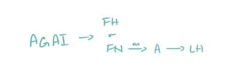
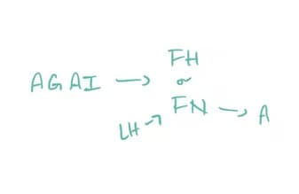
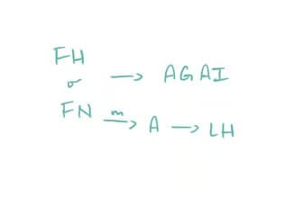

# Conditional Practice

[Bootcamps](../../README.md) | [Chapter](../README.md) | [Formatted capture](source.html) | [Original captured JSON](source.json)

Source: https://new.theloophole.com/book-extras/bootcamps/conditional-reasoning/conditional-practice

Captured: 2026-10-18T12:55:37.308Z. Instructor/source: Loophole Online / Ellen Cassidy.

Coverage: 5/5 questions. Complete observed question sequence and resolved states.

Original source wording follows. Capture commentary and verified-answer labels are archival annotations. Already-answered questions may have no new attempts. Only observed feedback is preserved; unvisited alternative-answer feedback is not claimed.

Archived evidence: `raw/sources/loophole-bootcamps-2026-10-18/conditional-reasoning/conditional-practice/source.json`.

## Question 1

### Initial observed question and choices

<h2>Question 1</h2>

<em>If frozen milk and rice is considered to be ice cream, then ice cream was invented in China in 200 BC. Chefs in that era could make the frozen treat only if they packed it with snow.</em>

Which one of the following is a valid diagram of the statements above?

Correct!

<button>
A

FMR = IC → Ch. 200 BC

PS → Ch. 200 BC

</button>

<button>
B

PS ← Ch. 200 BC → FMR = IC

</button>

<button>
C

FMR = IC → Ch.200 BC → PS

</button>

### Final observed answer and feedback

<h2>Question 1</h2>

<em>If frozen milk and rice is considered to be ice cream, then ice cream was invented in China in 200 BC. Chefs in that era could make the frozen treat only if they packed it with snow.</em>

Which one of the following is a valid diagram of the statements above?

Correct!

<button>
A

FMR = IC → Ch. 200 BC

PS → Ch. 200 BC

</button>

<button>
B

PS ← Ch. 200 BC → FMR = IC

</button>

<button>
C

FMR = IC → Ch.200 BC → PS

</button>

**Verified answer:** C FMR = IC → Ch.200 BC → PS

Capture commentary: Observed successful final state and selected answer styling.

## Question 2

### Initial observed question and choices

<h2>Question 2</h2>

<em>Alexander the Great ate ice only if it was flavored with honey or nectar, the latter mostly coming from agave plants. Without laborious harvesting, agave nectar cannot be used as flavoring.</em>

Which one of the following is a valid diagram of the statements above?

Correct! You got it right on the first try!

<button></button>
<button>A</button>

<button></button>
<button>B</button>

<button></button>
<button>C</button>

### Final observed answer and feedback

<h2>Question 2</h2>

<em>Alexander the Great ate ice only if it was flavored with honey or nectar, the latter mostly coming from agave plants. Without laborious harvesting, agave nectar cannot be used as flavoring.</em>

Which one of the following is a valid diagram of the statements above?

Correct! You got it right on the first try!

<button></button>
<button>A</button>

<button></button>
<button>B</button>

<button></button>
<button>C</button>

**Verified answer:** A

Capture commentary: Observed successful final state and selected answer styling.

## Question 3

### Initial observed question and choices

<h2>Question 3</h2>

<em>Ice cream was a delicacy in the United States until after 1800, when insulated ice houses were invented. In order to mass produce ice cream, insulated ice houses are a must.</em>

Which one of the following is a valid diagram of the statements above?

Correct!

<button>
A

&gt;1800 → ~ICD

IIH → MPI

</button>

<button>
B

~ICD → &gt;1800

MPI → IIH → &gt;1800

</button>

<button>
C

&gt;1800 → ~ICD

MPI → IIH → &gt;1800

</button>

### Final observed answer and feedback

<h2>Question 3</h2>

<em>Ice cream was a delicacy in the United States until after 1800, when insulated ice houses were invented. In order to mass produce ice cream, insulated ice houses are a must.</em>

Which one of the following is a valid diagram of the statements above?

Correct!

<button>
A

&gt;1800 → ~ICD

IIH → MPI

</button>

<button>
B

~ICD → &gt;1800

MPI → IIH → &gt;1800

</button>

<button>
C

&gt;1800 → ~ICD

MPI → IIH → &gt;1800

</button>

**Verified answer:** B ~ICD → >1800 MPI → IIH → >1800

Capture commentary: Observed successful final state and selected answer styling.

## Question 4

### Initial observed question and choices

<h2>Question 4</h2>

<em>In order to keep morale high the US military served troops ice cream in World War II. Dairy was rationed until 1946, when and only when Americans consumed more than 20 quarts of ice cream per person. No country that consumes such a quantity of ice cream per capita is completely lactose intolerant.</em>

Which one of the following is a valid diagram of the statements above?

Correct!

<button>
A

TIC → MH

~DR → 1946 ←→ 20Q+ → ~CLI

</button>

<button>
B

MH→ TIC

~DR → 1946 ←→ 20Q+ → ~CLI

</button>

<button>
C

MH → TIC

~DR → 1946 → 20Q+ → ~CLI

</button>

### Final observed answer and feedback

<h2>Question 4</h2>

<em>In order to keep morale high the US military served troops ice cream in World War II. Dairy was rationed until 1946, when and only when Americans consumed more than 20 quarts of ice cream per person. No country that consumes such a quantity of ice cream per capita is completely lactose intolerant.</em>

Which one of the following is a valid diagram of the statements above?

Correct!

<button>
A

TIC → MH

~DR → 1946 ←→ 20Q+ → ~CLI

</button>

<button>
B

MH→ TIC

~DR → 1946 ←→ 20Q+ → ~CLI

</button>

<button>
C

MH → TIC

~DR → 1946 → 20Q+ → ~CLI

</button>

**Verified answer:** B MH→ TIC ~DR → 1946 ←→ 20Q+ → ~CLI

Capture commentary: Observed successful final state and selected answer styling.

## Question 5

### Initial observed question and choices

<h2>Question 5</h2>

Turn to PT2.S2.Q20*. Which one of the following is a correct diagram of the stimulus?

<em>*In LawHub, PT numbers 1-23 are in the <a href="https://app.lawhub.org/library/additionalpractice">Additional Practice</a> tab. Open up LawHub, go to LSAT Prep in the left sidebar, click Additional Practice, and select &quot;Logical Reasoning - The Official LSAT PrepTest 02, Section 2,&quot; and go to Question 20. LawHub Advantage required.</em>

PT2.S2.Q20

<h3>Upgrade to Practice</h3>
Get access to real LSAT questions and Loophole Online with the Practice plan

<button>Upgrade to Practice</button>

<button>
A

IB → SA ←s→ TF

SA ←s→ TF

</button>

<button>
B

SA → IB

IB ←s→ TF

SA ←s→ TF

</button>

<button>
C

SA → IB ←s→ TF

SA ←s→ TF

</button>

### Observed attempt 1: A IB → SA ←s→ TF SA ←s→ TF

<h2>Question 5</h2>

Turn to PT2.S2.Q20*. Which one of the following is a correct diagram of the stimulus?

<em>*In LawHub, PT numbers 1-23 are in the <a href="https://app.lawhub.org/library/additionalpractice">Additional Practice</a> tab. Open up LawHub, go to LSAT Prep in the left sidebar, click Additional Practice, and select &quot;Logical Reasoning - The Official LSAT PrepTest 02, Section 2,&quot; and go to Question 20. LawHub Advantage required.</em>

PT2.S2.Q20

<h3>Upgrade to Practice</h3>
Get access to real LSAT questions and Loophole Online with the Practice plan

<button>Upgrade to Practice</button>

Ah, not quite

<button>
A

IB → SA ←s→ TF

SA ←s→ TF

</button>

<button>
B

SA → IB

IB ←s→ TF

SA ←s→ TF

</button>

<button>
C

SA → IB ←s→ TF

SA ←s→ TF

</button>

### Observed attempt 2: B SA → IB IB ←s→ TF SA ←s→ TF

<h2>Question 5</h2>

Turn to PT2.S2.Q20*. Which one of the following is a correct diagram of the stimulus?

<em>*In LawHub, PT numbers 1-23 are in the <a href="https://app.lawhub.org/library/additionalpractice">Additional Practice</a> tab. Open up LawHub, go to LSAT Prep in the left sidebar, click Additional Practice, and select &quot;Logical Reasoning - The Official LSAT PrepTest 02, Section 2,&quot; and go to Question 20. LawHub Advantage required.</em>

PT2.S2.Q20

<h3>Upgrade to Practice</h3>
Get access to real LSAT questions and Loophole Online with the Practice plan

<button>Upgrade to Practice</button>

Ah, not quite

<button>
A

IB → SA ←s→ TF

SA ←s→ TF

</button>

<button>
B

SA → IB

IB ←s→ TF

SA ←s→ TF

</button>

<button>
C

SA → IB ←s→ TF

SA ←s→ TF

</button>

### Observed attempt 3: C SA → IB ←s→ TF SA ←s→ TF

<h2>Question 5</h2>

Turn to PT2.S2.Q20*. Which one of the following is a correct diagram of the stimulus?

<em>*In LawHub, PT numbers 1-23 are in the <a href="https://app.lawhub.org/library/additionalpractice">Additional Practice</a> tab. Open up LawHub, go to LSAT Prep in the left sidebar, click Additional Practice, and select &quot;Logical Reasoning - The Official LSAT PrepTest 02, Section 2,&quot; and go to Question 20. LawHub Advantage required.</em>

PT2.S2.Q20

<h3>Upgrade to Practice</h3>
Get access to real LSAT questions and Loophole Online with the Practice plan

<button>Upgrade to Practice</button>

Correct!

<button>
A

IB → SA ←s→ TF

SA ←s→ TF

</button>

<button>
B

SA → IB

IB ←s→ TF

SA ←s→ TF

</button>

<button>
C

SA → IB ←s→ TF

SA ←s→ TF

</button>

### Final observed answer and feedback

<h2>Question 5</h2>

Turn to PT2.S2.Q20*. Which one of the following is a correct diagram of the stimulus?

<em>*In LawHub, PT numbers 1-23 are in the <a href="https://app.lawhub.org/library/additionalpractice">Additional Practice</a> tab. Open up LawHub, go to LSAT Prep in the left sidebar, click Additional Practice, and select &quot;Logical Reasoning - The Official LSAT PrepTest 02, Section 2,&quot; and go to Question 20. LawHub Advantage required.</em>

PT2.S2.Q20

<h3>Upgrade to Practice</h3>
Get access to real LSAT questions and Loophole Online with the Practice plan

<button>Upgrade to Practice</button>

Correct!

<button>
A

IB → SA ←s→ TF

SA ←s→ TF

</button>

<button>
B

SA → IB

IB ←s→ TF

SA ←s→ TF

</button>

<button>
C

SA → IB ←s→ TF

SA ←s→ TF

</button>

**Verified answer:** C SA → IB ←s→ TF SA ←s→ TF

Capture commentary: Observed successful final state and selected answer styling.
