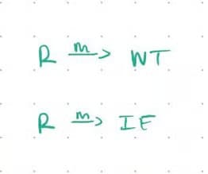
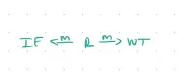
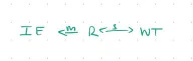
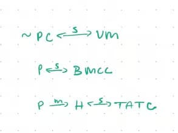
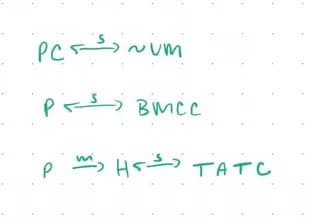
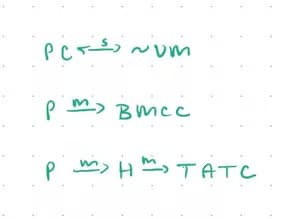

# Some/Most

[Bootcamps](../../README.md) | [Chapter](../README.md) | [Formatted capture](source.html) | [Original captured JSON](source.json)

Source: https://new.theloophole.com/book-extras/bootcamps/conditional-reasoning/some-most

Captured: 2026-10-18T12:55:24.936Z. Instructor/source: Loophole Online / Ellen Cassidy.

Coverage: 16/16 questions. Complete observed question sequence and resolved states.

Original source wording follows. Capture commentary and verified-answer labels are archival annotations. Already-answered questions may have no new attempts. Only observed feedback is preserved; unvisited alternative-answer feedback is not claimed.

Archived evidence: `raw/sources/loophole-bootcamps-2026-10-18/conditional-reasoning/some-most/source.json`.

## Question 1

### Initial observed question and choices

<h2>Question 1</h2>

What does Some denote?

<button>
A

Anywhere from 0% to 100%

</button>

<button>
B

Anywhere from 1% to 100%

</button>

<button>
C

Anywhere from .01% to 99.9%

</button>

### Observed attempt 1: A Anywhere from 0% to 100%

<h2>Question 1</h2>

What does Some denote?

Ah, not quite

<button>
A

Anywhere from 0% to 100%

</button>

<button>
B

Anywhere from 1% to 100%

</button>

<button>
C

Anywhere from .01% to 99.9%

</button>

### Observed attempt 2: B Anywhere from 1% to 100%

<h2>Question 1</h2>

What does Some denote?

Correct!

<button>
A

Anywhere from 0% to 100%

</button>

<button>
B

Anywhere from 1% to 100%

</button>

<button>
C

Anywhere from .01% to 99.9%

</button>

### Final observed answer and feedback

<h2>Question 1</h2>

What does Some denote?

Correct!

<button>
A

Anywhere from 0% to 100%

</button>

<button>
B

Anywhere from 1% to 100%

</button>

<button>
C

Anywhere from .01% to 99.9%

</button>

**Verified answer:** B Anywhere from 1% to 100%

Capture commentary: Observed successful final state and selected answer styling.

## Question 2

### Initial observed question and choices

<h2>Question 2</h2>

What does Most denote?

<button>
A

More than 50%

</button>

<button>
B

Nearly 100%

</button>

<button>
C

More than some

</button>

### Observed attempt 1: A More than 50%

<h2>Question 2</h2>

What does Most denote?

Correct! You got it right on the first try!

<button>
A

More than 50%

</button>

<button>
B

Nearly 100%

</button>

<button>
C

More than some

</button>

### Final observed answer and feedback

<h2>Question 2</h2>

What does Most denote?

Correct! You got it right on the first try!

<button>
A

More than 50%

</button>

<button>
B

Nearly 100%

</button>

<button>
C

More than some

</button>

**Verified answer:** A More than 50%

Capture commentary: Observed successful final state and selected answer styling.

## Question 3

### Initial observed question and choices

<h2>Question 3</h2>

Which one of the following is not a member of the <em>Some</em> Family?

<button>
A

Many

</button>

<button>
B

At least one

</button>

<button>
C

Usually

</button>

<button>
D

Few

</button>

<button>
E

Several

</button>

### Observed attempt 1: A Many

<h2>Question 3</h2>

Which one of the following is not a member of the <em>Some</em> Family?

Ah, not quite

<button>
A

Many

</button>

<button>
B

At least one

</button>

<button>
C

Usually

</button>

<button>
D

Few

</button>

<button>
E

Several

</button>

### Observed attempt 2: B At least one

<h2>Question 3</h2>

Which one of the following is not a member of the <em>Some</em> Family?

Ah, not quite

<button>
A

Many

</button>

<button>
B

At least one

</button>

<button>
C

Usually

</button>

<button>
D

Few

</button>

<button>
E

Several

</button>

### Observed attempt 3: C Usually

<h2>Question 3</h2>

Which one of the following is not a member of the <em>Some</em> Family?

Correct!

<button>
A

Many

</button>

<button>
B

At least one

</button>

<button>
C

Usually

</button>

<button>
D

Few

</button>

<button>
E

Several

</button>

### Final observed answer and feedback

<h2>Question 3</h2>

Which one of the following is not a member of the <em>Some</em> Family?

Correct!

<button>
A

Many

</button>

<button>
B

At least one

</button>

<button>
C

Usually

</button>

<button>
D

Few

</button>

<button>
E

Several

</button>

**Verified answer:** C Usually

Capture commentary: Observed successful final state and selected answer styling.

## Question 4

### Initial observed question and choices

<h2>Question 4</h2>

Do Some statements have contrapositives?

<button>
A

No

</button>

<button>
B

Yes

</button>

### Observed attempt 1: A No

<h2>Question 4</h2>

Do Some statements have contrapositives?

Correct! You got it right on the first try!

<button>
A

No

</button>

Never negate Some statements. They don&#x27;t imply anything when negated.

<button></button>

<button>
B

Yes

</button>

### Final observed answer and feedback

<h2>Question 4</h2>

Do Some statements have contrapositives?

Correct! You got it right on the first try!

<button>
A

No

</button>

Never negate Some statements. They don&#x27;t imply anything when negated.

<button></button>

<button>
B

Yes

</button>

**Verified answer:** A No

Capture commentary: Observed successful final state and selected answer styling.

## Question 5

### Initial observed question and choices

<h2>Question 5</h2>

Which one of the following is not a member of the Most Family?

<button>
A

Mostly

</button>

<button>
B

Usually

</button>

<button>
C

More often than not

</button>

<button>
D

Probably

</button>

<button>
E

Many

</button>

### Observed attempt 1: A Mostly

<h2>Question 5</h2>

Which one of the following is not a member of the Most Family?

Ah, not quite

<button>
A

Mostly

</button>

<button>
B

Usually

</button>

<button>
C

More often than not

</button>

<button>
D

Probably

</button>

<button>
E

Many

</button>

### Observed attempt 2: B Usually

<h2>Question 5</h2>

Which one of the following is not a member of the Most Family?

Ah, not quite

<button>
A

Mostly

</button>

<button>
B

Usually

</button>

<button>
C

More often than not

</button>

<button>
D

Probably

</button>

<button>
E

Many

</button>

### Observed attempt 3: C More often than not

<h2>Question 5</h2>

Which one of the following is not a member of the Most Family?

Ah, not quite

<button>
A

Mostly

</button>

<button>
B

Usually

</button>

<button>
C

More often than not

</button>

<button>
D

Probably

</button>

<button>
E

Many

</button>

### Observed attempt 4: D Probably

<h2>Question 5</h2>

Which one of the following is not a member of the Most Family?

Ah, not quite

<button>
A

Mostly

</button>

<button>
B

Usually

</button>

<button>
C

More often than not

</button>

<button>
D

Probably

</button>

<button>
E

Many

</button>

### Observed attempt 5: E Many

<h2>Question 5</h2>

Which one of the following is not a member of the Most Family?

Correct!

<button>
A

Mostly

</button>

<button>
B

Usually

</button>

<button>
C

More often than not

</button>

<button>
D

Probably

</button>

<button>
E

Many

</button>

### Final observed answer and feedback

<h2>Question 5</h2>

Which one of the following is not a member of the Most Family?

Correct!

<button>
A

Mostly

</button>

<button>
B

Usually

</button>

<button>
C

More often than not

</button>

<button>
D

Probably

</button>

<button>
E

Many

</button>

**Verified answer:** E Many

Capture commentary: Observed successful final state and selected answer styling.

## Question 6

### Initial observed question and choices

<h2>Question 6</h2>

<em>Microwaves probably eat popcorn as a road trip snack.</em>

Which one of the following is a valid diagram of the statement above?

<button>
A

M –m--&gt; EPRTS

</button>

<button>
B

M &lt;--s--&gt; EPRTS

</button>

<button>
C

EPTRTS –m--&gt; M

</button>

### Observed attempt 1: A M –m--> EPRTS

<h2>Question 6</h2>

<em>Microwaves probably eat popcorn as a road trip snack.</em>

Which one of the following is a valid diagram of the statement above?

Correct! You got it right on the first try!

<button>
A

M –m--&gt; EPRTS

</button>

<button>
B

M &lt;--s--&gt; EPRTS

</button>

<button>
C

EPTRTS –m--&gt; M

</button>

### Final observed answer and feedback

<h2>Question 6</h2>

<em>Microwaves probably eat popcorn as a road trip snack.</em>

Which one of the following is a valid diagram of the statement above?

Correct! You got it right on the first try!

<button>
A

M –m--&gt; EPRTS

</button>

<button>
B

M &lt;--s--&gt; EPRTS

</button>

<button>
C

EPTRTS –m--&gt; M

</button>

**Verified answer:** A M –m--> EPRTS

Capture commentary: Observed successful final state and selected answer styling.

## Question 7

### Initial observed question and choices

<h2>Question 7</h2>

<em>Many microwaves get lost when they go on road trips.</em>

Which one of the following is a valid diagram of the statement above?

<button>
A

M –m--&gt; LWGRT

</button>

<button>
B

M &lt;--s--&gt; LWGRT

</button>

<button>
C

LWGRT –m--&gt; M

</button>

### Observed attempt 1: A M –m--> LWGRT

<h2>Question 7</h2>

<em>Many microwaves get lost when they go on road trips.</em>

Which one of the following is a valid diagram of the statement above?

Ah, not quite

<button>
A

M –m--&gt; LWGRT

</button>

<button>
B

M &lt;--s--&gt; LWGRT

</button>

<button>
C

LWGRT –m--&gt; M

</button>

### Observed attempt 2: B M <--s--> LWGRT

<h2>Question 7</h2>

<em>Many microwaves get lost when they go on road trips.</em>

Which one of the following is a valid diagram of the statement above?

Correct!

<button>
A

M –m--&gt; LWGRT

</button>

<button>
B

M &lt;--s--&gt; LWGRT

</button>

<button>
C

LWGRT –m--&gt; M

</button>

### Final observed answer and feedback

<h2>Question 7</h2>

<em>Many microwaves get lost when they go on road trips.</em>

Which one of the following is a valid diagram of the statement above?

Correct!

<button>
A

M –m--&gt; LWGRT

</button>

<button>
B

M &lt;--s--&gt; LWGRT

</button>

<button>
C

LWGRT –m--&gt; M

</button>

**Verified answer:** B M <--s--> LWGRT

Capture commentary: Observed successful final state and selected answer styling.

## Question 8

### Initial observed question and choices

<h2>Question 8</h2>

Which one of the following does not yield a provable <em>Some/Most</em> Inference?

<button>
A

A &lt;--s--&gt; B --&gt; C

</button>

<button>
B

A –m--&gt; B; A –m--&gt; C

</button>

<button>
C

A &lt;--s--&gt; B &lt;--s--&gt; C

</button>

### Observed attempt 1: A A <--s--> B --> C

<h2>Question 8</h2>

Which one of the following does not yield a provable <em>Some/Most</em> Inference?

Ah, not quite

<button>
A

A &lt;--s--&gt; B --&gt; C

</button>

<button>
B

A –m--&gt; B; A –m--&gt; C

</button>

<button>
C

A &lt;--s--&gt; B &lt;--s--&gt; C

</button>

### Observed attempt 2: B A –m--> B; A –m--> C

<h2>Question 8</h2>

Which one of the following does not yield a provable <em>Some/Most</em> Inference?

Ah, not quite

<button>
A

A &lt;--s--&gt; B --&gt; C

</button>

<button>
B

A –m--&gt; B; A –m--&gt; C

</button>

<button>
C

A &lt;--s--&gt; B &lt;--s--&gt; C

</button>

### Observed attempt 3: C A <--s--> B <--s--> C

<h2>Question 8</h2>

Which one of the following does not yield a provable <em>Some/Most</em> Inference?

Correct!

<button>
A

A &lt;--s--&gt; B --&gt; C

</button>

<button>
B

A –m--&gt; B; A –m--&gt; C

</button>

<button>
C

A &lt;--s--&gt; B &lt;--s--&gt; C

</button>

### Final observed answer and feedback

<h2>Question 8</h2>

Which one of the following does not yield a provable <em>Some/Most</em> Inference?

Correct!

<button>
A

A &lt;--s--&gt; B --&gt; C

</button>

<button>
B

A –m--&gt; B; A –m--&gt; C

</button>

<button>
C

A &lt;--s--&gt; B &lt;--s--&gt; C

</button>

**Verified answer:** C A <--s--> B <--s--> C

Capture commentary: Observed successful final state and selected answer styling.

## Question 9

### Initial observed question and choices

<h2>Question 9</h2>

Which one of the following does yield a provable <em>Some/Most</em> Inference?

<button>
A

A --&gt; B &lt;--s--&gt; C

</button>

<button>
B

A &lt;--s--&gt; B –m--&gt; C

</button>

<button>
C

A –m--&gt; B --&gt; C

</button>

### Observed attempt 1: A A --> B <--s--> C

<h2>Question 9</h2>

Which one of the following does yield a provable <em>Some/Most</em> Inference?

Ah, not quite

<button>
A

A --&gt; B &lt;--s--&gt; C

</button>

<button>
B

A &lt;--s--&gt; B –m--&gt; C

</button>

<button>
C

A –m--&gt; B --&gt; C

</button>

### Observed attempt 2: B A <--s--> B –m--> C

<h2>Question 9</h2>

Which one of the following does yield a provable <em>Some/Most</em> Inference?

Ah, not quite

<button>
A

A --&gt; B &lt;--s--&gt; C

</button>

<button>
B

A &lt;--s--&gt; B –m--&gt; C

</button>

<button>
C

A –m--&gt; B --&gt; C

</button>

### Observed attempt 3: C A –m--> B --> C

<h2>Question 9</h2>

Which one of the following does yield a provable <em>Some/Most</em> Inference?

Correct!

<button>
A

A --&gt; B &lt;--s--&gt; C

</button>

<button>
B

A &lt;--s--&gt; B –m--&gt; C

</button>

<button>
C

A –m--&gt; B --&gt; C

</button>

### Final observed answer and feedback

<h2>Question 9</h2>

Which one of the following does yield a provable <em>Some/Most</em> Inference?

Correct!

<button>
A

A --&gt; B &lt;--s--&gt; C

</button>

<button>
B

A &lt;--s--&gt; B –m--&gt; C

</button>

<button>
C

A –m--&gt; B --&gt; C

</button>

**Verified answer:** C A –m--> B --> C

Capture commentary: Observed successful final state and selected answer styling.

## Question 10

### Initial observed question and choices

<h2>Question 10</h2>

<em>All porcelain, which makes up the material for several plates, is microwave safe.</em>

Which one of the following is a valid diagram of the statement above?

<button>
A

PL &lt;--s--&gt; PO --&gt; MS

</button>

<button>
B

PO --&gt; MS&lt;--s--&gt; ~PL

</button>

<button>
C

PL &lt;--s--&gt; MS --&gt; PO

</button>

### Observed attempt 1: A PL <--s--> PO --> MS

<h2>Question 10</h2>

<em>All porcelain, which makes up the material for several plates, is microwave safe.</em>

Which one of the following is a valid diagram of the statement above?

Correct! You got it right on the first try!

<button>
A

PL &lt;--s--&gt; PO --&gt; MS

</button>

<button>
B

PO --&gt; MS&lt;--s--&gt; ~PL

</button>

<button>
C

PL &lt;--s--&gt; MS --&gt; PO

</button>

### Final observed answer and feedback

<h2>Question 10</h2>

<em>All porcelain, which makes up the material for several plates, is microwave safe.</em>

Which one of the following is a valid diagram of the statement above?

Correct! You got it right on the first try!

<button>
A

PL &lt;--s--&gt; PO --&gt; MS

</button>

<button>
B

PO --&gt; MS&lt;--s--&gt; ~PL

</button>

<button>
C

PL &lt;--s--&gt; MS --&gt; PO

</button>

**Verified answer:** A PL <--s--> PO --> MS

Capture commentary: Observed successful final state and selected answer styling.

## Question 11

### Initial observed question and choices

<h2>Question 11</h2>

<em>All porcelain, which makes up the material for several plates, is microwave safe.</em>

PL &lt;--s--&gt; PO --&gt; MS

Is there a valid Inference to be drawn from the statement above?

<button>
A

PO &lt;--s--&gt; PL

</button>

<button>
B

There is no valid Inference.

</button>

<button>
C

PL &lt;--s--&gt; MS

</button>

### Observed attempt 1: A PO <--s--> PL

<h2>Question 11</h2>

<em>All porcelain, which makes up the material for several plates, is microwave safe.</em>

PL &lt;--s--&gt; PO --&gt; MS

Is there a valid Inference to be drawn from the statement above?

Ah, not quite

<button>
A

PO &lt;--s--&gt; PL

</button>

<button>
B

There is no valid Inference.

</button>

<button>
C

PL &lt;--s--&gt; MS

</button>

### Observed attempt 2: B There is no valid Inference.

<h2>Question 11</h2>

<em>All porcelain, which makes up the material for several plates, is microwave safe.</em>

PL &lt;--s--&gt; PO --&gt; MS

Is there a valid Inference to be drawn from the statement above?

Ah, not quite

<button>
A

PO &lt;--s--&gt; PL

</button>

<button>
B

There is no valid Inference.

</button>

<button>
C

PL &lt;--s--&gt; MS

</button>

### Observed attempt 3: C PL <--s--> MS

<h2>Question 11</h2>

<em>All porcelain, which makes up the material for several plates, is microwave safe.</em>

PL &lt;--s--&gt; PO --&gt; MS

Is there a valid Inference to be drawn from the statement above?

Correct!

<button>
A

PO &lt;--s--&gt; PL

</button>

<button>
B

There is no valid Inference.

</button>

<button>
C

PL &lt;--s--&gt; MS

</button>

### Final observed answer and feedback

<h2>Question 11</h2>

<em>All porcelain, which makes up the material for several plates, is microwave safe.</em>

PL &lt;--s--&gt; PO --&gt; MS

Is there a valid Inference to be drawn from the statement above?

Correct!

<button>
A

PO &lt;--s--&gt; PL

</button>

<button>
B

There is no valid Inference.

</button>

<button>
C

PL &lt;--s--&gt; MS

</button>

**Verified answer:** C PL <--s--> MS

Capture commentary: Observed successful final state and selected answer styling.

## Question 12

### Initial observed question and choices

<h2>Question 12</h2>

<em>Travel mugs are mostly made of metal, which usually catches fire in the microwave.</em>

Which one of the following is a valid diagram of the statement above?

<button>
A

TM –m--&gt; M –m--&gt; CF

</button>

<button>
B

TM &lt;--s--&gt; M –m--&gt; CF

</button>

<button>
C

TM –m--&gt; M &lt;--s--&gt; CF

</button>

### Observed attempt 1: A TM –m--> M –m--> CF

<h2>Question 12</h2>

<em>Travel mugs are mostly made of metal, which usually catches fire in the microwave.</em>

Which one of the following is a valid diagram of the statement above?

Correct! You got it right on the first try!

<button>
A

TM –m--&gt; M –m--&gt; CF

</button>

<button>
B

TM &lt;--s--&gt; M –m--&gt; CF

</button>

<button>
C

TM –m--&gt; M &lt;--s--&gt; CF

</button>

### Final observed answer and feedback

<h2>Question 12</h2>

<em>Travel mugs are mostly made of metal, which usually catches fire in the microwave.</em>

Which one of the following is a valid diagram of the statement above?

Correct! You got it right on the first try!

<button>
A

TM –m--&gt; M –m--&gt; CF

</button>

<button>
B

TM &lt;--s--&gt; M –m--&gt; CF

</button>

<button>
C

TM –m--&gt; M &lt;--s--&gt; CF

</button>

**Verified answer:** A TM –m--> M –m--> CF

Capture commentary: Observed successful final state and selected answer styling.

## Question 13

### Initial observed question and choices

<h2>Question 13</h2>

<em>Travel mugs are mostly made of metal, which usually catches fire in the microwave.</em>

TM --m--&gt; M --m--&gt; CF 

Is there a valid Inference to be drawn from the statement above?

<button>
A

CF &lt;--s--&gt; TM

</button>

<button>
B

TM –m--&gt; CF

</button>

<button>
C

There is no valid Inference.

</button>

### Observed attempt 1: A CF <--s--> TM

<h2>Question 13</h2>

<em>Travel mugs are mostly made of metal, which usually catches fire in the microwave.</em>

TM --m--&gt; M --m--&gt; CF 

Is there a valid Inference to be drawn from the statement above?

Ah, not quite

<button>
A

CF &lt;--s--&gt; TM

</button>

<button>
B

TM –m--&gt; CF

</button>

<button>
C

There is no valid Inference.

</button>

### Observed attempt 2: B TM –m--> CF

<h2>Question 13</h2>

<em>Travel mugs are mostly made of metal, which usually catches fire in the microwave.</em>

TM --m--&gt; M --m--&gt; CF 

Is there a valid Inference to be drawn from the statement above?

Ah, not quite

<button>
A

CF &lt;--s--&gt; TM

</button>

<button>
B

TM –m--&gt; CF

</button>

<button>
C

There is no valid Inference.

</button>

### Observed attempt 3: C There is no valid Inference.

<h2>Question 13</h2>

<em>Travel mugs are mostly made of metal, which usually catches fire in the microwave.</em>

TM --m--&gt; M --m--&gt; CF 

Is there a valid Inference to be drawn from the statement above?

Correct!

<button>
A

CF &lt;--s--&gt; TM

</button>

<button>
B

TM –m--&gt; CF

</button>

<button>
C

There is no valid Inference.

</button>

### Final observed answer and feedback

<h2>Question 13</h2>

<em>Travel mugs are mostly made of metal, which usually catches fire in the microwave.</em>

TM --m--&gt; M --m--&gt; CF 

Is there a valid Inference to be drawn from the statement above?

Correct!

<button>
A

CF &lt;--s--&gt; TM

</button>

<button>
B

TM –m--&gt; CF

</button>

<button>
C

There is no valid Inference.

</button>

**Verified answer:** C There is no valid Inference.

Capture commentary: Observed successful final state and selected answer styling.

## Question 14

### Initial observed question and choices

<h2>Question 14</h2>

<em>Most railways are well-traveled. However, railways usually inspire evil.</em>

Which one of the following is a valid diagram of the statements above?

<button></button>
<button>A</button>

<button></button>
<button>B</button>

<button></button>
<button>C</button>

### Observed attempt 1: A

<h2>Question 14</h2>

<em>Most railways are well-traveled. However, railways usually inspire evil.</em>

Which one of the following is a valid diagram of the statements above?

Correct! You got it right on the first try!

<button></button>
<button>A</button>

<button></button>
<button>B</button>

<button></button>
<button>C</button>

### Final observed answer and feedback

<h2>Question 14</h2>

<em>Most railways are well-traveled. However, railways usually inspire evil.</em>

Which one of the following is a valid diagram of the statements above?

Correct! You got it right on the first try!

<button></button>
<button>A</button>

<button></button>
<button>B</button>

<button></button>
<button>C</button>

**Verified answer:** A

Capture commentary: Observed successful final state and selected answer styling.

## Question 15

### Initial observed question and choices

<h2>Question 15</h2>

<em>Most railways are well-traveled. However, railways usually inspire evil.</em>

R -m-&gt; WT

R -m-&gt; IE

Is there a valid Inference to be drawn from the statements above?

<button>
A

WT &lt;--s--&gt; IE

</button>

<button>
B

There is no valid Inference.

</button>

<button>
C

IE &lt;--s--&gt; ~R and WT &lt;--s--&gt; ~R

</button>

### Observed attempt 1: A WT <--s--> IE

<h2>Question 15</h2>

<em>Most railways are well-traveled. However, railways usually inspire evil.</em>

R -m-&gt; WT

R -m-&gt; IE

Is there a valid Inference to be drawn from the statements above?

Correct! You got it right on the first try!

<button>
A

WT &lt;--s--&gt; IE

</button>

<button>
B

There is no valid Inference.

</button>

<button>
C

IE &lt;--s--&gt; ~R and WT &lt;--s--&gt; ~R

</button>

### Final observed answer and feedback

<h2>Question 15</h2>

<em>Most railways are well-traveled. However, railways usually inspire evil.</em>

R -m-&gt; WT

R -m-&gt; IE

Is there a valid Inference to be drawn from the statements above?

Correct! You got it right on the first try!

<button>
A

WT &lt;--s--&gt; IE

</button>

<button>
B

There is no valid Inference.

</button>

<button>
C

IE &lt;--s--&gt; ~R and WT &lt;--s--&gt; ~R

</button>

**Verified answer:** A WT <--s--> IE

Capture commentary: Observed successful final state and selected answer styling.

## Question 16

### Initial observed question and choices

<h2>Question 16</h2>

<em>Not all professional cooks use microwaves. Many painters boast that microwaving coffee can give you cancer, but painters are more often than not hypochondriacs, at least one of whom thinks every technological invention out there is carcinogenic.</em>

Which one of the following is a valid diagram of the statements above?

<button></button>
<button>A</button>

<button></button>
<button>B</button>

<button></button>
<button>C</button>

### Observed attempt 1: A

<h2>Question 16</h2>

<em>Not all professional cooks use microwaves. Many painters boast that microwaving coffee can give you cancer, but painters are more often than not hypochondriacs, at least one of whom thinks every technological invention out there is carcinogenic.</em>

Which one of the following is a valid diagram of the statements above?

Ah, not quite

<button></button>
<button>A</button>

<button></button>
<button>B</button>

<button></button>
<button>C</button>

### Observed attempt 2: B

<h2>Question 16</h2>

<em>Not all professional cooks use microwaves. Many painters boast that microwaving coffee can give you cancer, but painters are more often than not hypochondriacs, at least one of whom thinks every technological invention out there is carcinogenic.</em>

Which one of the following is a valid diagram of the statements above?

Correct!

<button></button>
<button>A</button>

<button></button>
<button>B</button>

<button></button>
<button>C</button>

### Final observed answer and feedback

<h2>Question 16</h2>

<em>Not all professional cooks use microwaves. Many painters boast that microwaving coffee can give you cancer, but painters are more often than not hypochondriacs, at least one of whom thinks every technological invention out there is carcinogenic.</em>

Which one of the following is a valid diagram of the statements above?

Correct!

<button></button>
<button>A</button>

<button></button>
<button>B</button>

<button></button>
<button>C</button>

**Verified answer:** B

Capture commentary: Observed successful final state and selected answer styling.
