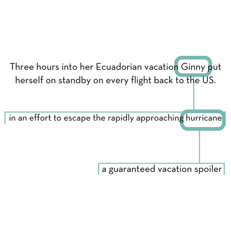

# What is Translation?

[Bootcamps](../../README.md) | [Chapter](../README.md) | [Formatted capture](source.html) | [Original captured JSON](source.json)

Source: https://new.theloophole.com/book-extras/bootcamps/translation-and-cluster-sentences/what-is-translation

Captured: 2026-10-18T12:44:27.355Z. Instructor/source: Loophole Online / Ellen Cassidy.

Coverage: 6/6 questions. Complete observed question sequence and resolved states.

Original source wording follows. Capture commentary and verified-answer labels are archival annotations. Already-answered questions may have no new attempts. Only observed feedback is preserved; unvisited alternative-answer feedback is not claimed.

Archived evidence: `raw/sources/loophole-bootcamps-2026-10-18/translation-and-cluster-sentences/what-is-translation/source.json`.

## Question 1

### Initial observed question and choices

<h2>Question 1</h2>

First of all, what <em>is</em> Translation?

Correct! You got it right on the first try!

<button>
A

Memorizing the stimulus word for word.

</button>

<button>
B

Taking the stimulus and really making it your own. You need to memorize the conclusion and key support, but the background info can go.

</button>

<button>
C

Turning the stimulus into a story you can tell while preserving all the details.

</button>

### Final observed answer and feedback

<h2>Question 1</h2>

First of all, what <em>is</em> Translation?

Correct! You got it right on the first try!

<button>
A

Memorizing the stimulus word for word.

</button>

<button>
B

Taking the stimulus and really making it your own. You need to memorize the conclusion and key support, but the background info can go.

</button>

<button>
C

Turning the stimulus into a story you can tell while preserving all the details.

</button>

**Verified answer:** C Turning the stimulus into a story you can tell while preserving all the details.

Capture commentary: Observed successful final state and selected answer styling.

## Question 2

### Initial observed question and choices

<h2>Question 2</h2>

Why is Translation so important?

<button>
A

You have to know what the stimulus says in order to answer the question correctly.

</button>

<button>
B

Translation makes the LSAT a lot less complicated and anxiety-inducing.

</button>

<button>
C

Both!

</button>

### Observed attempt 1: A You have to know what the stimulus says in order to answer the question correctly.

<h2>Question 2</h2>

Why is Translation so important?

Ah, not quite

<button>
A

You have to know what the stimulus says in order to answer the question correctly.

</button>

<button>
B

Translation makes the LSAT a lot less complicated and anxiety-inducing.

</button>

<button>
C

Both!

</button>

### Observed attempt 2: B Translation makes the LSAT a lot less complicated and anxiety-inducing.

<h2>Question 2</h2>

Why is Translation so important?

Ah, not quite

<button>
A

You have to know what the stimulus says in order to answer the question correctly.

</button>

<button>
B

Translation makes the LSAT a lot less complicated and anxiety-inducing.

</button>

<button>
C

Both!

</button>

### Observed attempt 3: C Both!

<h2>Question 2</h2>

Why is Translation so important?

Correct!

<button>
A

You have to know what the stimulus says in order to answer the question correctly.

</button>

<button>
B

Translation makes the LSAT a lot less complicated and anxiety-inducing.

</button>

<button>
C

Both!

</button>

### Final observed answer and feedback

<h2>Question 2</h2>

Why is Translation so important?

Correct!

<button>
A

You have to know what the stimulus says in order to answer the question correctly.

</button>

<button>
B

Translation makes the LSAT a lot less complicated and anxiety-inducing.

</button>

<button>
C

Both!

</button>

**Verified answer:** C Both!

Capture commentary: Observed successful final state and selected answer styling.

## Question 3

### Initial observed question and choices

<h2>Question 3</h2>

Here are a few key takeaways about Translation, just so you remember.

1. You must translate every LSAT stimulus.

If you can&#x27;t translate the stimulus, you don&#x27;t understand it well enough to answer the question.

2. Translating is the opposite of skimming.

Translation is not &quot;getting the gist.&quot; It&#x27;s something you do after you have more than the gist.

3. At first you will have to translate consciously.

It will quickly become subconscious with practice.

Soon, you will &quot;just know&quot; everything the stimulus says from reading it. That&#x27;s the goal, but you&#x27;ve got to stay ultra-disciplined until it becomes that automatic.

### Final observed answer and feedback

<h2>Question 3</h2>

Here are a few key takeaways about Translation, just so you remember.

1. You must translate every LSAT stimulus.

If you can&#x27;t translate the stimulus, you don&#x27;t understand it well enough to answer the question.

2. Translating is the opposite of skimming.

Translation is not &quot;getting the gist.&quot; It&#x27;s something you do after you have more than the gist.

3. At first you will have to translate consciously.

It will quickly become subconscious with practice.

Soon, you will &quot;just know&quot; everything the stimulus says from reading it. That&#x27;s the goal, but you&#x27;ve got to stay ultra-disciplined until it becomes that automatic.

**Verified answer:** No answer required

Capture commentary: Information page; no answer required.

## Question 4

### Initial observed question and choices

<h2>Question 4</h2>

What is the core element in the following sentence? We&#x27;ll translate the whole thing next.

<em>Three hours into her Ecuadorian vacation, in an effort to escape the rapidly approaching hurricane, a guaranteed vacation spoiler, Ginny put herself on standby on every flight back to the US.</em>

<button>
A

A guaranteed vacation spoiler.

</button>

<button>
B

Three hours into her Ecuadorian vacation, Ginny put herself on standby on every flight back to the US.

</button>

<button>
C

In an effort to escape the rapidly approaching hurricane.

</button>

### Observed attempt 1: A A guaranteed vacation spoiler.

<h2>Question 4</h2>

What is the core element in the following sentence? We&#x27;ll translate the whole thing next.

<em>Three hours into her Ecuadorian vacation, in an effort to escape the rapidly approaching hurricane, a guaranteed vacation spoiler, Ginny put herself on standby on every flight back to the US.</em>

Ah, not quite

<button>
A

A guaranteed vacation spoiler.

</button>

<button>
B

Three hours into her Ecuadorian vacation, Ginny put herself on standby on every flight back to the US.

</button>

<button>
C

In an effort to escape the rapidly approaching hurricane.

</button>

### Observed attempt 2: B Three hours into her Ecuadorian vacation, Ginny put herself on standby on every flight back to the US.

<h2>Question 4</h2>

What is the core element in the following sentence? We&#x27;ll translate the whole thing next.

<em>Three hours into her Ecuadorian vacation, in an effort to escape the rapidly approaching hurricane, a guaranteed vacation spoiler, Ginny put herself on standby on every flight back to the US.</em>

Correct!

<button>
A

A guaranteed vacation spoiler.

</button>

<button>
B

Three hours into her Ecuadorian vacation, Ginny put herself on standby on every flight back to the US.

</button>

<button>
C

In an effort to escape the rapidly approaching hurricane.

</button>

### Final observed answer and feedback

<h2>Question 4</h2>

What is the core element in the following sentence? We&#x27;ll translate the whole thing next.

<em>Three hours into her Ecuadorian vacation, in an effort to escape the rapidly approaching hurricane, a guaranteed vacation spoiler, Ginny put herself on standby on every flight back to the US.</em>

Correct!

<button>
A

A guaranteed vacation spoiler.

</button>

<button>
B

Three hours into her Ecuadorian vacation, Ginny put herself on standby on every flight back to the US.

</button>

<button>
C

In an effort to escape the rapidly approaching hurricane.

</button>

**Verified answer:** B Three hours into her Ecuadorian vacation, Ginny put herself on standby on every flight back to the US.

Capture commentary: Observed successful final state and selected answer styling.

## Question 5

### Initial observed question and choices

<h2>Question 5</h2>

Now that we&#x27;ve got our core element, let&#x27;s work on translating the entire sentence. To start, check out this cluster tree visualizing the relationship between this sentence&#x27;s core and optional elements.

### Final observed answer and feedback

<h2>Question 5</h2>

Now that we&#x27;ve got our core element, let&#x27;s work on translating the entire sentence. To start, check out this cluster tree visualizing the relationship between this sentence&#x27;s core and optional elements.

**Verified answer:** No answer required

Capture commentary: Information page; no answer required.

## Question 6

### Initial observed question and choices

<h2>Question 6</h2>

Which one of the following Translations matches the meaning of the original sentence?

<em>Three hours into her Ecuadorian vacation, in an effort to escape the rapidly approaching hurricane, a guaranteed vacation spoiler, Ginny put herself on standby on every flight back to the US.</em>

<button>
A

To make sure her vacation didn&#x27;t get spoiled, Ginny put herself on standby for flights back to the US.

</button>

<button>
B

After three hours, Ginny realized she needed to flee the approaching hurricane.

</button>

<button>
C

Ginny wanted to get far away from the hurricane because it would dampen her vacation, so three hours after arriving in Ecuador she got on standby on all the US-bound flights.

</button>

### Observed attempt 1: A To make sure her vacation didn't get spoiled, Ginny put herself on standby for flights back to the US.

<h2>Question 6</h2>

Which one of the following Translations matches the meaning of the original sentence?

<em>Three hours into her Ecuadorian vacation, in an effort to escape the rapidly approaching hurricane, a guaranteed vacation spoiler, Ginny put herself on standby on every flight back to the US.</em>

Ah, not quite

<button>
A

To make sure her vacation didn&#x27;t get spoiled, Ginny put herself on standby for flights back to the US.

</button>

<button>
B

After three hours, Ginny realized she needed to flee the approaching hurricane.

</button>

<button>
C

Ginny wanted to get far away from the hurricane because it would dampen her vacation, so three hours after arriving in Ecuador she got on standby on all the US-bound flights.

</button>

### Observed attempt 2: B After three hours, Ginny realized she needed to flee the approaching hurricane.

<h2>Question 6</h2>

Which one of the following Translations matches the meaning of the original sentence?

<em>Three hours into her Ecuadorian vacation, in an effort to escape the rapidly approaching hurricane, a guaranteed vacation spoiler, Ginny put herself on standby on every flight back to the US.</em>

Ah, not quite

<button>
A

To make sure her vacation didn&#x27;t get spoiled, Ginny put herself on standby for flights back to the US.

</button>

<button>
B

After three hours, Ginny realized she needed to flee the approaching hurricane.

</button>

<button>
C

Ginny wanted to get far away from the hurricane because it would dampen her vacation, so three hours after arriving in Ecuador she got on standby on all the US-bound flights.

</button>

### Observed attempt 3: C Ginny wanted to get far away from the hurricane because it would dampen her vacation, so three hours after arriving in Ecuador she got on standby on all the US-bound flights.

<h2>Question 6</h2>

Which one of the following Translations matches the meaning of the original sentence?

<em>Three hours into her Ecuadorian vacation, in an effort to escape the rapidly approaching hurricane, a guaranteed vacation spoiler, Ginny put herself on standby on every flight back to the US.</em>

Correct!

<button>
A

To make sure her vacation didn&#x27;t get spoiled, Ginny put herself on standby for flights back to the US.

</button>

<button>
B

After three hours, Ginny realized she needed to flee the approaching hurricane.

</button>

<button>
C

Ginny wanted to get far away from the hurricane because it would dampen her vacation, so three hours after arriving in Ecuador she got on standby on all the US-bound flights.

</button>

### Final observed answer and feedback

<h2>Question 6</h2>

Which one of the following Translations matches the meaning of the original sentence?

<em>Three hours into her Ecuadorian vacation, in an effort to escape the rapidly approaching hurricane, a guaranteed vacation spoiler, Ginny put herself on standby on every flight back to the US.</em>

Correct!

<button>
A

To make sure her vacation didn&#x27;t get spoiled, Ginny put herself on standby for flights back to the US.

</button>

<button>
B

After three hours, Ginny realized she needed to flee the approaching hurricane.

</button>

<button>
C

Ginny wanted to get far away from the hurricane because it would dampen her vacation, so three hours after arriving in Ecuador she got on standby on all the US-bound flights.

</button>

**Verified answer:** C Ginny wanted to get far away from the hurricane because it would dampen her vacation, so three hours after arriving in Ecuador she got on standby on all the US-bound flights.

Capture commentary: Observed successful final state and selected answer styling.
