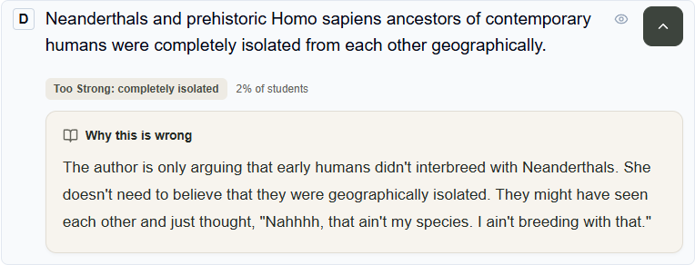
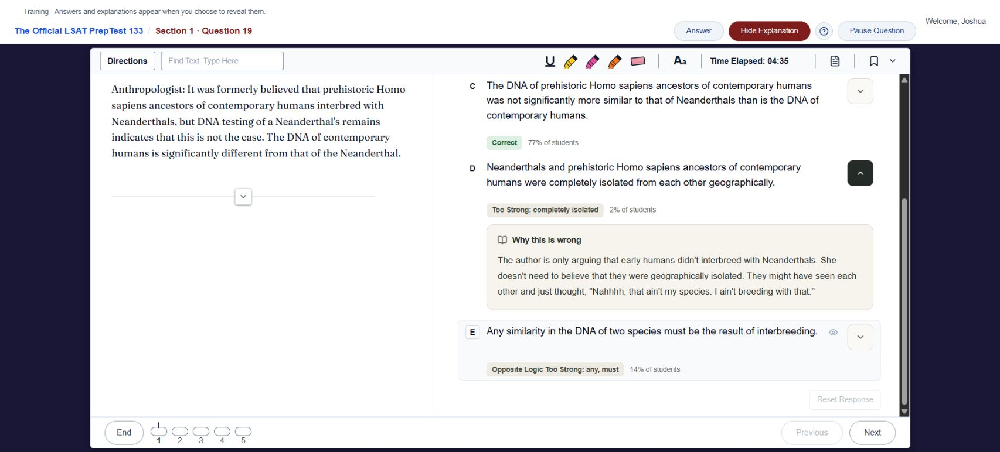
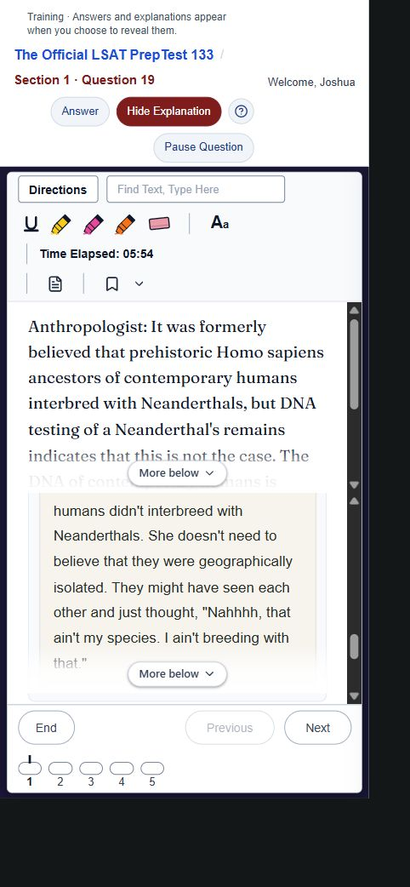

# LR explanations now have a distinct reading panel

Merged and published on 2026-10-29. Live signed-in LR drill verified. The sections below retain the earlier local verification record.

Checkout: `C:/Users/Joshu/dev/ai-os-projects/lsatu-lr-explanation-20261028`  
Branch: `codex/lr-explanation-polish`  
Baseline: `9b1eec11bde0746f899c34ec9b5d42630395bfe8`

## What changed

- Warm inset paper surface, quiet edge and restrained contact shadow replace the bare left rule.
- Sentence-case heading, a small reading/correctness icon and clearer prose spacing establish the reading order.
- Metadata wraps, percentages retain tabular figures and zero values, and “Your answer” uses ordinary sentence case.
- Dropdowns have clear open, hover, disabled and keyboard-focus states. The phone control is visually compact with an extended 44px pointer target; its target does not overlap Restore.
- Notes use the full answer-row width on phones. Shrinking grid tracks and long-token wrapping prevent horizontal overflow.
- Source prose, correctness, missing-content behavior, answer selection, highlights and question-scoped disclosure behavior are preserved.

The shared pane is used by Drill, section review and the LR question modal. Their source configurations were inspected. Signed-in parent routes were not exercised.

## Rendered evidence

Actual `OfficialQuestionPane`, application CSS and checked-in PT133-S1-LR question 19 were rendered in Edge. D's note and metadata are transcribed from Joshua's screenshot. Extra all-five/long-token modes are explicitly synthetic stress fixtures, never saved teaching content.

- [Desktop](production-screenshots/after-1440.png), [900px docked](production-screenshots/after-900.png), [tablet](production-screenshots/after-768.png), [phone](production-screenshots/after-390.png), [320px](production-screenshots/after-320.png).
- [Before desktop](screenshots/before-1440.png), [before phone](screenshots/before-390.png).
- [Browser results](production-screenshots/results.json), [production Taste measurements](taste-production/report.json).

All final browser and inspector screenshots were opened and visually reviewed. The component was also built as a separate minified Vite production entry using the project's configuration; only its input and output folder were overridden. The fixture uses an esnext target for its top-level await. It is separate from the normal app build and introduces no production route or authentication bypass.

## Checks that passed

| Check | Result |
|---|---|
| Existing component and review tests | 36 passed across 3 files |
| Full TypeScript check | Passed with an 8 GiB Node heap on retry |
| Final full app build | Passed, including postbuild scan of 784 files |
| Production browser matrix | 9 cases passed, zero page errors |
| Overflow | None at 1440, 900, 768, 390 or 320 pixels |
| Input behavior | Enter/Space and pointer toggles do not select an answer; disabled controls remain disabled |
| Restore boundary | Separate target geometry and boundary clicks verified at 320px |
| Stress states | All-five always-open, long unbroken text, 0%, wrong selection, 1.3 font scale and reduced motion passed |
| Targeted ESLint | Zero errors; existing mixed-export and standalone-entry Fast Refresh warnings |
| Production Taste inspector | 0 failures, 1 inherited layout warning |
| Whitespace/diff check | Passed |

The remaining Taste warning is the blank area beneath a short stimulus in the existing split exam pane. Preserving that reading geometry is deliberate; filling it with decoration would change the exam surface beyond this request. The 3% contact shadow is permitted by the app-screen rules despite the generic source linter's shadow warning.

Earlier dependency and memory failures were resolved locally. `npm ci` needs the legacy-peer setting with this repository's current lockfile, and Testing Library's DOM peer needed a local unsaved install. Neither package file changed. Earlier TypeScript attempts exhausted memory; the subsequent full check exited successfully. [Final build log](build-final.log), [successful typecheck log](typecheck-retry.log).

## Independent review and remaining limits

Claudex used Codex as planner/builder and Claude as reviewer/inspector. No model override was requested; observed Claude CLI model was `claude-sonnet-5-5`, CLI 2.1.309. Four plan-review rounds and two fresh code inspections were used. The final inspection was **APPROVED**, with no material defects. Full responses and dispositions are in [REVIEW-LOG.md](REVIEW-LOG.md).

Two low-priority observations remain: the existing Restore button is still smaller than the new dropdown's target, and the verification script assumes Edge is installed. Neither changes the approved behavior or blocks this local diff.

The normal Vite MCP generator rewrote `supabase/functions/mcp/index.ts` into a Windows-path stub during verification. This was a build side effect, correcting the host's earlier concurrency assumption. Its owning plugin was inspected, host preview/dev servers were stopped and only the generated file was restored to baseline. Final Git status contains no backend change. Future Windows Vite runs can regenerate it again; do not include that generated stub in a release.

Normal production assets contain none of the fixture title or synthetic stress strings. Verification files stay under the existing `scripts/verification/` directory. No student record or published explanation was modified. Production account access and live deployment remain unverified because this task ends with a local branch diff.

## Published release verified on 2026-10-29

- PR: https://github.com/vnjkoxpl-42905/lsatu-684d89db/pull/249
- Merged main: `ed5f56ab076254b2f3cc9af6f722c682160c61d0`. Lovable latest_commit_sha matched before free frontend publication.
- Free deploy requests: `0b270c66-ac92-43cb-86ff-743cc5c35b3e`, then `8998af3e-953a-43f2-bc3c-6a7360f8a406` after source build readiness. Custom domain subsequently served the release.
- https://lsatprep.study changed from `index-Cs6GFrK8.js` to `index-CrkGJBQn.js`. Live `OfficialQuestionPane-8mG3S3mt.css` contains the new panel and expanded-state styles. See `live-assets.json`.
- Signed-in Chrome, actual PT133-S1-Q19: mouse open, Enter close, Space reopen, correct C and incorrect D panels, global Explanation hide and re-enable all passed. Reset Response remained disabled, proving no answer selection.
- Desktop screenshot visually inspected. Phone emulation visually inspected; panel background rgb(247,244,238), clientWidth equals scrollWidth at 324px and 245px. Requested 320px emulation reported actual innerWidth 356px, so this is narrow-layout evidence rather than exact 320px live proof. Exact 320px was verified locally earlier.
- Browser-level viewport override did not alter the extension tab; supported tab CDP emulation was used instead. Both overrides cleared afterward. Verification drill paused; no answer submitted and no student records modified.
- This verifies the live LR drill, not every parent route or full application. Integrated build, typecheck and 36 tests passed before merge.

## Independent Gemini review on 2026-10-29

Joshua requested Gemini review after publication. Gemini 4 Argon, medium effort (observed gemini-4-argon-trial, MODEL_PLACEHOLDER_M418), approved both the original plan and a fresh seven-file code inspection against pre-merge main 63783a3b96f9b5f11160c2220f7fd7efc89a2806. No findings; no dispositions or code revisions required. Read-only static source review only: Gemini did not run tests, builds or browser checks. Earlier host runtime evidence remains separate. Full structured records: GEMINI-PLAN-RESULT.json and GEMINI-CODE-RESULT.json. Initial connection failed because Antigravity was closed; starting the installed IDE allowed both reviews to complete.
