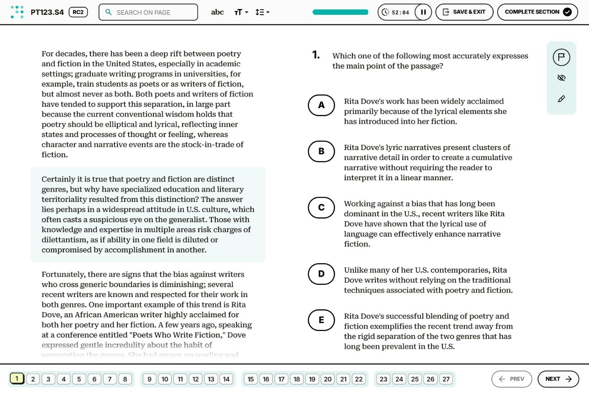
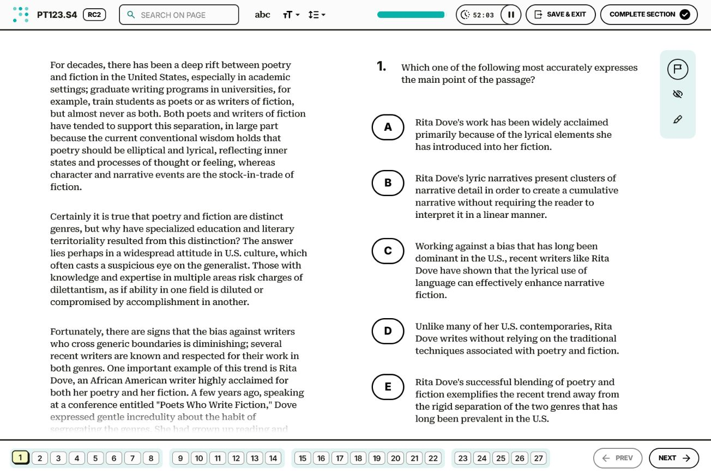

# Loophole pointer focus: live inspection and LSAT U implementation

Inspected 2026-10-14 in the user-authorized Codex browser. Source: https://new.theloophole.com/pt-taking-platform?takeId=58d9793b-a3c1-4b7c-95f0-3f896e68eb64

## What actually happens

The onboarding describes a focus highlight following the pointer along a line. The rendered behavior is paragraph hover: the entire passage paragraph under the pointer receives a pale turquoise rectangle. Moving within a paragraph does not isolate a line. Moving to another paragraph moves the block. Leaving the passage clears it. No eye tracking was observed or indicated by the rendered mechanism.

The passage paragraphs have class rounded-lg hover:bg-turquoise-lc/44, with constant lg:px-6 lg:py-4 spacing. The active second paragraph computed background was oklab(0.951289 -0.0175027 -0.00390249 / 0.44). All four passage paragraph backgrounds became transparent when the pointer left for the gutter. This is an ephemeral CSS hover background, not a saved text annotation. Answer cards also declare a hover background; their interaction was not tested because clicking them would change a response.

The UI API has no pointer-move primitive in its documented high-level interface, so safe clicks inside passage text were used to position the pointer at different lines/paragraphs and inspect hover state. No answer selection, completion or exit control was used. The timer was paused between inspection steps and left paused at the end to prevent continued time consumption.

## How to implement the observed effect in LSAT U

Read-only source inspection of C:/Users/Joshu/dev/ai-os-projects/lsatu, branch codex/rc-quality:

- src/features/rc/components/RcPassagePane.tsx:144 owns .rc-passage-text and renders RcMarkdown. Add a scoped enabled class here, with a paragraph hover background.
- src/features/rc/hooks/useRcA11y.ts:33 contains the validated, persisted reading preferences (rc-player-a11y). Add a boolean paragraph-focus preference.
- src/features/rc/components/RcModals.tsx:78 contains the reading-settings controls; expose an optional Paragraph focus toggle here. RcPlayer.tsx:1186 wires these controls.
- RcMarkdown.tsx:32 is shared with questions, choices and explanations. Do not globally style its paragraphs as if they were all passages.
- useRcMarkSurface.ts:123 handles text selection and annotation popovers. CSS hover should avoid new event interception or text wrappers.

Use hover-capable pointer media queries, a theme-specific background, and an explicit off switch. Keep padding and margins unchanged while hovering. Preserve all six existing color schemes and make saved marks distinguishable from temporary focus. An optional small outer shadow can create a visual gutter without shifting text.

The simplest matching behavior needs no backend, eye-tracking service, tracking hook or continuous React pointer updates. A true one-line reading ruler is a separate design requiring pointer coordinates, rendered line geometry, scrolling/reflow handling and an overlay that does not capture selection input.

## Intended benefit and validation

The intended benefit is a visual place marker while reading. This inspection does not establish a learning or timing improvement. Before shipping, check paragraph switching/exit, scrolling under a stationary pointer, all font/spacing settings, six themes, text drag selection, saved highlighting/annotation popovers, split and passage-only layouts, and off/on persistence. Touch-only behavior and keyboard/screen-reader access must retain normal passage readability.

Browser references: [CSS hover](https://developer.mozilla.org/en-US/docs/Web/CSS/Reference/Selectors/:hover), [hover capability media query](https://developer.mozilla.org/en-US/docs/Web/CSS/Reference/At-rules/@media/hover).

No LSAT U code was changed, no tests run, and nothing deployed. The code paths were verified locally; this is not a signed-in production acceptance claim for our site.
